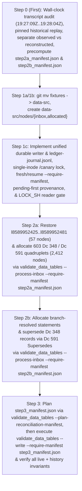

Original problem: Some node IDs were allocated twice by deleting them after assignment and then checking out the pre-assignment state of the graph from Git. This causes those nodes to be ambiguous, which is meant to never happen by making the graph strictly append-only. As that was not enforced in any technical way, it left room for this type of blunder. To prevent this reoccurring, I've added scripts which *should* enforce through technical means that the .ctbnodes files are strictly append-only. Since the .ctbnbdl files are, I believe, generated from the .ctbnodes files, that should also ensure that the union of the active and history .ctbnbdl files should also be append-only going forward. To address the now-ambiguous node IDs as best as possible, I'm looking into how to model this situation precisely in the graph.

Thanks, I think we're back and it's set up now! Great.

Next, let's look at recovering from the duplicated node IDs. So, I *think* the best way to approach this will need a few steps:
1. Come up with a new system for inserting graph nodes that *aren't* derived from the CSVs. I think:
  1a. Rename src/formats/dcdata/fixtures/ to src/formats/dcdata/data-src/.
  1b. Add new folders: src/formats/dcdata/data-src/nodes/{inbox,allocated}.
  1c. Add a build step that looks at all files in the 'inbox' folder, determines their filetype from a list of permitted types (maybe f635 .dcsh right now would be the best pick?), checks if any existing node has the same data and is not self-referential (I think? I want to avoid adding duplicate nodes, but in some cases duplicate nodes are *necessary* for one reason or another, for instance all the ordinary Dc IDs are 0-byte nodes, and if a node has been replaced and then its data needs to be referenced again, I guess it would need to be inserted again - how that should interact with atomic/data nodes, I'm not sure), and if they pass checks, allocates them a new node ID and appends them to the current .ctbnodes file, and moves them into the 'allocated' folder, prefxing their filename with their assigned node ID.
2. For every node ID that was assigned twice:
  2a. Insert new nodes for each body given to each overwritten node. E.g. if 123 was given body of string "abc" and overwritten with "is a, foo, bar" insert four new nodes: a new "abc", a new "is a, foo, bar" node (the latter being an intentional duplicate of 123), a node stating 348 "Ambiguous values" with a [list] of the other two nodes, and a node stating 591 "Supersedes" pointing to the original overwritten node and to the new "Ambiguous values" node, so that the original statement is correctly documented as ambiguous between the two values it was assigned.
  2b. *Somehow* figure out how to *disambiguate which ambiguous node values* were used for each of the above duplicated statements - e.g. if the "is a, foo, bar" referred to a node 234 for "foo" which was one of these ambiguous nodes, we would need to add, I *think*, a subsequent 591 "Supersedes" statement replacing the "is a, foo, bar" with "is a, foo, bar" but with the "foo" reference changed from the now-ambiguous 234 to whatever it was *meant* to point to.
3. Finally, re-run the graph CSV derivation, letting it automatically insert any needed new 591 "Supersedes" and 592 "Retracts" statements to leave the graph coherenent to the intended data.

Does that sound like the correct recovery path? How can we go about this with really careful auditing and precision to make sure it's recovered correctly and doesn't make even more of a mess? I think the source data where you found the original and overwritten graph values should be copied using a checked-in/committed script (*not* regenerating them but scripting what to copy out of the session transcript or wherever you found it using an auditable, committed script), and every step should also be implemented as a script, with all scripts and data committed to Git with every edit and step, so that the full process can be reproduced and audited after the fact.
 [/plan](slashCommand;plan)

# Append-Only Graph Ledger Recovery & Manual Node Allocation Plan

## Goal Description

In session `23f9eaf6-7cd6-416e-8470-852b9878ea88`, two separate graph derivation runs were executed against the commit `3345d2dff` baseline (`17,207` nodes, `l8589934592`..`l8589951798`):
1. **Run 1 (`task-680`, launched at `step_index == 679` [`19:27:09Z`] / process exited at `19:28:04Z` [notification queued and delivered at `step_index == 687` at `19:28:48Z`])**: Appended `683` nodes (`l8589951799`..`l8589952481`, `17,890` total nodes), which included 19 invented file extensions (`57` nodes = `19 × 3`) and an earlier `Dc 573 "Description"` string for `f95` (`Dce`).
2. **Run 2 (`task-693`, launched at `step_index == 692` [`19:29:15Z`] / process exited at `19:30:01Z` [notification delivered at `step_index == 698` at `19:30:58Z`], committed in `a90464028`)**: After resetting `assets/data/graph/`, appended `626` nodes (`l8589951799`..`l8589952424`, `17,833` total nodes), overwriting `l8589951799`..`l8589952424` and erasing `l8589952425`..`l8589952481`.

This plan implements a permanent, auditable, strictly append-only recovery and manual node ingestion pipeline in the following strict sequence:
1. **Step 0 (Evidence Preservation, Wall-Clock Mutation-Window Audit, & Precomputed Step 2a/2b Manifests First — Before Any Code Refactoring)**:
   - Audit **every** step (`step_index == 1..699`) and wall-clock execution interval (`Created At`, `Completed At`, `[Message] timestamp`) in `23f9eaf6/transcript_full.jsonl` from commit `3345d2dff` through `a90464028`, verifying that `task-680`'s process execution window (`19:27:09Z`..`19:28:04Z`) finished `39 seconds` before `step_index == 685` modified `document.csv` on disk (`19:28:43Z`..`19:28:46Z`).
   - Strictly separate **directly observed evidence** (`step_index == 684` `Target` and `Replacement` payloads from physical JSONL line `685`, `step_index == 687` & `698` task stdout logs, commit `3345d2dff` git tree, and commit `a90464028` surviving `.ctbnodes` bytes) from **reconstructed Run 1 output** (`reconstructed_run1_nodes_8589951799_8589952481.ctbnodes`), documenting explicitly that because Run 1's `.ctbnodes` files were never read into the transcript before being overwritten, Run 1's node bodies are reconstructed via deterministic replay of the unmodified `a90464028` / `3345d2dff` generator and corroborated by the `19:28:04Z` summary metrics (`17,890 total / 683 appended / 1 superseded / 0 retracted`).
   - Precompute and commit the deterministic manifests for **Step 2a** (`step2a_manifest.json`) and **Step 2b** (`step2b_manifest.json`).
2. **Step 1 (Shared Durable Transactional Ledger Writer, Single-Inode Watcher Lock, & `fixtures/` -> `data-src/` Pipeline)**:
   - Rename `src/formats/dcdata/fixtures/` to `src/formats/dcdata/data-src/` and create `src/formats/dcdata/data-src/nodes/{inbox,allocated}`.
   - Route **all** ledger writers (`process_inbox_nodes` and `update_system_graph_ledger`) through a single shared durable transactional writer (`execute_durable_ledger_transaction`), locking the **single permanent lock inode** `.git/ctb-append-only-canary` (`flock(LOCK_EX)`, mounted at `/canary` in the watcher container) and writing to the **unified journal** (`src/formats/dcdata/data-src/nodes/allocated/ledger-journal.jsonl`, mounted read-only at `/journal-dir/ledger-journal.jsonl` in the watcher container).
   - Enforce `--require-manifest <path>` with distinct **Fresh-Start**, **Resume (`BATCH_PENDING`)**, and **Already-Committed (`BATCH_COMMITTED`)** paths under the writer lock, running journal recovery **before** `BATCH_COMMITTED`-only provenance validation.
3. **Step 2 (Restore Erased Tail & Disambiguate Overwritten Node IDs via `nodes/inbox/` with `--require-manifest`)**:
   - **Step 2a**: Stage and allocate the `57` restored Run 1 tail nodes (`l8589952425`..`l8589952481`) + `603` `Dc 348 "Ambiguous values"` / `Dc 591 "Supersedes"` quadruplets (`2,412` nodes at `l8589952482`..`l8589954893`), verified inside the transaction via `--require-manifest step2a_manifest.json`.
   - **Step 2b**: Stage and allocate the branch-resolved statements (`l<r1_resolved(N)>`, `l<r2_resolved(N)>`) + `Dc 591 "Supersedes"` links + updated `Dc 348 "Ambiguous values"` records (`l<ambig_resolved(N)>`), verified inside the transaction via `--require-manifest step2b_manifest.json`.
4. **Step 3 (Generate & Execute Ownership-Scoped CSV Reconciliation Manifest)**:
   - Using the tested Step 1c Rust reconciliation planner (`validate_data_tables --plan-reconciliation-manifest step3_manifest.json`), generate and review `step3_manifest.json` against the committed Step 2b ledger, then execute `validate_data_tables --write --require-manifest step3_manifest.json` under the shared lock to reconcile CSV-owned statements against `DesiredGraphState` via `Dc 591 "Supersedes"` and `Dc 592 "Retracts"`.

---

## Confirmed Design Decisions & Reviewer Fixes (Rounds 1–6)

1. **Step 0 Wall-Clock Execution Window Audit & Explicit Epistemic Boundary (Fixes R1-F3, R2-F6, R4-F1, & R5-F1)**:
   - Step 0 audits both `step_index` and the exact wall-clock timestamps recorded in `23f9eaf6/transcript_full.jsonl`:
     - `step_index == 675..678` (`19:26:43Z`..`19:27:09Z`): Edited `ctoolbox.magic` and `document.csv` prior to launching Run 1.
     - `step_index == 679` (`19:27:09Z`): Launched `./scripts/validate-data-tables` (`task-680`), which backgrounded at `step_index == 680` (`19:27:33Z`).
     - `step_index == 682..683` (`19:27:45Z`..`19:28:01Z`): Ran read-only `grep -rn "\.dce\b\|\.3_0" old/`.
     - **`19:28:04Z` (`task-680` actual process completion)**: Recorded in `[Message] timestamp=2026-10-31T19:28:04Z sender=23f9eaf6-7cd6-416e-8470-852b9878ea88/task-680` (dequeued at `step_index == 687` at `19:28:48Z`).
     - `step_index == 684..686`: The `edit_file` tool execution on `document.csv` (`step_index == 685`) ran from `Created At: 2026-10-31T19:28:43Z` to `Completed At: 2026-10-31T19:28:46Z` — **39 seconds after `task-680` had already exited at `19:28:04Z`**.
   - **Explicit Epistemic Boundary**:
     - Because `task-680` ran without per-syscall file-access tracing and its `.ctbnodes` output was overwritten at `step_index == 688..693` before being read into the transcript, Run 1's `.ctbnodes` bytes were not directly captured in `transcript_full.jsonl`.
     - Step 0 labels `reconstructed_run1_nodes_8589951799_8589952481.ctbnodes` explicitly as **deterministic reconstruction corroborated by the `19:28:04Z` task summary metrics (`17,890 total / 683 appended / 1 superseded / 0 retracted / 7 chunk files updated`) and 100% exact Run 2 replay**, noting the absence of direct historical `.ctbnodes` byte capture as an explicit, documented boundary.

2. **Separate Fresh-Start vs. Resume Paths for `--require-manifest` & Post-Step-1 Reconciliation Planning (Fixes R5-F2 & R6-F2)**:
   - `execute_durable_ledger_transaction` accepts `--require-manifest <manifest.json>` and operates under `flock(LOCK_EX)` on `.git/ctb-append-only-canary` with three explicit state paths based on `ledger-journal.jsonl` (after repairing any unterminated trailing line):
     1. **Fresh-Start Path (No open `BATCH_PENDING` in `ledger-journal.jsonl`)**:
        - Verifies current on-disk ledger equals `manifest.baseline_last_id` and `manifest.baseline_ledger_sha256`.
        - Verifies all input files (`nodes/inbox/*.dcsh` for inbox runs; all CSV tables and `BATCH_COMMITTED` `NodeProvenanceMap` for CSV reconciliation runs) match `manifest.pinned_input_sha256s`.
        - Runs in-memory prevalidation/planning and verifies that the planned `items`, `final_last_id`, and `final_ledger_sha256` match `manifest` byte-for-byte.
        - Records `manifest_sha256: Some(sha256(manifest_bytes))` inside `BATCH_PENDING`, writes + `fsync`s `BATCH_PENDING`, and proceeds into execution.
     2. **Resume Path (An intact `BATCH_PENDING` record is open in `ledger-journal.jsonl`)**:
        - Does **not** replan from `nodes/inbox/` or allocate new node IDs, and does **not** require the current on-disk ledger to still be at `baseline_last_id` or all `.dcsh` files to still be in `nodes/inbox/`!
        - Instead, verifies that the open `BATCH_PENDING` record is bound to the supplied manifest:
          - `BATCH_PENDING.manifest_sha256 == Some(sha256(manifest_bytes))`
          - `BATCH_PENDING.baseline_last_id == manifest.baseline_last_id` and `BATCH_PENDING.baseline_ledger_sha256 == manifest.baseline_ledger_sha256`
          - `BATCH_PENDING.final_last_id == manifest.final_last_id` and `BATCH_PENDING.final_ledger_sha256 == manifest.final_ledger_sha256`
          - `BATCH_PENDING.items == manifest.planned_items`
        - Verifies that the current on-disk `.ctbnodes` ledger equals the exact `manifest.baseline_ledger_sha256` prefix (`<= baseline_last_id`) followed by an **exact verified byte prefix** of `BATCH_PENDING.items`.
        - For each `kind == "inbox_allocation"` item in `BATCH_PENDING.items`, verifies its `.dcsh` file exists with `sha256 == item.inbox_sha256` and matching `# @provenance` at **either** `nodes/inbox/<item.inbox_name>` (if not yet moved) **or** `nodes/allocated/<item.allocated_name>` (if already moved before the crash).
        - Resumes execution directly from `BATCH_PENDING.items` to finish remaining writes/moves/`fsync`s, rebuild `.ctbnbdl` bundles, and write `BATCH_COMMITTED`.
     3. **Idempotent Already-Committed Path (Latest `BATCH_COMMITTED` already has `manifest_sha256 == Some(sha256(manifest_bytes))`)**:
        - If a prior run crashed *after* `BATCH_COMMITTED` was written (or after a torn `BATCH_COMMITTED` was repaired), verifies that the on-disk ledger equals `manifest.final_ledger_sha256` and all `allocated` files and `.ctbnbdl` bundles are intact and `fsync`ed, and returns `Ok` idempotently.

3. **Pending-Aware Provenance Validation Ordering vs. `BATCH_COMMITTED`-Only Validation (Fixes R5-Clarification & R6-F1)**:
   - Throughout the codebase and plan, a **"committed journal entry"** means a record in `ledger-journal.jsonl` whose `BATCH_PENDING` transaction has a corresponding complete, checksum-verified **`BATCH_COMMITTED`** record in `ledger-journal.jsonl` (not a Git commit).
   - **Recovery Runs Before Strict `BATCH_COMMITTED`-Only Provenance Validation**:
     1. Whenever `execute_durable_ledger_transaction` starts under `flock(LOCK_EX)`, it inspects `ledger-journal.jsonl` **before** calling `load_and_validate_node_provenance`.
     2. If an open `BATCH_PENDING` record is present, recovery validates provenance for `<= baseline_last_id` against prior `BATCH_COMMITTED` records, and validates nodes `> baseline_last_id` currently in `.ctbnodes` against the verified prefix of `BATCH_PENDING.items` (accepting each `.dcsh` source file at either `nodes/inbox/<inbox_name>` or `nodes/allocated/<allocated_name>` with matching `inbox_sha256` and `# @provenance`).
     3. Only **after** `BATCH_PENDING` recovery finishes and writes `BATCH_COMMITTED` (so zero `BATCH_PENDING` transactions remain open in `ledger-journal.jsonl`) does `load_and_validate_node_provenance` enforce the committed-state invariant: every node ID `>= l8589952425` must belong to a `BATCH_COMMITTED` transaction in `ledger-journal.jsonl`, and every `inbox_allocation` item must reside at `nodes/allocated/<allocated_name>` with matching `inbox_sha256` and `# @provenance`.

4. **Single Permanent Lock Inode (`.git/ctb-append-only-canary`), Reader/Packager `LOCK_SH` + Clean-Journal Gate, & Watcher Mounts (Fixes R4-F2, R5-F3, & R6-Clarification 1)**:
   - **Single Permanent Lock Inode**:
     - Writers (`execute_durable_ledger_transaction`) and the Python watcher (`lock_pass` in [lock-graph-append-only](file:///workspaces/ctoolbox/scripts/lock-graph-append-only#L77-L91)) acquire `flock(LOCK_EX)` on the **single permanent file** `${REPO_ROOT}/.git/ctb-append-only-canary` (`/canary` inside the watcher container), with zero fallback lock paths.
     - `run_host_init()` and `run_unlock()` in [lock-graph-append-only](file:///workspaces/ctoolbox/scripts/lock-graph-append-only#L140-L189) mount `-v "${REPO_ROOT}/src/formats/dcdata/data-src/nodes/allocated:/journal-dir:ro"` so `lock_pass` inspects `/journal-dir/ledger-journal.jsonl` while holding `LOCK_EX` on `/canary`, refusing to seal any chunk with `FS_IMMUTABLE_FL` (`+i`) while `BATCH_PENDING` is open or if any line among the 100 lines lacks `\n` or fails `^l[0-9]+:( .*)?\n$`.
   - **Reader & Asset-Packager Synchronization Policy (`R6-Clarification 1`)**:
     - Because `execute_durable_ledger_transaction` holds `flock(LOCK_EX)` on `.git/ctb-append-only-canary` across Phase 1 (`.ctbnodes` appends) and Phase 2 (atomic temp-file rebuild + `sync_all()` + `rename` + parent-dir `sync_all()` of **both** active `assets/data/graph/85899_34592.ctbnbdl` and historical `assets/data/graph/system/85899_34942.ctbnbdl`, followed by writing + `sync_all()` of `BATCH_COMMITTED`), any repository reader, codegen step (`generate_format_id_file`, `dc_codegen`, `extension_codegen`, `encoding_codegen`, `format_support_codegen`), `build.rs`, or `asset_packer::prepare_assets` acquires a shared lock (`flock(LOCK_SH)`) on `.git/ctb-append-only-canary` and calls `ensure_ledger_journal_clean(repo_root)` before reading `.ctbnodes` or packaging `.ctbnbdl` bundles!
     - If a previous writer crashed mid-transaction (releasing `LOCK_EX` while leaving `BATCH_PENDING` open or leaving active/history `.ctbnbdl` bundles half-updated prior to `BATCH_COMMITTED`), `ensure_ledger_journal_clean` fails loudly and refuses to read or package the pending generation until the writer resumes and commits `BATCH_COMMITTED`.
     - Furthermore, `ensure_ledger_journal_clean` verifies that the decoded node union of `assets/data/graph/85899_34592.ctbnbdl` (active) and `assets/data/graph/system/85899_34942.ctbnbdl` (history) has last node ID equal to `BATCH_COMMITTED.final_last_id`, guaranteeing that the active/history `.ctbnbdl` pair always belongs to the exact same committed generation.

5. **Shared Effective-State Resolver for Dynamic Duplicate Checking & Cross-Ownership Protection (Fixes R1-Q3, R3-F3, R5-F4, & R5-F5)**:
   - Prevalidation uses `compute_effective_inactive_ids` (shared with `SeedGraphIndex`) so revision cancellations accurately update `active_nodes_by_tokens`, and requires `# @allow-duplicate-of: l<id1>[, l<id2>, ...]` to equal `*active_matches`.
   - `# @provenance: manual` nodes cannot attach `Dc 610 "Has value"` or `Dc 570 "Preferred"` qualifiers to non-`Manual` `has_a_id`s or supersede/retract non-`Manual` nodes, and `LedgerBuilder::apply_desired_state` aborts with an explicit cross-ownership conflict error if any active `Manual` node references a CSV-owned node scheduled for withdrawal or collides on a single-valued `(subj, prop)` in `DesiredGraphState`.

6. **Correct CLI Entry Point ([validate_data_tables.rs](file:///workspaces/ctoolbox/src/formats/dcdata/bin/validate_data_tables.rs)) & Mode Dispatch Before `--write` Mutations (`R6-Clarification 2`)**:
   - All CLI flags are added to [src/formats/dcdata/bin/validate_data_tables.rs](file:///workspaces/ctoolbox/src/formats/dcdata/bin/validate_data_tables.rs) and dispatched at the top of `main()` **before** `assign_and_update_dc_categories`, `assign_and_update_format_categories`, or `generate_merged_csvs`:
     1. `--process-inbox [--require-manifest <path>] [--expected-last-id l<id>] [--expected-ledger-sha256 <hex>] [--dry-run]`: Runs **only** `process_inbox_nodes` and exits immediately without touching CSV files.
     2. `--plan-reconciliation-manifest <path>`: Runs read-only under `LOCK_EX` on `.git/ctb-append-only-canary`, verifies `ensure_ledger_journal_clean` and empty `nodes/inbox/`, computes the planned CSV reconciliation transaction in memory without mutating any CSV or `.ctbnodes` files, writes `<path>`, and exits.
     3. `--write [--require-manifest <path>]`: If an open `kind: "csv_reconciliation"` `BATCH_PENDING` exists in `ledger-journal.jsonl`, immediately resumes and completes `update_system_graph_ledger` (enforcing `--require-manifest` via the Resume Path) before running downstream `.generated.rs` codegen and `prepare_assets`; otherwise runs CSV ID assignment/validation/merge, `update_system_graph_ledger` (enforcing `--require-manifest` via the Fresh-Start Path), and downstream codegen.

---

## Proposed Execution Sequence

---

### Step 0 (Executed First): Wall-Clock Audit, Historical Replay, & Precomputed Step 2a/2b Manifests

#### [NEW] `scripts/graph-recovery/step0_extract_transcript_data.py`
- Runs **before** any modifications to `src/formats/dcdata/` or `src/build_support/`:
  1. Audits all steps (`step_index == 1..699`) and wall-clock timestamps (`Created At`, `Completed At`, `[Message] timestamp`) in `/root/.gemini/antigravity/brain/23f9eaf6-7cd6-416e-8470-852b9878ea88/.system_generated/logs/transcript_full.jsonl` and `git diff 3345d2dff..a90464028`, writing `invocation_and_mutation_window_audit.json`.
  2. Saves observed evidence (`observed_step684_record.json`, `observed_step687_and_698_logs.json`, `observed_run1_document_csv_slice.csv`, `observed_run2_document_csv_slice.csv`, `observed_run2_nodes_8589951799_8589952424.ctbnodes`).
  3. Replays the unmodified historical generator on `(commit 3345d2dff + Run 2 document.csv)` and asserts 100% token-for-token and comment-for-comment identity with `observed_run2_nodes_8589951799_8589952424.ctbnodes`.
  4. Replays the unmodified historical generator on `(commit 3345d2dff + Run 1 document.csv)` to produce `reconstructed_run1_nodes_8589951799_8589952481.ctbnodes` and verifies the `19:28:04Z` summary metrics (`17,890 total / 683 appended / 1 superseded / 0 retracted / 7 chunk files updated`).
  5. Computes the transitive dependency-ambiguity closure (`23` unambiguous, `603` ambiguous, `57` erased tail) and writes `collision_manifest.json`, `step2a_manifest.json`, and `step2b_manifest.json`.
  6. Commits Step 0.

---

### Component 1: Unified Durable Transactional Writer, Single-Inode Watcher Lock, & `data-src` Pipeline (`Steps 1a–1c`)

#### [MODIFY] `src/formats/dcdata/fixtures/` -> `src/formats/dcdata/data-src/` (`Steps 1a & 1b`)
- Move via `git mv src/formats/dcdata/fixtures src/formats/dcdata/data-src` and create `src/formats/dcdata/data-src/nodes/{inbox,allocated}/.keep`.
- Update `src/formats/dcdata/fixtures` path references to `src/formats/dcdata/data-src` across [dcdata.rs](file:///workspaces/ctoolbox/src/formats/dcdata/dcdata.rs), [graph_ledger.rs](file:///workspaces/ctoolbox/src/formats/dcdata/graph_ledger.rs), [updater.rs](file:///workspaces/ctoolbox/src/formats/dcdata/updater.rs), [validation.rs](file:///workspaces/ctoolbox/src/formats/dcdata/validation.rs), [format.rs](file:///workspaces/ctoolbox/src/formats/dcdata/format.rs), [syntax.rs](file:///workspaces/ctoolbox/src/formats/dcdata/syntax.rs), and [modify-columns.py](file:///workspaces/ctoolbox/scripts/modify-columns.py), and commit Steps 1a & 1b.

#### [MODIFY] [lock-graph-append-only](file:///workspaces/ctoolbox/scripts/lock-graph-append-only), [ctbnbdl.rs](file:///workspaces/ctoolbox/src/build_support/ctbnbdl.rs), [graph_ledger.rs](file:///workspaces/ctoolbox/src/formats/dcdata/graph_ledger.rs), [seed_graph.rs](file:///workspaces/ctoolbox/src/formats/dcdata/seed_graph.rs), & [validate_data_tables.rs](file:///workspaces/ctoolbox/src/formats/dcdata/bin/validate_data_tables.rs) (`Step 1c`)
1. **Single-Inode Lock, Reader `LOCK_SH` Gate, & Watcher Container Mounts**:
   - Writers and Python `lock_pass` acquire `flock(LOCK_EX)` on `.git/ctb-append-only-canary` (`/canary` inside the watcher container); readers, codegen steps, and `asset_packer::prepare_assets` acquire `flock(LOCK_SH)` on `.git/ctb-append-only-canary` and call `ensure_ledger_journal_clean`.
   - Update `run_host_init()` and `run_unlock()` in `scripts/lock-graph-append-only` to mount `-v "${REPO_ROOT}/src/formats/dcdata/data-src/nodes/allocated:/journal-dir:ro"`.
2. **Unified Durable Transactional Writer with Fresh/Resume `--require-manifest` & Pending-First Recovery**:
   - Runs pending-journal recovery **before** committed-only `load_and_validate_node_provenance`.
   - Implements the Fresh-Start, Resume (`BATCH_PENDING` bound via `manifest_sha256`), and Already-Committed (`BATCH_COMMITTED`) paths for `--require-manifest <path>`.
   - Dispatches `--process-inbox`, `--plan-reconciliation-manifest <path>`, and `--write [--require-manifest <path>]` at the top of `main()` in [validate_data_tables.rs](file:///workspaces/ctoolbox/src/formats/dcdata/bin/validate_data_tables.rs).
3. **Effective-State Duplicate Checking & Provenance Ownership Contract**:
   - Reuses `compute_effective_inactive_ids` for dynamic duplicate checking across revision cancellations; enforces `BATCH_COMMITTED` `NodeProvenanceMap` validation after recovery; enforces cross-ownership boundary checks for `Manual` nodes; and reconciles CSV-owned property groups component-wise (preserving shared IDs such as `l8589951812`).

---

### Component 2: Step-by-Step Recovery Execution (`Steps 2a, 2b, 3`)

#### [NEW] `scripts/graph-recovery/step2a_stage_ambiguous_nodes.py`
- Stages the precomputed Step 2a `.dcsh` files (`57` restored Run 1 tail nodes at `l8589952425`..`l8589952481` + `603` quadruplets = `2,412` nodes at `l8589952482`..`l8589954893`) into `src/formats/dcdata/data-src/nodes/inbox/`.
- Executes `validate_data_tables --process-inbox --require-manifest src/formats/dcdata/data-src/recovery-audit/step2a_manifest.json` and commits Step 2a.

#### [NEW] `scripts/graph-recovery/step2b_stage_disambiguations.py`
- Stages the precomputed Step 2b `.dcsh` files (branch-resolved statements `l<r1_resolved(N)>`, `l<r2_resolved(N)>`, `Dc 591 "Supersedes"` links, updated `Dc 348 "Ambiguous values"` records `l<ambig_resolved(N)>`, and disambiguated tail statements) into `src/formats/dcdata/data-src/nodes/inbox/`.
- Executes `validate_data_tables --process-inbox --require-manifest src/formats/dcdata/data-src/recovery-audit/step2b_manifest.json` and commits Step 2b.

#### [NEW] `scripts/graph-recovery/step3_reconcile_csv_graph.sh`
- Runs `validate_data_tables --plan-reconciliation-manifest src/formats/dcdata/data-src/recovery-audit/step3_manifest.json` using the tested Rust reconciliation planner to produce and inspect the exact Step 3 reconciliation manifest (`Dc 591 "Supersedes"` and `Dc 592 "Retracts"` statements).
- Executes `validate_data_tables --write --require-manifest src/formats/dcdata/data-src/recovery-audit/step3_manifest.json` under the shared lock to apply Step 3, rebuild `.ctbnbdl` bundles, and update generated files.
- Runs `./scripts/validate-data-tables` a second time to verify `0` nodes are appended, then commits Step 3.

---

## Verification Plan

### Automated Invariant & Fault-Injection Tests
1. **Unified Durable Writer, Watcher, & Fault-Injection Tests (`cargo test -p ctb-formats-dcdata --lib graph_ledger`)**:
   - **Prevalidation, revision cancellation, & `--require-manifest` guards**:
     - Syntax error, self/forward reference, unpermitted active duplicate, incomplete `# @allow-duplicate-of` set, self-supersession (`591 l<a> l<a>`), supersession cycle, or duplicate `Dc 591 "Supersedes"` target aborts before `BATCH_PENDING`.
     - **Revision cancellation duplicate test (`R5-F5`)**: Retracting a prior `591`/`592` revision statement reactivates its original target in `active_nodes_by_tokens`.
     - **`--require-manifest` fresh mismatch test (`R5-F2`)**: Any discrepancy in baseline hash, input file hash, or planned `.ctbnodes` line aborts under the lock before `BATCH_PENDING` is written.
   - **Crash, resume, & durability boundaries**:
     1. **Retrying `--require-manifest` after partial append + file move (`R6-F1` & `R6-F2`)**: In a multi-item inbox batch invoked with `--process-inbox --require-manifest`, simulate a crash after item 1 is appended to `.ctbnodes` and moved from `nodes/inbox/` to `nodes/allocated/` (while items 2..N are still in `nodes/inbox/` and `BATCH_PENDING` is open). Re-invoke the **exact same `--process-inbox --require-manifest` command** and verify that:
        - pending-aware provenance validation accepts item 1 at `nodes/allocated/` and items 2..N at `nodes/inbox/` without failing on the absence of `BATCH_COMMITTED`,
        - the `--require-manifest` Resume Path verifies `BATCH_PENDING.manifest_sha256` and the on-disk output prefix without replanning or allocating duplicate IDs,
        - items 2..N complete their `.ctbnodes` appends and moves, `BATCH_COMMITTED` is written, and post-recovery `BATCH_COMMITTED`-only provenance validation succeeds.
     2. Torn trailing `BATCH_PENDING` line (both on initial batch and after an intervening `csv_reconciliation` `BATCH_COMMITTED` record in `ledger-journal.jsonl`) -> repaired cleanly on retry; complete (`\n`-terminated) record with bad `record_sha256` -> rejected as hard corruption.
     3. **100th-line torn write + kernel watcher interaction**: Write 99 complete lines + a torn 100th line (without `\n`), run `lock-graph-append-only` (`lock_pass`), verify the chunk remains `FS_APPEND_FL` (`+a`), then run journal recovery to complete the 100th line's suffix via `O_APPEND` and verify a subsequent `lock_pass` seals it with `+i`.
     4. Crash after write/rename but **before `fsync`** -> verify resume unconditionally invokes `sync_all()` on all touched primary/shadow chunks, `allocated` files, and directories, rebuilds `.ctbnbdl` bundles, and writes `BATCH_COMMITTED`.
     5. Torn trailing `BATCH_COMMITTED` line after completed items -> verify resume validates intact `BATCH_PENDING` and completed items, repairs torn suffix, and writes complete `BATCH_COMMITTED`.
     6. **Reader / packager clean-journal gate (`R6-Clarification 1`)**: While `BATCH_PENDING` is open in `ledger-journal.jsonl`, verify `ensure_ledger_journal_clean` rejects reader/codegen/packaging calls until recovery finishes and writes `BATCH_COMMITTED`.
     7. `--dry-run` in clean, `BATCH_PENDING`, and torn-journal states -> zero file mutations.
   - **Provenance & Cross-Ownership Protection Tests (`R5-F4` & `R5-Clarification`)**:
     - Verify a self-contained `# @provenance: manual` statement is preserved untouched across `update_system_graph_ledger` runs.
     - Verify attaching a `# @provenance: manual` `Dc 610 "Has value"` or `Dc 570 "Preferred"` node to a CSV-owned `has_a_id` is rejected by prevalidation, and that if a CSV-owned node referenced by a `Manual` node is scheduled for withdrawal, `apply_desired_state` aborts with an explicit cross-ownership conflict error.
     - Verify missing or conflicting provenance between `nodes/allocated/*.dcsh` and `BATCH_COMMITTED` entries in `ledger-journal.jsonl` fails validation.
2. **Recovery & Live vs. Historical Graph Invariant Tests (`cargo test -p ctb-formats-dcdata --lib seed_graph`)**:
   - **Unchanged Prefix Invariant**: `l8589934592`..`l8589952424` (`17,833` nodes) match commit `a90464028` byte-for-byte.
   - **Exact Tail Restoration Invariant**: `l8589952425`..`l8589952481` (`57` nodes) match `reconstructed_run1_nodes_8589951799_8589952481.ctbnodes` token-for-token.
   - **Preserved Unambiguous Nodes (`23` nodes)**:
     - All `23` nodes (`l8589951799`..`l8589951801`, `l8589951803`..`l8589951812`, `l8589951814`..`l8589951823`) remain **ledger-effective** (`!full_index.inactive_ids.contains(&id)`), including `f95`'s shared `Dc 584 "Has a"` node `l8589951812` and revision statement `l8589951819` (`591 l8589951818 l8589941912`).
     - The `22` non-revision unambiguous nodes are in `assets/data/graph/85899_34592.ctbnbdl`, while `l8589951819` is in `assets/data/graph/system/85899_34942.ctbnbdl` with its supersession of `l8589941912` by `l8589951818` active.
   - **Complete `603`-Node Ambiguity Closure & Post-Reconciliation Branch Inspectability Invariant**:
     - Every node in the `603`-node ambiguity closure (`l8589951802`, `l8589951813`, `l8589951824`..`l8589952424`) resolves via `full_index.get_ambiguous_candidates(id)` to `[l<r1_resolved(N)>, l<r2_resolved(N)>]`, neither candidate references any of the `603` ambiguous IDs, and both `full_index.get_node(r1_resolved(N))` and `full_index.get_node(r2_resolved(N))` remain intact and inspectable in the historical index after Step 3 reconciliation.
   - **Live Runtime Bundle Purity, Uniqueness, & Idempotency Invariant**:
     - Zero nodes from the `603`-node ambiguous set are present in or referenced by `assets/data/graph/85899_34592.ctbnbdl`.
     - `find_duplicate_or_conflicting_active_statements()` returns empty.
     - `reconstruct_dc_defns()` and `reconstruct_format_defns()` round-trip the CSV dataset with zero drift, active + history `.ctbnbdl` bundles partition 100% of `.ctbnodes`, and a second `update_system_graph_ledger` run appends `0` nodes.
3. **Repository Lints & Kernel Guard Canary**:
   - `cargo run --manifest-path src/build_support/Cargo.toml --bin ctb-lint -- all --quick`
   - `./scripts/lock-graph-append-only --test-canary`

Question 1: If those 23 were unambiguous, it sounds fine to leave them as-is even if they were deleted and recreeated in a bit-for-bit-, meaning-for-meaning-identical way.
Question 2: It sounds like those 57 nodes should be restored to their original definitions, yes.
Question 3: I think that sounds good.
