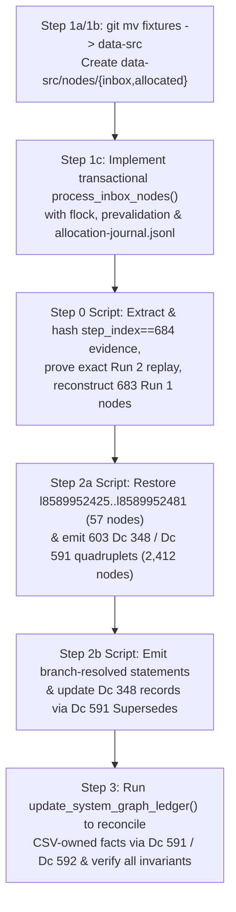

Original problem: Some node IDs were allocated twice by deleting them after assignment and then checking out the pre-assignment state of the graph from Git. This causes those nodes to be ambiguous, which is meant to never happen by making the graph strictly append-only. As that was not enforced in any technical way, it left room for this type of blunder. To prevent this reoccurring, I've added scripts which *should* enforce through technical means that the .ctbnodes files are strictly append-only. Since the .ctbnbdl files are, I believe, generated from the .ctbnodes files, that should also ensure that the union of the active and history .ctbnbdl files should also be append-only going forward. To address the now-ambiguous node IDs as best as possible, I'm looking into how to model this situation precisely in the graph.

Thanks, I think we're back and it's set up now! Great.

Next, let's look at recovering from the duplicated node IDs. So, I *think* the best way to approach this will need a few steps:
1. Come up with a new system for inserting graph nodes that *aren't* derived from the CSVs. I think:
  1a. Rename src/formats/dcdata/fixtures/ to src/formats/dcdata/data-src/.
  1b. Add new folders: src/formats/dcdata/data-src/nodes/{inbox,allocated}.
  1c. Add a build step that looks at all files in the 'inbox' folder, determines their filetype from a list of permitted types (maybe f635 .dcsh right now would be the best pick?), checks if any existing node has the same data and is not self-referential (I think? I want to avoid adding duplicate nodes, but in some cases duplicate nodes are *necessary* for one reason or another, for instance all the ordinary Dc IDs are 0-byte nodes, and if a node has been replaced and then its data needs to be referenced again, I guess it would need to be inserted again - how that should interact with atomic/data nodes, I'm not sure), and if they pass checks, allocates them a new node ID and appends them to the current .ctbnodes file, and moves them into the 'allocated' folder, prefxing their filename with their assigned node ID.
2. For every node ID that was assigned twice:
  2a. Insert new nodes for each body given to each overwritten node. E.g. if 123 was given body of string "abc" and overwritten with "is a, foo, bar" insert four new nodes: a new "abc", a new "is a, foo, bar" node (the latter being an intentional duplicate of 123), a node stating 348 "Ambiguous values" with a [list] of the other two nodes, and a node stating 591 "Supersedes" pointing to the original overwritten node and to the new "Ambiguous values" node, so that the original statement is correctly documented as ambiguous between the two values it was assigned.
  2b. *Somehow* figure out how to *disambiguate which ambiguous node values* were used for each of the above duplicated statements - e.g. if the "is a, foo, bar" referred to a node 234 for "foo" which was one of these ambiguous nodes, we would need to add, I *think*, a subsequent 591 "Supersedes" statement replacing the "is a, foo, bar" with "is a, foo, bar" but with the "foo" reference changed from the now-ambiguous 234 to whatever it was *meant* to point to.
3. Finally, re-run the graph CSV derivation, letting it automatically insert any needed new 591 "Supersedes" and 592 "Retracts" statements to leave the graph coherenent to the intended data.

Does that sound like the correct recovery path? How can we go about this with really careful auditing and precision to make sure it's recovered correctly and doesn't make even more of a mess? I think the source data where you found the original and overwritten graph values should be copied using a checked-in/committed script (*not* regenerating them but scripting what to copy out of the session transcript or wherever you found it using an auditable, committed script), and every step should also be implemented as a script, with all scripts and data committed to Git with every edit and step, so that the full process can be reproduced and audited after the fact.
 [/plan](slashCommand;plan)

# Append-Only Graph Ledger Recovery & Manual Node Allocation Plan

## Goal Description

In session `23f9eaf6-7cd6-416e-8470-852b9878ea88`, two separate graph derivation runs were executed against the commit `3345d2dff` baseline (`17,207` nodes, `l8589934592`..`l8589951798`):
1. **Run 1 (`task-680`, started at `step_index == 679` / finished at `step_index == 687`)**: Appended `683` nodes (`l8589951799`..`l8589952481`, `17,890` total nodes), which included 19 invented file extensions (`57` nodes = `19 × 3`) and an earlier `Dc 573 "Description"` string for `f95` (`Dce`).
2. **Run 2 (`task-693`, started at `step_index == 693` / finished at `step_index == 698`, committed in `a90464028`)**: After resetting `assets/data/graph/`, appended `626` nodes (`l8589951799`..`l8589952424`, `17,833` total nodes), overwriting `l8589951799`..`l8589952424` and erasing `l8589952425`..`l8589952481`.

This plan implements a permanent, auditable, strictly append-only recovery and manual node ingestion pipeline:
1. Rename `src/formats/dcdata/fixtures/` to `src/formats/dcdata/data-src/` and add `src/formats/dcdata/data-src/nodes/{inbox,allocated}` with a **resumable, transactional** allocator for non-CSV graph nodes in `f635 "Dc shorthand ASCII list"` (`.dcsh`) format.
2. Extract and hash the exact transcript and Git evidence (`step_index == 684` on physical JSONL line `685` of `transcript_full.jsonl`), prove generator replay exactness token-for-token against all `626` surviving Run 2 nodes (`l8589951799`..`l8589952424`), and deterministically reconstruct the `683` Run 1 nodes (`l8589951799`..`l8589952481`).
3. Compute the **full transitive dependency-ambiguity closure** over `l8589951799`..`l8589952424` (`603` ambiguous IDs: `l8589951802`, `l8589951813`, and `l8589951824`..`l8589952424`; `23` proven-unambiguous IDs: `l8589951799`..`l8589951801`, `l8589951803`..`l8589951812`, `l8589951814`..`l8589951823`), and stage `.dcsh` node batches via auditable scripts to:
   - Restore the `57` erased Run 1 tail nodes (`l8589952425`..`l8589952481`) at their original IDs first so they are never double-assigned.
   - **Step 2a**: For each of the `603` ambiguous IDs `l<N>`, allocate its literal Run 1 candidate `l<r1_raw(N)>`, its literal Run 2 candidate `l<r2_raw(N)>`, a `Dc 348 "Ambiguous values"` list node (`348 310 275 l<r1_raw(N)> 312 l<r2_raw(N)> 311` using `Dc 310 "Begin list (ordered, contiguous, typed)"`, `Dc 275 "Built-in type identifier: * (Object or any subtype)"`, `Dc 312 "List element separator"`, `Dc 311 "End list"`), and a single `Dc 591 "Supersedes"` statement (`591 l<ambig_raw(N)> l<N>`).
   - **Step 2b**: Disambiguate every statement from Run 1 and Run 2 that references any of the `603` ambiguous IDs by allocating branch-resolved replacement statements (`l<r1_resolved(N)>`, `l<r2_resolved(N)>`) linked via `Dc 591 "Supersedes"`, **and** superseding `l<ambig_raw(N)>` with `l<ambig_resolved(N)> = 348 310 275 l<r1_resolved(N)> 312 l<r2_resolved(N)> 311` so the terminal `Dc 348 "Ambiguous values"` record for `l<N>` points directly at the branch-resolved candidates.
4. **Step 3**: Re-run the CSV graph derivation (`update_system_graph_ledger`) to reconcile active CSV-owned statements against the authoritative CSV tables using `Dc 591 "Supersedes"` and `Dc 592 "Retracts"` without blind allocation-order collapsing.

---

## Confirmed Design Decisions & Reviewer Fixes

1. **Full Dependency-Ambiguity Closure (`603` Ambiguous IDs vs. `23` Unambiguous IDs — Fixes Finding 1)**:
   - A node `l<N>` in the overwritten range `l8589951799`..`l8589952424` is ambiguous if **either** (a) its literal token sequence differed between Run 1 and Run 2 (`602` nodes: `l8589951802` and `l8589951824`..`l8589952424`) **or** (b) its tokens in Run 1 or Run 2 transitively reference an ambiguous node ID (`1` additional node: `l8589951813 = 610 l8589951812 l8589951802`, whose target `l8589951802` had two different meanings).
   - Including `l8589951813` in the ambiguity closure (`603` ambiguous IDs total) ensures `l8589951813` receives its own `Dc 348 "Ambiguous values"` record and a **single** `591 l<ambig_raw(8589951813)> l8589951813` (`Dc 591 "Supersedes"`), rather than two competing `Dc 591 "Supersedes"` statements that would collide in `SeedGraphIndex::superseded_by`.
   - The remaining `23` nodes (`l8589951799`..`l8589951801`, `l8589951803`..`l8589951812`, `l8589951814`..`l8589951823`) are verified to have both identical literal tokens and zero transitive dependency on any ambiguous node, and are left as-is.
   - We also add a strict ledger validation check rejecting any two active `Dc 591 "Supersedes"` statements that target the same `old_id`.

2. **Restore the 57 Erased Run 1 Tail Nodes (`l8589952425`..`l8589952481`) First**:
   - Currently `assets/data/graph/85899_52392.ctbnodes` ends at `l8589952424` (`626` nodes). Before allocating any new Step 2a recovery nodes, Run 1's `57` tail nodes are restored at their original IDs `l8589952425`..`l8589952481` via `nodes/inbox/` so those `57` IDs hold their single original Run 1 definitions (never double-assigned), and all new recovery nodes start cleanly at `l8589952482`.

3. **Resumable Transactional Inbox Allocator (`# @allow-duplicate-of: l<old_id>` — Fixes Finding 2)**:
   - `process_inbox_nodes` is **not** run implicitly during ordinary builds or validations. Instead, ordinary `validate_tables` / lint runs fail loudly if `src/formats/dcdata/data-src/nodes/inbox/` contains any unallocated `.dcsh` files, and allocation requires explicit `--process-inbox` invocation.
   - The allocator acquires an exclusive advisory lock (`flock`) on `src/formats/dcdata/data-src/nodes/.allocator.lock`, verifies optional `--expected-last-id` and `--expected-ledger-sha256` preconditions, prevalidates the entire `nodes/inbox/` batch in memory before touching disk, and writes a persistent transactional journal (`src/formats/dcdata/data-src/nodes/allocated/allocation-journal.jsonl`) so any interrupted write or failed move can be resumed idempotently without ever double-allocating an ID.

4. **Pinned Transcript Evidence & Exact Run 2 Replay Proof (Fixes Finding 3)**:
   - Step 0 queries `transcript_full.jsonl` by JSON field `step_index == 684` (which resides on physical line `685`, 1-indexed) and records SHA-256 digests of the transcript, commit `3345d2dff` inputs, and extracted CSV slices.
   - Step 0 proves generator determinism by replaying `(commit 3345d2dff baseline + step_index == 684 Replacement CSV)` through `update_ledger_in_memory` and asserting **100% token-for-token and comment-for-comment identity** against all `626` surviving Run 2 nodes (`l8589951799`..`l8589952424`).
   - Step 0 then reconstructs the `683` Run 1 nodes from `(commit 3345d2dff baseline + step_index == 684 Target CSV)`, verifies the exact `step_index == 687` metrics (`17890 total / 683 appended / 1 superseded / 0 retracted`), and labels the output clearly as reconstructed evidence verified by Run 2 replay.

5. **Branch-Resolved Ambiguity Lists in Step 2b (Fixes Finding 4)**:
   - In Step 2a, `l<ambig_raw(N)>` lists the literal Run 1 and Run 2 candidate nodes `[ l<r1_raw(N)>, l<r2_raw(N)> ]`.
   - In Step 2b, whenever `l<r1_raw(N)>` or `l<r2_raw(N)>` references any of the `603` ambiguous IDs and is superseded by `l<r1_resolved(N)>` or `l<r2_resolved(N)>`, Step 2b **also** allocates `l<ambig_resolved(N)> = 348 310 275 l<r1_resolved(N)> 312 l<r2_resolved(N)> 311` (`Dc 348 "Ambiguous values"`) and supersedes `l<ambig_raw(N)>` via `591 l<ambig_resolved(N)> l<ambig_raw(N)>` (`Dc 591 "Supersedes"`).
   - Thus, both the literal Step 2a bodies and the disambiguated Step 2b bodies are preserved in the append-only ledger, and following `Dc 591 "Supersedes"` from any ambiguous node `l<N>` to its terminal `Dc 348 "Ambiguous values"` record yields `[ l<r1_resolved(N)>, l<r2_resolved(N)> ]` with all internal references branch-resolved.

6. **CSV-Provenance-Driven Reconciliation in Step 3 (Fixes Finding 5)**:
   - `SeedGraphIndex` will **not** blindly collapse or auto-supersede active statements by allocation order.
   - Instead, `SeedGraphIndex` exposes `find_duplicate_or_conflicting_active_statements()` to surface all active statements per `(subj, prop)`, `(subj, prop, val)`, and `(verb, subj, obj)`.
   - In Step 3, `LedgerBuilder::apply_desired_state` reconciles active CSV-owned statement groups (`has_a_id`, `has_val_id`, and optional `preferred_id`) strictly against `DesiredGraphState` derived from the verified CSV tables:
     - For `f95` `Dc 573 "Description"`, Run 2's disambiguated statement pair matches `DesiredGraphState` and supersedes Run 1's disambiguated statement pair (`Dc 591 "Supersedes"`).
     - For the 19 invented Run 1 file extensions (absent from `DesiredGraphState`), their disambiguated `Dc 584 "Has a"` statements are retracted via `Dc 592 "Retracts"` (`592 615 l<r1_has_a_id>`), which deactivates their paired `Dc 610 "Has value"` statements and string value nodes.
     - For CSV facts that are identical in both Run 1 and Run 2 (where both branches produced active disambiguated statement groups for the same CSV fact), the canonical Run 2 statement group supersedes the duplicate Run 1 statement group (`has_a_id`, `has_val_id`, and any `preferred_id`) via `Dc 591 "Supersedes"`.

---

## Proposed Changes

---

### Component 1: Rename `fixtures/` to `data-src/` & Transactional Manual Node Pipeline (`Step 1a–1c`)

#### [MODIFY] `src/formats/dcdata/fixtures/` -> `src/formats/dcdata/data-src/`
- Move via `git mv src/formats/dcdata/fixtures src/formats/dcdata/data-src`.
- Create `src/formats/dcdata/data-src/nodes/inbox/.keep` and `src/formats/dcdata/data-src/nodes/allocated/.keep`.

#### [MODIFY] [dcdata.rs](file:///workspaces/ctoolbox/src/formats/dcdata/dcdata.rs), [updater.rs](file:///workspaces/ctoolbox/src/formats/dcdata/updater.rs), [validation.rs](file:///workspaces/ctoolbox/src/formats/dcdata/validation.rs), [format.rs](file:///workspaces/ctoolbox/src/formats/dcdata/format.rs), [syntax.rs](file:///workspaces/ctoolbox/src/formats/dcdata/syntax.rs), [modify-columns.py](file:///workspaces/ctoolbox/scripts/modify-columns.py)
- Update all `src/formats/dcdata/fixtures` paths to `src/formats/dcdata/data-src`.
- In [dcdata.rs](file:///workspaces/ctoolbox/src/formats/dcdata/dcdata.rs#L178-L200), resolve `data-src/` relative to `env!("CARGO_MANIFEST_DIR")`.

#### [MODIFY] [graph_ledger.rs](file:///workspaces/ctoolbox/src/formats/dcdata/graph_ledger.rs), [seed_graph.rs](file:///workspaces/ctoolbox/src/formats/dcdata/seed_graph.rs), & [validate_tables.rs](file:///workspaces/ctoolbox/src/formats/dcdata/bin/validate_tables.rs)
1. **Resumable Transactional Inbox Node Allocator (`process_inbox_nodes`)**:
   - Invoked explicitly via `validate_tables --process-inbox [--expected-last-id l<id>] [--expected-ledger-sha256 <hex>] [--dry-run]`.
   - Ordinary `validate_tables` and `update_system_graph_ledger` runs check that `nodes/inbox/` contains no unallocated files (bailing with an actionable message if any exist, so routine builds never silently consume node IDs).
   - **Locking & Preconditions**:
     - Acquires an exclusive `flock` on `src/formats/dcdata/data-src/nodes/.allocator.lock`.
     - Verifies `--expected-last-id` and `--expected-ledger-sha256` (if provided) against `assets/data/graph/*.ctbnodes`.
   - **Journal Recovery (`nodes/allocated/allocation-journal.jsonl`)**:
     - Before processing new inbox files, inspects `allocation-journal.jsonl` for any `PENDING` records from a prior interrupted run:
       - If the `PENDING` node ID is already present at the tail of `assets/data/graph/*.ctbnodes` with matching tokens and `nodes/inbox/<filename>` still exists, completes the move to `nodes/allocated/<grouped_id>_<filename>` and marks the entry `COMMITTED`.
       - If the `PENDING` node ID was not yet appended to `.ctbnodes`, appends it, completes the move, and marks `COMMITTED`.
   - **Whole-Batch In-Memory Prevalidation**:
     - Scans `src/formats/dcdata/data-src/nodes/inbox/` in deterministic ASCII filename order (skipping dotfiles like `.keep`).
     - Validates `.dcsh` (`f635 "Dc shorthand ASCII list"`) extension and parses tokens via `DcShorthand::parse`, extracting `# @comment: <text>` and `# @allow-duplicate-of: l<id>`.
     - Simulates the entire batch in memory:
       - Rejects any token `DcShorthand::Long(id)` with `id >= prospective_node_id` (no self-reference or forward reference).
       - Rejects any two active `Dc 591 "Supersedes"` statements targeting the same `old_id`.
       - Checks if any currently active (`!inactive_ids.contains(&id)`) non-empty node has identical tokens (excluding `586 615 <class_dc>` seed entity declarations using `Dc 586 "Is an instance of"` and `Dc 615 "Enclosing document"`). If an active match exists, fails unless `# @allow-duplicate-of: l<existing_id>` matches that active node ID.
       - Updates the simulated active/inactive state after each node in the batch as `591` (`Dc 591 "Supersedes"`) and `592` (`Dc 592 "Retracts"`) statements are encountered.
   - **Commit Phase**:
     - If `--dry-run` is set, prints the planned allocation range and exits without writing.
     - Otherwise, writes `PENDING` entries to `allocation-journal.jsonl`, appends to `assets/data/graph/*.ctbnodes` via `write_ledger_nodes_to_dir` (`O_APPEND`), syncs high-water shadow ledgers, moves each file to `nodes/allocated/<grouped_id>_<filename>`, and records `COMMITTED` in `allocation-journal.jsonl`.
2. **Active Value Node Indexing & CSV-Provenance Reconciliation**:
   - In [`SeedGraphIndex::from_nodes_with_single_props`](file:///workspaces/ctoolbox/src/formats/dcdata/seed_graph.rs#L442-L459):
     - Skip `inactive_ids` when populating `value_node_by_tokens` so superseded value nodes (`l8589951802`, `l8589951824`, etc.) are never reused by `LedgerBuilder::get_or_insert_value_node`.
     - Add `get_ambiguous_candidates(id: u128) -> Option<Vec<DcShorthand>>` to follow `superseded_by` from `id` to its terminal `Dc 348 "Ambiguous values"` node and return its candidate list.
     - Add `find_duplicate_or_conflicting_active_statements()` to report all active statement groups sharing a `(subj, prop)` single-valued key, `(subj, prop, val)` multi-valued key, or `(verb, subj, obj)` direct key, plus any duplicate active `Dc 591 "Supersedes"` targets.
   - In [`LedgerBuilder::apply_desired_state`](file:///workspaces/ctoolbox/src/formats/dcdata/graph_ledger.rs#L1180-L1520):
     - Reconcile all active CSV-owned statement groups against `DesiredGraphState` (superseding outdated single-valued properties and duplicate branch statement groups (`has_a_id`, `has_val_id`, `preferred_id`) with the canonical active CSV statement group via `Dc 591 "Supersedes"`, and retracting removed CSV statements via `Dc 592 "Retracts"`).

---

### Component 2: Auditable Forensic Extraction & Step-by-Step Recovery Scripts (`Steps 0, 2a, 2b, 3`)

#### [NEW] `scripts/graph-recovery/step0_extract_transcript_data.py`
- Queries `/root/.gemini/antigravity/brain/23f9eaf6-7cd6-416e-8470-852b9878ea88/.system_generated/logs/transcript_full.jsonl` by `step_index`:
  - Verifies SHA-256 of `transcript_full.jsonl` and locates `step_index == 679` (physical line `680`), `step_index == 684` (physical line `685`, containing `tool_calls[0].args.Target` and `Replacement` for `document.csv`), `step_index == 687` (physical line `688`, `task-680` output), and `step_index == 698` (physical line `699`, `task-693` output).
  - Verifies against Git (`3345d2dff..a90464028`) that `document.csv` was the only modified input table in `src/formats/dcdata/` and pins the SHA-256 of every input CSV file at `3345d2dff` and `a90464028`.
  - Runs the generator in-memory against `(3345d2dff + Run 2 document.csv)` and asserts **100% token-for-token and comment-for-comment identity** with the `626` surviving Run 2 nodes (`l8589951799`..`l8589952424`).
  - Runs the generator in-memory against `(3345d2dff + Run 1 document.csv from step_index == 684 Target)` to reconstruct the `683` Run 1 nodes (`l8589951799`..`l8589952481`) and verifies the exact `step_index == 687` metrics (`17890 total / 683 appended / 1 superseded / 0 retracted`).
  - Computes the transitive dependency-ambiguity closure over `l8589951799`..`l8589952424`, confirming `23` unambiguous nodes (`l8589951799`..`l8589951801`, `l8589951803`..`l8589951812`, `l8589951814`..`l8589951823`), `603` ambiguous nodes (`l8589951802`, `l8589951813`, `l8589951824`..`l8589952424`), and `57` erased tail nodes (`l8589952425`..`l8589952481`).
  - Writes all artifacts and SHA-256 manifests into `src/formats/dcdata/data-src/recovery-audit/` and commits them.

#### [NEW] `scripts/graph-recovery/step2a_stage_ambiguous_nodes.py`
- Reads `src/formats/dcdata/data-src/recovery-audit/collision_manifest.json` and stages `.dcsh` files into `src/formats/dcdata/data-src/nodes/inbox/`:
  1. **Tail restoration (`l8589952425`..`l8589952481`, `57` nodes)**: Restores the `57` erased Run 1 tail nodes at their exact original IDs `l8589952425`..`l8589952481`.
  2. **Ambiguous node quadruplets (`603` IDs: `l8589951802`, `l8589951813`, `l8589951824`..`l8589952424` × 4 nodes = `2,412` nodes at `l8589952482`..`l8589954893`)**:
     For each ambiguous node `l<N>`:
     - `l<r1_raw(N)>`: literal Run 1 token body of `l<N>` (with `# @allow-duplicate-of` where needed)
     - `l<r2_raw(N)>`: literal Run 2 token body of `l<N>` (with `# @allow-duplicate-of: l<N>` or `# @allow-duplicate-of: l<r1_raw(N)>` for `l8589951813`)
     - `l<ambig_raw(N)>`: `348 310 275 l<r1_raw(N)> 312 l<r2_raw(N)> 311` (`Dc 348 "Ambiguous values"`, `Dc 310 "Begin list (ordered, contiguous, typed)"`, `Dc 275 "Built-in type identifier: * (Object or any subtype)"`, `l<r1_raw(N)>`, `Dc 312 "List element separator"`, `l<r2_raw(N)>`, `Dc 311 "End list"`)
     - `l<sup_raw(N)>`: `591 l<ambig_raw(N)> l<N>` (`Dc 591 "Supersedes"`)
- Runs `validate_tables --process-inbox --expected-last-id l8589952424 --dry-run` first, then executes the allocation and commits all changes.

#### [NEW] `scripts/graph-recovery/step2b_stage_disambiguations.py`
- In ascending topological order of original node ID `N`:
  - For each of the `603` ambiguous IDs `N`:
    - If `l<r1_raw(N)>` references any of the `603` ambiguous IDs `l<X>`, stages `l<r1_resolved(N)>` (with every ambiguous `l<X>` rewritten to `l<r1_resolved(X)>`) and `591 l<r1_resolved(N)> l<r1_raw(N)>` (`Dc 591 "Supersedes"`). Otherwise `l<r1_resolved(N)> = l<r1_raw(N)>`.
    - If `l<r2_raw(N)>` references any of the `603` ambiguous IDs `l<X>`, stages `l<r2_resolved(N)>` (with every ambiguous `l<X>` rewritten to `l<r2_resolved(X)>`) and `591 l<r2_resolved(N)> l<r2_raw(N)>` (`Dc 591 "Supersedes"`). Otherwise `l<r2_resolved(N)> = l<r2_raw(N)>`.
    - Whenever `l<r1_resolved(N)> != l<r1_raw(N)>` or `l<r2_resolved(N)> != l<r2_raw(N)>`, stages `l<ambig_resolved(N)> = 348 310 275 l<r1_resolved(N)> 312 l<r2_resolved(N)> 311` (`Dc 348 "Ambiguous values"`) and `591 l<ambig_resolved(N)> l<ambig_raw(N)>` (`Dc 591 "Supersedes"`), so the terminal `Dc 348 "Ambiguous values"` node for `l<N>` points directly at `[ l<r1_resolved(N)>, l<r2_resolved(N)> ]`.
  - For each restored Run 1 tail node `N` in `l8589952425`..`l8589952481` that references any of the `603` ambiguous IDs `l<X>`:
    - Stages `l<r1_resolved(N)>` (rewriting `l<X> -> l<r1_resolved(X)>`) and `591 l<r1_resolved(N)> l<N>` (`Dc 591 "Supersedes"`).
- Runs `validate_tables --process-inbox --expected-last-id l8589954893 --dry-run` first, then executes the allocation and commits all changes.

#### [NEW] `scripts/graph-recovery/step3_reconcile_csv_graph.sh`
- Runs `./scripts/validate-data-tables` (`update_system_graph_ledger`), which:
  - Emits `Dc 592 "Retracts"` (`592 615 l<id>`) for the 19 disambiguated Run 1 file-extension statements that are absent from the current CSVs.
  - Emits `Dc 591 "Supersedes"` (`591 l<r2_id> l<r1_id>`) for the disambiguated Run 1 statements (both `f95`'s outdated description and the shifted duplicate statements) that are superseded by Run 2's canonical disambiguated statements.
  - Compiles `assets/data/graph/85899_34592.ctbnbdl` (active) and `assets/data/graph/system/85899_34942.ctbnbdl` (historical).
- Verifies that a second consecutive run of `./scripts/validate-data-tables` appends **0 nodes**, then commits the final reconciled graph.

---

## Verification Plan

### Automated Invariant & Fault-Injection Tests
1. **Allocator Transactional & Fault-Injection Tests (`cargo test -p ctb-formats-dcdata --lib graph_ledger`)**:
   - Test whole-batch prevalidation failure (syntax error, self-reference, forward reference, duplicate active node without `# @allow-duplicate-of`, duplicate `Dc 591 "Supersedes"` target) ensures zero bytes are appended to `.ctbnodes`.
   - Test crash/interruption recovery: simulate an interrupted run where `.ctbnodes` was appended and `allocation-journal.jsonl` has a `PENDING` entry before `fs::rename`, then verify re-running `process_inbox_nodes` completes the move without allocating a duplicate ID.
   - Test `--expected-last-id` and `--expected-ledger-sha256` mismatch rejection and `flock` lock contention.
   - Test that ordinary validation fails if `nodes/inbox/` is non-empty.
2. **Recovery & Live vs. Historical Graph Invariant Tests (`cargo test -p ctb-formats-dcdata --lib seed_graph`)**:
   - **Unchanged Prefix Invariant**: Verify `l8589934592`..`l8589952424` (`17,833` nodes) match commit `a90464028` byte-for-byte.
   - **Exact Tail Restoration Invariant**: Verify `l8589952425`..`l8589952481` (`57` nodes) match the reconstructed Run 1 tail nodes token-for-token.
   - **Complete Ambiguity Closure & Unambiguous Preservation Invariant**:
     - Verify the `23` unambiguous nodes (`l8589951799`..`l8589951801`, `l8589951803`..`l8589951812`, `l8589951814`..`l8589951823`) remain active and unsuperseded.
     - Verify every node in the `603`-node ambiguity closure (`l8589951802`, `l8589951813`, `l8589951824`..`l8589952424`) resolves via `get_ambiguous_candidates(id)` to a terminal `Dc 348 "Ambiguous values"` list of 2 branch-resolved candidates `[l<r1_resolved(N)>, l<r2_resolved(N)>]`, and neither candidate references any of the `603` ambiguous IDs.
   - **Live Active Graph Purity & Uniqueness Invariant**:
     - Verify that in the active bundle (`assets/data/graph/85899_34592.ctbnbdl`), zero nodes from the `603`-node ambiguous set are active or referenced by any active node.
     - Verify `find_duplicate_or_conflicting_active_statements()` returns empty (strictly 1 active statement per CSV fact, zero duplicate `Dc 591 "Supersedes"` targets).
     - Verify `reconstruct_dc_defns()` and `reconstruct_format_defns()` round-trip the CSV tables with zero drift.
   - **Active + History Union & Idempotency Invariant**:
     - Verify active + history `.ctbnbdl` bundles partition 100% of `.ctbnodes` with zero overlap and identical active state, and a second `update_system_graph_ledger` run appends `0` nodes.
3. **Repository Lints & Kernel Guard Canary**:
   - `cargo run --manifest-path src/build_support/Cargo.toml --bin ctb-lint -- all --quick`
   - `./scripts/lock-graph-append-only --test-canary`

Question 1: If those 23 were unambiguous, it sounds fine to leave them as-is even if they were deleted and recreeated in a bit-for-bit-, meaning-for-meaning-identical way.
Question 2: It sounds like those 57 nodes should be restored to their original definitions, yes.
Question 3: I think that sounds good.
