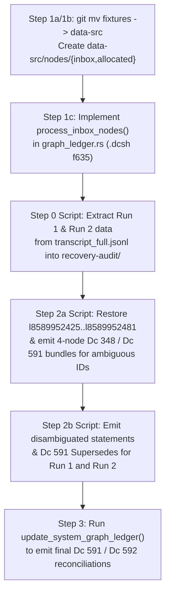

Thanks, I think we're back and it's set up now! Great.

Next, let's look at recovering from the duplicated node IDs. So, I *think* the best way to approach this will need a few steps:
1. Come up with a new system for inserting graph nodes that *aren't* derived from the CSVs. I think:
  1a. Rename src/formats/dcdata/fixtures/ to src/formats/dcdata/data-src/.
  1b. Add new folders: src/formats/dcdata/data-src/nodes/{inbox,allocated}.
  1c. Add a build step that looks at all files in the 'inbox' folder, determines their filetype from a list of permitted types (maybe f635 .dcsh right now would be the best pick?), checks if any existing node has the same data and is not self-referential (I think? I want to avoid adding duplicate nodes, but in some cases duplicate nodes are *necessary* for one reason or another, for instance all the ordinary Dc IDs are 0-byte nodes, and if a node has been replaced and then its data needs to be referenced again, I guess it would need to be inserted again - how that should interact with atomic/data nodes, I'm not sure), and if they pass checks, allocates them a new node ID and appends them to the current .ctbnodes file, and moves them into the 'allocated' folder, prefxing their filename with their assigned node ID.
2. For every node ID that was assigned twice:
  2a. Insert new nodes for each body given to each overwritten node. E.g. if 123 was given body of string "abc" and overwritten with "is a, foo, bar" insert four new nodes: a new "abc", a new "is a, foo, bar" node (the latter being an intentional duplicate of 123), a node stating 348 "Ambiguous values" with a [list] of the other two nodes, and a node stating 591 "Supersedes" pointing to the original overwritten node and to the new "Ambiguous values" node, so that the original statement is correctly documented as ambiguous between the two values it was assigned.
  2b. *Somehow* figure out how to *disambiguate which ambiguous node values* were used for each of the above duplicated statements - e.g. if the "is a, foo, bar" referred to a node 234 for "foo" which was one of these ambiguous nodes, we would need to add, I *think*, a subsequent 591 "Supersedes" statement replacing the "is a, foo, bar" with "is a, foo, bar" but with the "foo" reference changed from the now-ambiguous 234 to whatever it was *meant* to point to.
3. Finally, re-run the graph CSV derivation, letting it automatically insert any needed new 591 "Supersedes" and 592 "Retracts" statements to leave the graph coherenent to the intended data.

Does that sound like the correct recovery path? How can we go about this with really careful auditing and precision to make sure it's recovered correctly and doesn't make even more of a mess? I think the source data where you found the original and overwritten graph values should be copied using a checked-in/committed script (*not* regenerating them but scripting what to copy out of the session transcript or wherever you found it using an auditable, committed script), and every step should also be implemented as a script, with all scripts and data committed to Git with every edit and step, so that the full process can be reproduced and audited after the fact.
 [/plan](slashCommand;plan)

# Append-Only Graph Ledger Recovery & Manual Node Allocation Plan

## Goal Description

In session `23f9eaf6-7cd6-416e-8470-852b9878ea88`, two separate graph derivation runs were executed against the commit `3345d2dff` baseline (`17,207` nodes, `l8589934592`..`l8589951798`):
1. **Run 1 (`task-680` at `19:28:04Z`)**: Appended `683` nodes (`l8589951799`..`l8589952481`, `17,890` total nodes), which included 19 invented file extensions (`57` nodes = `19 × 3`) and an earlier `Dc 573 "Description"` string for `f95` (`Dce`).
2. **Run 2 (`task-693` at `19:29:47Z`, committed in `a90464028`)**: After resetting `assets/data/graph/`, appended `626` nodes (`l8589951799`..`l8589952424`, `17,833` total nodes), overwriting `l8589951799`..`l8589952424` and erasing `l8589952425`..`l8589952481`.

This plan implements a permanent, auditable, strictly append-only recovery and manual node ingestion pipeline:
1. Rename `src/formats/dcdata/fixtures/` to `src/formats/dcdata/data-src/` and add `src/formats/dcdata/data-src/nodes/{inbox,allocated}` for non-CSV graph nodes in `f635 "Dc shorthand ASCII list"` (`.dcsh`) format.
2. Extract the exact Run 1 vs. Run 2 inputs from the session transcript using a committed, reproducible script (`scripts/recover-graph-step0-extract.py`).
3. Stage and commit `.dcsh` node files into `src/formats/dcdata/data-src/nodes/inbox/` via auditable scripts to:
   - Restore the 57 erased Run 1 tail nodes (`l8589952425`..`l8589952481`) at their original IDs so they are not double-assigned.
   - For every double-assigned node ID with conflicting definitions (`l8589951802` and `l8589951824`..`l8589952424`, `602` nodes), allocate new nodes for both bodies, allocate a `Dc 348 "Ambiguous values"` list node (`348 310 275 l<run1_node> 312 l<run2_node> 311` using `Dc 310 "Begin list (ordered, contiguous, typed)"`, `Dc 275 "Built-in type identifier: * (Object or any subtype)"`, `Dc 312 "List element separator"`, `Dc 311 "End list"`), and supersede the overwritten node with a `Dc 591 "Supersedes"` statement (`591 l<ambiguous_node> l<overwritten_node>`).
   - Disambiguate every statement from Run 1 and Run 2 that referenced an ambiguous node ID by allocating a replacement statement referencing the corresponding Run 1 or Run 2 disambiguated target node and linking it via `Dc 591 "Supersedes"`.
4. Re-run the CSV graph derivation (`update_system_graph_ledger`) so it automatically emits `Dc 591 "Supersedes"` and `Dc 592 "Retracts"` statements to leave the active graph coherent with the current CSV tables.

---

## User Review Required

> [!IMPORTANT]
> **How Run 1 is preserved in the session transcript (`23f9eaf6-7cd6-416e-8470-852b9878ea88`)**:
> In `transcript_full.jsonl`, the previous agent never called `read_file` on `assets/data/graph/*.ctbnodes` between Run 1 (`step 679` / `task-680`) and `git checkout` / `rm` (`steps 688 & 692`). However, `transcript_full.jsonl` line `684` (`tool_calls[0].args.Target`) contains the **exact verbatim 26-line block of `document.csv`** that was on disk during Run 1, and line `687` records the exact `task-680` ledger summary (`17890 total nodes (683 appended, 1 superseded, 0 retracted, 7 chunk files updated)`).
> Because `update_ledger_in_memory` is a 100% deterministic `BTreeMap`-ordered function of `(commit 3345d2dff graph + step 684 Target CSV)`, our committed Step 0 script extracts that verbatim CSV payload from `transcript_full.jsonl` line `684` and deterministically reconstructs the exact 683 Run 1 nodes (`l8589951799`..`l8589952481`), verifying that the output matches the transcript's `17,890 total / 683 appended / 1 superseded / 0 retracted` counts.

---

## Open Questions

> [!WARNING]
> Please confirm your preference on these 3 design details before we begin execution:
>
> 1. **23 Unambiguous Nodes in `l8589951799`..`l8589951823`**:
>    - In `l8589951799`..`l8589951823` (the first 25 nodes appended after `l8589951798`), **23 nodes** (`l8589951799`..`l8589951801`, `l8589951803`..`l8589951812`, `l8589951814`..`l8589951823`) received **bit-for-bit identical token sequences and identical transitive targets** in both Run 1 and Run 2.
>    - Only `l8589951802` (`f95` `Dc 573 "Description"` string), `l8589951813` (`610 l8589951812 l8589951802`, which references `l8589951802`), and `l8589951824`..`l8589952424` (`601` nodes shifted by the 19 invented extensions) differed between Run 1 and Run 2.
>    - **Recommendation**: Leave the 23 bit-for-bit identical, unambiguously referenced nodes untouched, and apply Step 2a/2b to the `602` nodes with distinct bodies (`l8589951802` and `l8589951824`..`l8589952424`) plus `l8589951813` (whose target `l8589951802` is ambiguous). Should we skip the 23 identical nodes or mark all 626 as ambiguous?
>
> 2. **Restoring the 57 Erased Run 1 Tail Nodes (`l8589952425`..`l8589952481`) First**:
>    - Currently `assets/data/graph/85899_52392.ctbnodes` ends at `l8589952424` (626 nodes). In Run 1, IDs `l8589952425`..`l8589952481` (57 nodes) were also minted before `rm` deleted them.
>    - **Recommendation**: Before allocating any new Step 2a recovery nodes, first append Run 1's 57 tail nodes at `l8589952425`..`l8589952481` via `nodes/inbox/` so those 57 IDs hold their single original Run 1 definitions (never double-assigned!) and all new recovery nodes start cleanly at `l8589952482`. Does that sound right?
>
> 3. **Duplicate-Node Check Policy in `data-src/nodes/inbox/`**:
>    - By default, when processing a `.dcsh` (`f635 "Dc shorthand ASCII list"`) file in `nodes/inbox/`, we check whether any currently **active** (non-superseded, non-retracted), non-empty node in the ledger already has the exact same token sequence (and is not a seed-entity declaration `586 615 <class_dc>` using `Dc 586 "Is an instance of"` and `Dc 615 "Enclosing document"`).
>    - However, in Step 2a, the new copy of each overwritten node must be allocated *immediately before* the `Dc 348 "Ambiguous values"` and `Dc 591 "Supersedes"` nodes that mark the old node inactive.
>    - **Recommendation**: Allow a `.dcsh` file in `nodes/inbox/` to carry an optional header comment `# @allow-duplicate-of: l<old_id>` (which explicitly documents and permits duplicating `l<old_id>` prior to superseding it), while rejecting any accidental duplicate of an active node.

---

## Proposed Changes

---

### Component 1: Rename `fixtures/` to `data-src/` & Add Manual Node Pipeline (`Step 1a–1c`)

#### [MODIFY] `src/formats/dcdata/fixtures/` -> `src/formats/dcdata/data-src/`
- Move via `git mv src/formats/dcdata/fixtures src/formats/dcdata/data-src`.
- Create `src/formats/dcdata/data-src/nodes/inbox/.keep` and `src/formats/dcdata/data-src/nodes/allocated/.keep`.

#### [MODIFY] [dcdata.rs](file:///workspaces/ctoolbox/src/formats/dcdata/dcdata.rs), [updater.rs](file:///workspaces/ctoolbox/src/formats/dcdata/updater.rs), [validation.rs](file:///workspaces/ctoolbox/src/formats/dcdata/validation.rs), [format.rs](file:///workspaces/ctoolbox/src/formats/dcdata/format.rs), [syntax.rs](file:///workspaces/ctoolbox/src/formats/dcdata/syntax.rs), [modify-columns.py](file:///workspaces/ctoolbox/scripts/modify-columns.py)
- Update all `src/formats/dcdata/fixtures` paths to `src/formats/dcdata/data-src`.
- In [dcdata.rs](file:///workspaces/ctoolbox/src/formats/dcdata/dcdata.rs#L178-L200), resolve `data-src/` relative to the crate manifest directory instead of `fixtures/`.

#### [MODIFY] [graph_ledger.rs](file:///workspaces/ctoolbox/src/formats/dcdata/graph_ledger.rs) & [seed_graph.rs](file:///workspaces/ctoolbox/src/formats/dcdata/seed_graph.rs)
1. **Inbox Node Allocation (`process_inbox_nodes`)**:
   - Scans `src/formats/dcdata/data-src/nodes/inbox/` in deterministic ASCII filename order (ignoring hidden `.keep` files).
   - Validates that each file has a permitted extension (currently `.dcsh` corresponding to `f635 "Dc shorthand ASCII list"`).
   - Parses tokens using `DcShorthand::parse` (ignoring `#` comments, while extracting optional `# @comment: <text>` and `# @allow-duplicate-of: l<id>` directives).
   - **Self-reference & bounds check**: Rejects any node whose tokens reference its own prospective `l<next_id>` or any future unallocated `l<id>` (`id >= next_id`).
   - **Duplicate check**: Checks if any currently **active** (`!inactive_ids.contains(&id)`) non-empty node has identical tokens (excluding `586 615 <class_dc>` seed entity declarations using `Dc 586 "Is an instance of"` and `Dc 615 "Enclosing document"`). If an active match `l<existing_id>` exists, fails with an error unless `# @allow-duplicate-of: l<existing_id>` is declared.
   - Allocates `l<next_id>`, appends the node to `assets/data/graph/*.ctbnodes` via `write_ledger_nodes_to_dir` (`O_APPEND`), and moves the file from `nodes/inbox/<name>.dcsh` to `nodes/allocated/<grouped_id>_<name>.dcsh` (e.g. `85899_52425_...dcsh`).
2. **Active Value Node Indexing & Duplicate Active Statement Reconciliation**:
   - In [`SeedGraphIndex::from_nodes_with_single_props`](file:///workspaces/ctoolbox/src/formats/dcdata/seed_graph.rs#L442-L459), skip `inactive_ids` when populating `value_node_by_tokens`, `string_by_node_id`, and `integer_by_node_id` so that superseded value nodes (`l8589951802`, `l8589951824`, etc.) are never reused in place of their active replacements.
   - In `SeedGraphIndex` and `LedgerBuilder::apply_desired_state`, record any shadowed duplicate active statements (when both Run 1's disambiguated statement and Run 2's disambiguated statement are active for the same `(subj, prop)`, `(subj, prop, val_tok)`, or `(verb, subj, obj)`) so that `apply_desired_state` emits `Dc 591 "Supersedes"` (`591 l<canonical_active_id> l<shadowed_active_id>`) to leave only one active statement per fact.

---

### Component 2: Auditable Forensic Extraction & Step-by-Step Recovery Scripts (`Steps 2a, 2b, 3`)

Every recovery phase will be driven by a committed Python/shell script under `scripts/graph-recovery/` and committed to Git at each step:

#### [NEW] `scripts/graph-recovery/step0_extract_transcript_data.py`
- Reads `/root/.gemini/antigravity/brain/23f9eaf6-7cd6-416e-8470-852b9878ea88/.system_generated/logs/transcript_full.jsonl` (line `684` `Target` & `Replacement`, and line `687` & `698` task logs).
- Writes the extracted artifacts into `src/formats/dcdata/data-src/recovery-audit/`:
  - `run1_document_csv_slice.csv` (verbatim `Target` from step 684)
  - `run2_document_csv_slice.csv` (verbatim `Replacement` from step 684)
  - `run1_nodes_8589951799_8589952481.ctbnodes` (the 683 nodes of Run 1)
  - `run2_nodes_8589951799_8589952424.ctbnodes` (the 626 nodes of Run 2 copied from `assets/data/graph/`)
  - `collision_manifest.json` (complete audit table mapping each ID `l8589951799`..`l8589952481` to its Run 1 tokens, Run 2 tokens, classification, and referenced ambiguous node IDs).

#### [NEW] `scripts/graph-recovery/step2a_stage_ambiguous_nodes.py`
- Reads `collision_manifest.json` and stages `.dcsh` files into `src/formats/dcdata/data-src/nodes/inbox/`:
  1. **Tail restoration (`l8589952425`..`l8589952481`, `57` nodes)**: Stages the 57 erased Run 1 tail nodes so they are allocated at their exact original IDs `l8589952425`..`l8589952481`.
  2. **Ambiguous node quadruplets (`l8589951802` and `l8589951824`..`l8589952424`, `602` IDs × 4 nodes = `2,408` nodes)**:
     For each overwritten node `l<N>`:
     - `l<r1_copy(N)>`: Run 1 token body of `l<N>` (with `# @allow-duplicate-of` if needed)
     - `l<r2_copy(N)>`: Run 2 token body of `l<N>` (with `# @allow-duplicate-of: l<N>`)
     - `l<ambig(N)>`: `348 310 275 l<r1_copy(N)> 312 l<r2_copy(N)> 311` (`Dc 348 "Ambiguous values"`, `Dc 310 "Begin list (ordered, contiguous, typed)"`, `Dc 275 "Built-in type identifier: * (Object or any subtype)"`, `l<r1_copy(N)>`, `Dc 312 "List element separator"`, `l<r2_copy(N)>`, `Dc 311 "End list"`)
     - `l<sup(N)>`: `591 l<ambig(N)> l<N>` (`Dc 591 "Supersedes"` superseding `l<N>` with `l<ambig(N)>`)
- Runs the inbox allocator to append these nodes to `assets/data/graph/*.ctbnodes` and move the `.dcsh` files to `src/formats/dcdata/data-src/nodes/allocated/`, then commits the result.

#### [NEW] `scripts/graph-recovery/step2b_stage_disambiguations.py`
- In ascending topological order of original node ID `N`:
  - For every Run 1 statement node (`l8589951813`, `l<r1_copy(N)>`, or restored tail `l8589952425`..`l8589952481`) that references any ambiguous node `l<X>`:
    - Rewrites each ambiguous `l<X>` reference to `l<resolved_r1(X)>` (Run 1's disambiguated node for `X`).
    - Stages two `.dcsh` files in `nodes/inbox/`:
      1. `l<resolved_r1(N)>`: the disambiguated Run 1 statement tokens.
      2. `591 l<resolved_r1(N)> l<r1_source(N)>` (`Dc 591 "Supersedes"`).
  - For every Run 2 statement node (`l8589951813` or `l<r2_copy(N)>`) that references any ambiguous node `l<X>`:
    - Rewrites each ambiguous `l<X>` reference to `l<resolved_r2(X)>` (Run 2's disambiguated node for `X`).
    - Stages two `.dcsh` files in `nodes/inbox/`:
      1. `l<resolved_r2(N)>`: the disambiguated Run 2 statement tokens.
      2. `591 l<resolved_r2(N)> l<r2_source(N)>` (`Dc 591 "Supersedes"`).
- Runs the inbox allocator and commits the result.

#### [NEW] `scripts/graph-recovery/step3_reconcile_csv_graph.sh`
- Runs `./scripts/validate-data-tables` (`update_system_graph_ledger`), which:
  - Emits `Dc 592 "Retracts"` (`592 615 l<id>`) for the 19 disambiguated Run 1 file-extension statements that were removed in Run 2.
  - Emits `Dc 591 "Supersedes"` (`591 l<r2_id> l<r1_id>`) for the disambiguated Run 1 statements that were superseded by Run 2's disambiguated statements.
  - Compiles the updated active `assets/data/graph/85899_34592.ctbnbdl` and historical `assets/data/graph/system/85899_34942.ctbnbdl` bundles.
- Commits the final reconciled graph and generated files.

---

## Verification Plan

### Automated Tests
1. `cargo test -p ctb-formats-dcdata --lib graph_ledger` (including new unit tests for `process_inbox_nodes`, `.dcsh` duplicate/self-reference validation, `Dc 348 "Ambiguous values"` supersession, and `test_live_system_graph_ledger_has_zero_drift`).
2. `cargo test -p ctb-formats-dcdata --lib seed_graph` (verifying that `SeedGraphIndex::reconstruct_dc_defns()` and `reconstruct_format_defns()` round-trip the CSV tables with zero drift and zero references to ambiguous node IDs `l8589951802` or `l8589951813`..`l8589952481`).
3. `cargo run --manifest-path src/build_support/Cargo.toml --bin ctb-lint -- all --quick` (verifying Section 9 `graph ledger append-only lint` and all repository linters).
4. `./scripts/lock-graph-append-only --test-canary` (verifying kernel-level `FS_IMMUTABLE_FL` / `FS_APPEND_FL` flags on all `.ctbnodes` files).
