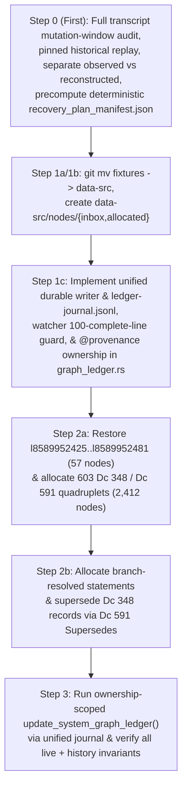

Original problem: Some node IDs were allocated twice by deleting them after assignment and then checking out the pre-assignment state of the graph from Git. This causes those nodes to be ambiguous, which is meant to never happen by making the graph strictly append-only. As that was not enforced in any technical way, it left room for this type of blunder. To prevent this reoccurring, I've added scripts which *should* enforce through technical means that the .ctbnodes files are strictly append-only. Since the .ctbnbdl files are, I believe, generated from the .ctbnodes files, that should also ensure that the union of the active and history .ctbnbdl files should also be append-only going forward. To address the now-ambiguous node IDs as best as possible, I'm looking into how to model this situation precisely in the graph.

Thanks, I think we're back and it's set up now! Great.

Next, let's look at recovering from the duplicated node IDs. So, I *think* the best way to approach this will need a few steps:
1. Come up with a new system for inserting graph nodes that *aren't* derived from the CSVs. I think:
  1a. Rename src/formats/dcdata/fixtures/ to src/formats/dcdata/data-src/.
  1b. Add new folders: src/formats/dcdata/data-src/nodes/{inbox,allocated}.
  1c. Add a build step that looks at all files in the 'inbox' folder, determines their filetype from a list of permitted types (maybe f635 .dcsh right now would be the best pick?), checks if any existing node has the same data and is not self-referential (I think? I want to avoid adding duplicate nodes, but in some cases duplicate nodes are *necessary* for one reason or another, for instance all the ordinary Dc IDs are 0-byte nodes, and if a node has been replaced and then its data needs to be referenced again, I guess it would need to be inserted again - how that should interact with atomic/data nodes, I'm not sure), and if they pass checks, allocates them a new node ID and appends them to the current .ctbnodes file, and moves them into the 'allocated' folder, prefxing their filename with their assigned node ID.
2. For every node ID that was assigned twice:
  2a. Insert new nodes for each body given to each overwritten node. E.g. if 123 was given body of string "abc" and overwritten with "is a, foo, bar" insert four new nodes: a new "abc", a new "is a, foo, bar" node (the latter being an intentional duplicate of 123), a node stating 348 "Ambiguous values" with a [list] of the other two nodes, and a node stating 591 "Supersedes" pointing to the original overwritten node and to the new "Ambiguous values" node, so that the original statement is correctly documented as ambiguous between the two values it was assigned.
  2b. *Somehow* figure out how to *disambiguate which ambiguous node values* were used for each of the above duplicated statements - e.g. if the "is a, foo, bar" referred to a node 234 for "foo" which was one of these ambiguous nodes, we would need to add, I *think*, a subsequent 591 "Supersedes" statement replacing the "is a, foo, bar" with "is a, foo, bar" but with the "foo" reference changed from the now-ambiguous 234 to whatever it was *meant* to point to.
3. Finally, re-run the graph CSV derivation, letting it automatically insert any needed new 591 "Supersedes" and 592 "Retracts" statements to leave the graph coherenent to the intended data.

Does that sound like the correct recovery path? How can we go about this with really careful auditing and precision to make sure it's recovered correctly and doesn't make even more of a mess? I think the source data where you found the original and overwritten graph values should be copied using a checked-in/committed script (*not* regenerating them but scripting what to copy out of the session transcript or wherever you found it using an auditable, committed script), and every step should also be implemented as a script, with all scripts and data committed to Git with every edit and step, so that the full process can be reproduced and audited after the fact.
 [/plan](slashCommand;plan)

# Append-Only Graph Ledger Recovery & Manual Node Allocation Plan

## Goal Description

In session `23f9eaf6-7cd6-416e-8470-852b9878ea88`, two separate graph derivation runs were executed against the commit `3345d2dff` baseline (`17,207` nodes, `l8589934592`..`l8589951798`):
1. **Run 1 (`task-680`, started at `step_index == 679` / finished at `step_index == 687`)**: Appended `683` nodes (`l8589951799`..`l8589952481`, `17,890` total nodes), which included 19 invented file extensions (`57` nodes = `19 × 3`) and an earlier `Dc 573 "Description"` string for `f95` (`Dce`).
2. **Run 2 (`task-693`, started at `step_index == 693` / finished at `step_index == 698`, committed in `a90464028`)**: After resetting `assets/data/graph/`, appended `626` nodes (`l8589951799`..`l8589952424`, `17,833` total nodes), overwriting `l8589951799`..`l8589952424` and erasing `l8589952425`..`l8589952481`.

This plan implements a permanent, auditable, strictly append-only recovery and manual node ingestion pipeline in the following strict sequence:
1. **Step 0 (Evidence Preservation, Full Mutation-Window Audit, & Complete Deterministic Recovery Manifest First — Before Any Code Refactoring)**:
   - Audit **every** step in `23f9eaf6/transcript_full.jsonl` from commit `3345d2dff` through `a90464028` (including the execution windows of `task-680` and `task-693`) to prove that no unrecorded file edits or generator changes occurred before or during Run 1.
   - Strictly separate **directly observed evidence** (the `step_index == 684` `Target` and `Replacement` payloads from physical JSONL line `685`, `step_index == 687` & `698` task stdout logs, commit `3345d2dff` git tree, and commit `a90464028` surviving `.ctbnodes` bytes) from **reconstructed Run 1 output** (`run1_reconstructed_nodes_8589951799_8589952481.ctbnodes`), generated by running the unmodified `a90464028` / `3345d2dff` generator code.
   - Precompute and commit a complete, deterministic `recovery_plan_manifest.json` containing the exact `.ctbnodes` lines to be appended in Steps 2a, 2b, and 3, branch mappings, provenance tags, and expected SHA-256 digests at each boundary.
2. **Step 1 (Shared Durable Transactional Ledger Writer, Kernel Watcher Coordination, & `fixtures/` -> `data-src/` Pipeline)**:
   - Rename `src/formats/dcdata/fixtures/` to `src/formats/dcdata/data-src/` and create `src/formats/dcdata/data-src/nodes/{inbox,allocated}`.
   - Route **all** ledger writers (`process_inbox_nodes` and `update_system_graph_ledger`) through a single shared durable transactional writer (`src/build_support/ctbnbdl.rs` & `src/formats/dcdata/graph_ledger.rs`), a single shared lock (`src/formats/dcdata/data-src/nodes/.ledger-writer.lock`), and a single **unified journal** (`src/formats/dcdata/data-src/nodes/allocated/ledger-journal.jsonl`) with full file + directory `fsync` durability and coordinated kernel watcher sealing (`scripts/lock-graph-append-only`).
3. **Step 2 (Restore Erased Tail & Disambiguate Overwritten Node IDs via `nodes/inbox/`)**:
   - **Step 2a**: Restore the `57` erased Run 1 tail nodes (`l8589952425`..`l8589952481`) at their original IDs first, then for each of the `603` dependency-ambiguous IDs (`l8589951802`, `l8589951813`, and `l8589951824`..`l8589952424`), allocate its literal Run 1 candidate `l<r1_raw(N)>` (`# @provenance: csv-recovery-run1`), its literal Run 2 candidate `l<r2_raw(N)>` (`# @provenance: csv-recovery-run2`), a `Dc 348 "Ambiguous values"` list node (`348 310 275 l<r1_raw(N)> 312 l<r2_raw(N)> 311` using `Dc 310 "Begin list (ordered, contiguous, typed)"`, `Dc 275 "Built-in type identifier: * (Object or any subtype)"`, `Dc 312 "List element separator"`, `Dc 311 "End list"`), and a single `Dc 591 "Supersedes"` statement (`591 l<ambig_raw(N)> l<N>`).
   - **Step 2b**: Disambiguate every statement from Run 1 and Run 2 that references any of the `603` ambiguous IDs by allocating branch-resolved replacement statements (`l<r1_resolved(N)>` with `# @provenance: csv-recovery-run1`, `l<r2_resolved(N)>` with `# @provenance: csv-recovery-run2`) linked via `Dc 591 "Supersedes"`, **and** superseding `l<ambig_raw(N)>` with `l<ambig_resolved(N)> = 348 310 275 l<r1_resolved(N)> 312 l<r2_resolved(N)> 311` so the terminal `Dc 348 "Ambiguous values"` record for `l<N>` points directly at the branch-resolved candidates.
4. **Step 3 (Ownership-Scoped CSV Graph Reconciliation)**:
   - Run `update_system_graph_ledger` through the unified durable transactional writer to reconcile only CSV-owned statements (`csv-derived`, `csv-recovery-run1`, `csv-recovery-run2`) against `DesiredGraphState` via `Dc 591 "Supersedes"` and `Dc 592 "Retracts"` while preserving shared statement IDs (`l8589951812`) and never retracting `# @provenance: manual` statements.

---

## Confirmed Design Decisions & Reviewer Fixes (Rounds 1–4)

1. **Step 0 Full Mutation-Window Audit & Observed vs. Reconstructed Distinction (Fixes R1-F3, R2-F6, & R4-F1)**:
   - Step 0 runs **before** any code refactoring or `fixtures -> data-src` rename, using the unmodified historical generator (`a90464028` / `3345d2dff`).
   - Rather than assuming `step_index == 684` was the only edit between Run 1 and Run 2, Step 0 programmatically audits **all** steps (`step_index == 1..699`) in `23f9eaf6/transcript_full.jsonl`:
     - Extracts and logs every `edit_file`, `write_file`, and `run_command` step between commit `3345d2dff` and commit `a90464028` (`step_index == 699`) with timestamps.
     - Verifies that between `3345d2dff` and the start of `task-680` (`step_index == 679`), the only modified input file was `src/formats/dcdata/fixtures/categories/formats/document.csv` and zero Rust generator files (`src/formats/dcdata/*.rs`, `src/build_support/*.rs`) were modified.
     - Verifies that during `task-680`'s execution window (`step_index == 679..683`, prior to `step_index == 684`), zero file-mutating tool calls or commands ran.
     - Verifies that between `task-680` (`step_index == 679`) and `task-693` (`step_index == 693`), the **sole** edit to any input table or generator source was `step_index == 684` (physical line `685` of `transcript_full.jsonl`), whose verbatim `Target` and `Replacement` blocks are preserved directly from the transcript.
   - All audit artifacts and manifests explicitly separate:
     - **Observed Evidence**: Raw JSON records from `transcript_full.jsonl`, verbatim `Target` / `Replacement` slices from `step_index == 684`, commit `3345d2dff` prefix nodes (`l8589934592`..`l8589951798`), and commit `a90464028` surviving Run 2 nodes (`l8589951799`..`l8589952424`).
     - **Reconstructed Output**: `run1_reconstructed_nodes_8589951799_8589952481.ctbnodes`, produced by deterministic replay of the pinned `3345d2dff` generator over the proven pre-`step_index == 684` input tree and corroborated by the `step_index == 687` summary metrics (`17,890 total / 683 appended / 1 superseded / 0 retracted / 7 chunk files updated`) and the 100% token-for-token / comment-for-comment Run 2 replay verification.
   - Step 0 also outputs `recovery_plan_manifest.json` precomputing the exact recovery nodes, branch mappings, provenance tags, and expected SHA-256 digests for Steps 2a, 2b, and 3.

2. **Full Dependency-Ambiguity Closure (`603` Ambiguous IDs vs. `23` Unambiguous IDs — Fixes R1-F1)**:
   - `603` nodes in `l8589951799`..`l8589952424` (`l8589951802`, `l8589951813`, and `l8589951824`..`l8589952424`) are in the transitive dependency-ambiguity closure and receive `Dc 348 "Ambiguous values"` + `Dc 591 "Supersedes"` records.
   - `23` nodes (`l8589951799`..`l8589951801`, `l8589951803`..`l8589951812`, `l8589951814`..`l8589951823`) have identical tokens and zero transitive dependency on any ambiguous node, and are left untouched.
   - No two active `Dc 591 "Supersedes"` statements may target the same `old_id`, and self-supersession (`new_id == old_id`) and cycles are forbidden.

3. **Explicit Multi-Target `# @allow-duplicate-of` Authorization (Fixes R1-Q3 & R3-F3)**:
   - Duplicate checking is never disabled. Prevalidation dynamically tracks `active_nodes_by_tokens: HashMap<Vec<DcShorthand>, BTreeSet<u128>>` (removing `old_id` as `Dc 591 "Supersedes"` and `Dc 592 "Retracts"` take effect in the batch) and requires `# @allow-duplicate-of: l<id1>[, l<id2>, ...]` to equal the **exact set** of currently active matching node IDs (`declared_allowed_ids == *active_matches`).

4. **Unified Shared Durable Journal & Complete `fsync` Protocol Across All Ledger Writers (Fixes R1-F2, R2-F1, R2-F2, R2-F3, R3-F1, R3-F2, R4-F3, R4-F4, & R4-Medium)**:
   - **Single Shared Writer & Unified Journal (`src/formats/dcdata/data-src/nodes/allocated/ledger-journal.jsonl`)**:
     - Both `process_inbox_nodes` and `update_system_graph_ledger` execute through a **single shared durable transactional writer** (`execute_durable_ledger_transaction`), holding `flock(LOCK_EX)` on `src/formats/dcdata/data-src/nodes/.ledger-writer.lock` from before reading the ledger until after `BATCH_COMMITTED` is `fsync`ed.
     - Both `kind: "inbox_allocation"` and `kind: "csv_reconciliation"` transactions write `BATCH_PENDING` and `BATCH_COMMITTED` records to the **same** `ledger-journal.jsonl` file. Consequently, legitimate CSV reconciliation writes between inbox batches advance the journal's latest `BATCH_COMMITTED.final_ledger_sha256` and `final_last_id`, so subsequent inbox transactions or torn-`BATCH_PENDING` checks always validate against the true latest committed ledger state!
   - **Journal Checksum Integrity & Torn-Record Recovery**:
     - Every complete (`\n`-terminated) line in `ledger-journal.jsonl` must parse as valid JSON and match its `record_sha256`; any mismatch in a `\n`-terminated line aborts immediately as hard corruption.
     - When `ledger-journal.jsonl` is newly created, both the file and its parent directory (`nodes/allocated/`) are `fsync`ed before any ledger mutation.
     - Only an unterminated final line (missing `\n`) is treated as a torn write:
       1. **Torn trailing `BATCH_PENDING`** (last complete `\n`-terminated record is `BATCH_COMMITTED` or file has 0 complete records): verify the on-disk `.ctbnodes` ledger matches the last `BATCH_COMMITTED.final_ledger_sha256` (or clean baseline if first transaction) and no `inbox` files were moved; repair the torn trailing bytes + `fsync` `ledger-journal.jsonl`.
       2. **Torn trailing `BATCH_COMMITTED`** (last complete `\n`-terminated record is an intact, checksum-verified `BATCH_PENDING`): repair the torn trailing bytes back to the end of the intact `BATCH_PENDING` line + `fsync`, and proceed into the full `BATCH_PENDING` resume flow below (which re-establishes all file/directory `fsync`s, rebuilds `.ctbnbdl` bundles, verifies `final_ledger_sha256`, and writes the complete `BATCH_COMMITTED` record + `fsync`).
   - **Resumable Preconditions & Strictly Read-Only `--dry-run`**:
     - When no `BATCH_PENDING` is open, `--expected-last-id` and `--expected-ledger-sha256` are checked against the current on-disk ledger (and must also match the latest `BATCH_COMMITTED` if `ledger-journal.jsonl` is non-empty).
     - When resuming an open `BATCH_PENDING`, `--expected-last-id` and `--expected-ledger-sha256` are checked against `BATCH_PENDING.baseline_last_id` and `BATCH_PENDING.baseline_ledger_sha256`, and the on-disk ledger is verified to equal `baseline_ledger_sha256` followed by an exact verified byte prefix of `BATCH_PENDING.items`.
     - `--dry-run` is strictly read-only in all states.
   - **Durable Per-Item Loop, Unconditional Resume `fsync`s, Bundle Rebuild, & Single `BATCH_COMMITTED`**:
     1. **Phase 1 — Per-item loop**: For each `item` in `BATCH_PENDING.items`:
        - **Primary `.ctbnodes` chunk (`assets/data/graph/<chunk>.ctbnodes`)**:
          - If `target_chunk_file` does not exist yet, create it (`O_WRONLY | O_CREAT | O_EXCL`), write `item.ctbnodes_line`, `fsync` the chunk file, and `fsync` `assets/data/graph/`.
          - If `item.ctbnodes_line` is already completely present at its expected line, verify byte-for-byte equality; if a partial trailing line is present, verify it is a strict byte prefix of `item.ctbnodes_line` and append **only the remaining suffix bytes** via `O_WRONLY | O_APPEND`; if not yet present, append `item.ctbnodes_line` via `O_WRONLY | O_APPEND`.
          - **Unconditional durability on resume (`R4-Medium`)**: Always call `sync_all()` (`fsync`) on every touched primary chunk file **and** on `assets/data/graph/`, even when `item.ctbnodes_line` was already completely present before the resume!
        - **Shadow high-water ledgers (`.git/ctb-graph-ledger-highwater` & `/root/.gemini/ctb-graph-ledger-highwater`)**:
          - Apply the exact same idempotent creation/suffix/line append and **unconditional `sync_all()`** on each touched shadow chunk file and shadow directory.
        - **Inbox -> Allocated file move (for `kind == "inbox_allocation"` items)**:
          - If `inbox` exists and `allocated` does not: verify `sha256(inbox) == item.inbox_sha256`, `sync_all()` `inbox`, `fs::rename(inbox, allocated)`, and `sync_all()` both `nodes/inbox/` and `nodes/allocated/`.
          - If `inbox` does not exist and `allocated` already exists: verify `sha256(allocated) == item.inbox_sha256`.
          - If both exist with matching `item.inbox_sha256`: remove `inbox`.
          - **Unconditional durability on resume (`R4-Medium`)**: Always `sync_all()` the `allocated` file and **both** `nodes/inbox/` and `nodes/allocated/` directories before leaving Phase 1, even if the `rename` had already happened before the crash!
     2. **Phase 2 — Whole-batch verification, atomic `.ctbnbdl` bundle rebuild + `fsync`, & single `BATCH_COMMITTED` (outside the per-item loop)**:
        - Verify that the on-disk `.ctbnodes` ledger's last node ID equals `BATCH_PENDING.final_last_id` and its SHA-256 equals `BATCH_PENDING.final_ledger_sha256`.
        - Rebuild `assets/data/graph/85899_34592.ctbnbdl` and `assets/data/graph/system/85899_34942.ctbnbdl` via atomic temp-file write + `sync_all()` + `rename` + parent-directory `sync_all()` (`assets/data/graph/` and `assets/data/graph/system/`).
        - Write **one** `BATCH_COMMITTED` record + `\n` to `ledger-journal.jsonl` and `sync_all()` `ledger-journal.jsonl` (and its parent directory).

5. **Kernel Watcher Coordination (`scripts/lock-graph-append-only` — Fixes R4-F2)**:
   - In [lock-graph-append-only](file:///workspaces/ctoolbox/scripts/lock-graph-append-only#L77-L91), `lock_pass`:
     1. Acquires `flock(LOCK_EX)` on `src/formats/dcdata/data-src/nodes/.ledger-writer.lock` (if present, or `.git/ctb-graph-ledger-writer.lock`) before inspecting or modifying inode flags on `assets/data/graph/*.ctbnodes`, so the background watcher never races with an active write or recovery transaction.
     2. Refuses to transition any chunk file to `FS_IMMUTABLE_FL` (`+i`) while `ledger-journal.jsonl` has an uncommitted `BATCH_PENDING` record.
     3. Counts a line toward the 100-line sealing threshold **only if** the line ends with `\n` (`line.endswith(b"\n")`) **and** matches the canonical `.ctbnodes` record grammar (`^l[0-9]+:( .*)?\n$`), and **all** lines in the file are valid and `\n`-terminated (`len(valid_complete_lines) == 100` and no trailing unterminated fragment). If the 100th line is partial/unterminated, the file is kept `FS_APPEND_FL` (`+a`) (and downgraded from `+i` to `+a` if needed) so recovery can append the missing suffix bytes via `O_APPEND`.

6. **Explicit Provenance & Ownership Contract for CSV Reconciliation (Fixes R1-F5, R2-F4, & R4-F5)**:
   - **Provenance Categories**:
     - Every node in the ledger belongs to a deterministic provenance category:
       1. `CsvDerived`: Nodes allocated by `update_system_graph_ledger` (including pre-recovery nodes `l8589934592`..`l8589952424` that were not superseded by recovery, and post-recovery CSV reconciliation nodes).
       2. `CsvRecoveryRun1`: Recovery nodes in Steps 2a/2b carrying `# @provenance: csv-recovery-run1` (the restored Run 1 tail `l8589952425`..`l8589952481`, `l<r1_raw(N)>`, and `l<r1_resolved(N)>`).
       3. `CsvRecoveryRun2`: Recovery nodes in Steps 2a/2b carrying `# @provenance: csv-recovery-run2` (`l<r2_raw(N)>` and `l<r2_resolved(N)>`).
       4. `AmbiguityRecord`: `Dc 348 "Ambiguous values"` list nodes (`l<ambig_raw(N)>` and `l<ambig_resolved(N)>`, `# @provenance: ambiguity-record`).
       5. `Manual`: General non-CSV nodes allocated via `nodes/inbox/` carrying `# @provenance: manual` (the default for `nodes/inbox/` files).
     - Provenance for inbox-allocated nodes is recorded in both the moved `nodes/allocated/<grouped_id>_<name>.dcsh` file header (`# @provenance: ...`) and in `ledger-journal.jsonl` (which `SeedGraphIndex` / `LedgerBuilder` loads alongside `assets/data/graph/*.ctbnodes`).
   - **Ownership Rule in `LedgerBuilder::apply_desired_state`**:
     - `LedgerBuilder::apply_desired_state` **only** reconciles, supersedes, or retracts active statements whose provenance is CSV-owned (`CsvDerived`, `CsvRecoveryRun1`, `CsvRecoveryRun2`).
     - Any active statement with `Manual` provenance (`# @provenance: manual`) is **excluded** from CSV diff/retraction in `apply_desired_state`: its absence from the CSV tables never triggers a `Dc 592 "Retracts"` or `Dc 591 "Supersedes"` statement!
   - **Deterministic Candidate Selection Between `CsvRecoveryRun1` and `CsvRecoveryRun2`**:
     - When reconciling active CSV-owned property groups `(has_a_id, has_val_id, pref_id)` or direct statements against `DesiredGraphState`:
       - Among active CSV-owned statements matching the desired CSV value, candidate selection deterministically chooses `CsvRecoveryRun2` (or `CsvDerived`) over `CsvRecoveryRun1` (never relying on incidental allocation order).
       - For `f95` `Dc 573 "Description"`, `CsvRecoveryRun2`'s `has_val_id` (`l<r2_resolved(8589951813)>`) matches `DesiredGraphState` and shares `has_a_id = l8589951812` with `CsvRecoveryRun1`'s `has_val_id` (`l<r1_resolved(8589951813)>`); component-wise reconciliation preserves the shared `l8589951812` untouched and emits `591 l<r2_resolved(8589951813)> l<r1_resolved(8589951813)>` (`Dc 591 "Supersedes"`).
       - For shifted statements where both `CsvRecoveryRun1` and `CsvRecoveryRun2` assert the same CSV fact on distinct node IDs, `CsvRecoveryRun2`'s statement group is selected as canonical and supersedes `CsvRecoveryRun1`'s distinct component IDs (`has_a_id`, `has_val_id`, `pref_id`) via `Dc 591 "Supersedes"`.
       - For the 19 invented Run 1 file extensions (`CsvRecoveryRun1`, absent from `DesiredGraphState`), `apply_desired_state` retracts their `has_a_id` and `has_val_id` via `Dc 592 "Retracts"`.
   - **Preserving Historical Branch Inspectability After Step 3**:
     - Because `AmbiguityRecord` nodes (`l<ambig_resolved(N)> = 348 310 275 l<r1_resolved(N)> 312 l<r2_resolved(N)> 311`) are never superseded or retracted in Step 3, calling `get_ambiguous_candidates(N)` on `SeedGraphIndex` (loaded with history) follows `superseded_by` from `l<N>` to `l<ambig_resolved(N)>` and returns the exact pair `[ l<r1_resolved(N)>, l<r2_resolved(N)> ]`.
     - Calling `full_index.get_node(r1_resolved(N))` and `full_index.get_node(r2_resolved(N))` directly inspects the exact branch-resolved Run 1 and Run 2 statements for `l<N>`, even after `r1_resolved(N)` has been superseded or retracted in Step 3!

7. **Explicit Distinction Between Ledger-Effective Activity and Runtime-Bundle Membership (`l8589951819: 591 l8589951818 l8589941912` — Fixes R1-F6, R2-F5, & R3-F4)**:
   - All `23` preserved unambiguous nodes (`l8589951799`..`l8589951801`, `l8589951803`..`l8589951812`, `l8589951814`..`l8589951823`) remain **ledger-effective** (`!full_index.inactive_ids.contains(&id)`), including `l8589951819` (`591 l8589951818 l8589941912`).
   - In `.ctbnbdl` bundle partitioning (`ctbnbdl.rs:1029`), the `22` non-revision unambiguous nodes reside in the runtime bundle (`assets/data/graph/85899_34592.ctbnbdl`), while the revision statement `l8589951819` resides in the history bundle (`assets/data/graph/system/85899_34942.ctbnbdl`) with its supersession of `l8589941912` by `l8589951818` in full effect.

---

## Proposed Execution Sequence

---

### Step 0 (Executed First): Full Mutation-Window Audit, Historical Replay, & Precomputed Recovery Manifest

#### [NEW] `scripts/graph-recovery/step0_extract_transcript_data.py`
- Runs **before** any modifications to `src/formats/dcdata/` or `src/build_support/`:
  1. Audits all steps (`step_index == 1..699`) in `/root/.gemini/antigravity/brain/23f9eaf6-7cd6-416e-8470-852b9878ea88/.system_generated/logs/transcript_full.jsonl` and `git log / diff` between `3345d2dff` and `a90464028`, producing `invocation_and_mutation_window_audit.json` proving that:
     - No generator code (`src/formats/dcdata/*.rs`, `src/build_support/*.rs`) changed between `3345d2dff` and `a90464028`.
     - No concurrent file mutations occurred while `task-680` (`step_index == 679..687`) or `task-693` (`step_index == 693..698`) was running.
     - `step_index == 684` (physical line `685`, `edit_file` on `document.csv`) was the sole input change between `task-680` and `task-693`.
  2. Saves the **observed evidence** files (`observed_step684_record.json`, `observed_step687_and_698_logs.json`, `observed_run1_document_csv_slice.csv`, `observed_run2_document_csv_slice.csv`, `observed_run2_nodes_8589951799_8589952424.ctbnodes`).
  3. Replays the unmodified historical generator on `(commit 3345d2dff + Run 2 document.csv)` and asserts 100% token-for-token and comment-for-comment identity with `observed_run2_nodes_8589951799_8589952424.ctbnodes`.
  4. Replays the unmodified historical generator on `(commit 3345d2dff + Run 1 document.csv)` to produce `reconstructed_run1_nodes_8589951799_8589952481.ctbnodes` and verifies the `step_index == 687` metrics (`17,890 total / 683 appended / 1 superseded / 0 retracted / 7 chunk files updated`).
  5. Computes the transitive dependency-ambiguity closure (`23` unambiguous, `603` ambiguous, `57` erased tail) and precomputes `recovery_plan_manifest.json` (containing the exact planned Step 2a, Step 2b, and Step 3 node allocations, branch mappings, `# @provenance` and `# @allow-duplicate-of` headers, and expected SHA-256 digests).
  6. Commits Step 0.

---

### Component 1: Unified Durable Transactional Writer, Watcher Guard, & `data-src` Pipeline (`Steps 1a–1c`)

#### [MODIFY] `src/formats/dcdata/fixtures/` -> `src/formats/dcdata/data-src/` (`Steps 1a & 1b`)
- Move via `git mv src/formats/dcdata/fixtures src/formats/dcdata/data-src` and create `src/formats/dcdata/data-src/nodes/{inbox,allocated}/.keep`.
- Update `src/formats/dcdata/fixtures` path references to `src/formats/dcdata/data-src` across [dcdata.rs](file:///workspaces/ctoolbox/src/formats/dcdata/dcdata.rs), [graph_ledger.rs](file:///workspaces/ctoolbox/src/formats/dcdata/graph_ledger.rs), [updater.rs](file:///workspaces/ctoolbox/src/formats/dcdata/updater.rs), [validation.rs](file:///workspaces/ctoolbox/src/formats/dcdata/validation.rs), [format.rs](file:///workspaces/ctoolbox/src/formats/dcdata/format.rs), [syntax.rs](file:///workspaces/ctoolbox/src/formats/dcdata/syntax.rs), and [modify-columns.py](file:///workspaces/ctoolbox/scripts/modify-columns.py), and commit Steps 1a & 1b.

#### [MODIFY] [lock-graph-append-only](file:///workspaces/ctoolbox/scripts/lock-graph-append-only), [ctbnbdl.rs](file:///workspaces/ctoolbox/src/build_support/ctbnbdl.rs), [graph_ledger.rs](file:///workspaces/ctoolbox/src/formats/dcdata/graph_ledger.rs), [seed_graph.rs](file:///workspaces/ctoolbox/src/formats/dcdata/seed_graph.rs), & [validate_tables.rs](file:///workspaces/ctoolbox/src/formats/dcdata/bin/validate_tables.rs) (`Step 1c`)
1. **Kernel Watcher Coordination (`scripts/lock-graph-append-only`)**:
   - Acquire `flock(LOCK_EX)` on `.ledger-writer.lock` during `lock_pass`.
   - Only transition a `.ctbnodes` chunk to `FS_IMMUTABLE_FL` (`+i`) when no `BATCH_PENDING` record is open in `ledger-journal.jsonl` AND the file contains **100 complete, `\n`-terminated lines matching `^l[0-9]+:( .*)?\n$`** with zero unterminated trailing bytes.
2. **Unified Durable Transactional Writer (`ctbnbdl.rs` & `graph_ledger.rs`)**:
   - Used by **both** `process_inbox_nodes` (`kind: "inbox_allocation"`) and `update_system_graph_ledger` (`kind: "csv_reconciliation"`), sharing `.ledger-writer.lock` and `src/formats/dcdata/data-src/nodes/allocated/ledger-journal.jsonl`.
   - Implements checksummed `BATCH_PENDING` / `BATCH_COMMITTED` records, parent-directory `fsync` on journal/chunk/bundle creation, torn `BATCH_PENDING` and torn `BATCH_COMMITTED` recovery, suffix-only `O_APPEND` completion of partial lines, **unconditional `sync_all()` re-establishment on resume** for all touched primary/shadow chunks, `allocated` files, and directories (`assets/data/graph/`, `nodes/inbox/`, `nodes/allocated/`), and atomic `.ctbnbdl` bundle rebuild + `sync_all()` before writing the single `BATCH_COMMITTED` record outside the per-item loop.
3. **Provenance Ownership Contract & Component-Wise CSV Reconciliation (`seed_graph.rs` & `graph_ledger.rs`)**:
   - Parse and persist `# @provenance: manual | csv-recovery-run1 | csv-recovery-run2 | ambiguity-record` (defaulting to `manual` for `nodes/inbox/`) and `# @allow-duplicate-of: l<id1>[, l<id2>, ...]`.
   - In `SeedGraphIndex`, skip `inactive_ids` for `value_node_by_tokens`, track all active `Dc 610 "Has value"` and `Dc 570 "Preferred"` statements per `has_a_id`, and expose `get_ambiguous_candidates(id)` and `find_duplicate_or_conflicting_active_statements()`.
   - In `LedgerBuilder::apply_desired_state`, reconcile **only** CSV-owned statements (`CsvDerived`, `CsvRecoveryRun1`, `CsvRecoveryRun2`), preserving `# @provenance: manual` statements untouched, deterministically selecting `CsvRecoveryRun2` over `CsvRecoveryRun1` for matching CSV facts, and superseding only distinct component IDs (`has_a_id`, `has_val_id`, `pref_id`) so shared IDs (`l8589951812`) are preserved.

---

### Component 2: Step-by-Step Recovery Execution (`Steps 2a, 2b, 3`)

#### [NEW] `scripts/graph-recovery/step2a_stage_ambiguous_nodes.py`
- Stages the precomputed Step 2a `.dcsh` files from `recovery_plan_manifest.json` into `src/formats/dcdata/data-src/nodes/inbox/`:
  1. `57` restored Run 1 tail nodes (`l8589952425`..`l8589952481`, `# @provenance: csv-recovery-run1`).
  2. `603` quadruplets (`2,412` nodes at `l8589952482`..`l8589954893`) for `l8589951802`, `l8589951813`, and `l8589951824`..`l8589952424`, with exact `# @provenance` and `# @allow-duplicate-of` headers.
- Verifies `--dry-run` against `recovery_plan_manifest.json`, executes `validate_tables --process-inbox --expected-last-id l8589952424`, verifies the resulting ledger SHA-256 matches `recovery_plan_manifest.json`, and commits Step 2a.

#### [NEW] `scripts/graph-recovery/step2b_stage_disambiguations.py`
- Stages the precomputed Step 2b `.dcsh` files from `recovery_plan_manifest.json` into `src/formats/dcdata/data-src/nodes/inbox/`:
  - Branch-resolved statements `l<r1_resolved(N)>` (`# @provenance: csv-recovery-run1`) + `591 l<r1_resolved(N)> l<r1_raw(N)>` (`Dc 591 "Supersedes"`), `l<r2_resolved(N)>` (`# @provenance: csv-recovery-run2`) + `591 l<r2_resolved(N)> l<r2_raw(N)>` (`Dc 591 "Supersedes"`), updated `Dc 348 "Ambiguous values"` records `l<ambig_resolved(N)>` (`# @provenance: ambiguity-record`) + `591 l<ambig_resolved(N)> l<ambig_raw(N)>`, and disambiguated tail statements for `l8589952425`..`l8589952481`.
- Verifies `--dry-run`, executes `validate_tables --process-inbox --expected-last-id l8589954893`, verifies the resulting ledger SHA-256 matches `recovery_plan_manifest.json`, and commits Step 2b.

#### [NEW] `scripts/graph-recovery/step3_reconcile_csv_graph.sh`
- Runs `./scripts/validate-data-tables` (`update_system_graph_ledger`), which records a `kind: "csv_reconciliation"` transaction in `ledger-journal.jsonl`, reconciles CSV-owned statements against `DesiredGraphState` via `Dc 591 "Supersedes"` and `Dc 592 "Retracts"`, and rebuilds `assets/data/graph/85899_34592.ctbnbdl` and `assets/data/graph/system/85899_34942.ctbnbdl`.
- Runs `./scripts/validate-data-tables` a second time to verify `0` nodes are appended, then commits Step 3.

---

## Verification Plan

### Automated Invariant & Fault-Injection Tests
1. **Unified Durable Writer, Watcher, & Fault-Injection Tests (`cargo test -p ctb-formats-dcdata --lib graph_ledger`)**:
   - **Prevalidation & duplicate/cycle guards**: Syntax error, self/forward reference, unpermitted active duplicate, incomplete `# @allow-duplicate-of` set, self-supersession (`591 l<a> l<a>`), supersession cycle, or duplicate `Dc 591 "Supersedes"` target aborts before writing `BATCH_PENDING`.
   - **Crash & durability boundaries**:
     1. Torn trailing `BATCH_PENDING` line (both on first batch and **after an intervening `csv_reconciliation` commit in `ledger-journal.jsonl`**) -> repaired cleanly on retry; complete (`\n`-terminated) record with bad `record_sha256` -> rejected as hard corruption.
     2. **100th-line torn write + kernel watcher interaction**: Write 99 complete lines + a torn 100th line (without `\n`) to a chunk file, run `lock-graph-append-only` (`lock_pass`), verify the chunk remains `FS_APPEND_FL` (`+a`) and is **not** sealed with `FS_IMMUTABLE_FL` (`+i`), then run journal recovery to complete the 100th line's suffix via `O_APPEND` and verify a subsequent `lock_pass` seals it with `+i`.
     3. Multi-item batch interruption after item 1 completes move, before item 2 -> verify `BATCH_COMMITTED` is not written until items 2 and 3 complete.
     4. Crash after write/rename but **before `fsync`** -> verify resume unconditionally invokes `sync_all()` on all touched primary/shadow chunks, `allocated` files, and directories, rebuilds `.ctbnbdl` bundles, and writes `BATCH_COMMITTED`.
     5. Torn trailing `BATCH_COMMITTED` line after completed items -> verify resume validates intact `BATCH_PENDING` and completed items, repairs torn suffix, and writes complete `BATCH_COMMITTED`.
     6. `--dry-run` in clean, `BATCH_PENDING`, and torn-journal states -> zero file mutations.
   - **Manual provenance preservation**: Allocate a `# @provenance: manual` statement via `process_inbox_nodes`, then run `update_system_graph_ledger` (CSV reconciliation) and verify the manual statement is **not** retracted or superseded despite being absent from the CSV tables, and that a subsequent inbox batch succeeds cleanly after the CSV reconciliation commit in `ledger-journal.jsonl`.
2. **Recovery & Live vs. Historical Graph Invariant Tests (`cargo test -p ctb-formats-dcdata --lib seed_graph`)**:
   - **Unchanged Prefix Invariant**: `l8589934592`..`l8589952424` (`17,833` nodes) match commit `a90464028` byte-for-byte.
   - **Exact Tail Restoration Invariant**: `l8589952425`..`l8589952481` (`57` nodes) match `reconstructed_run1_nodes_8589951799_8589952481.ctbnodes` token-for-token.
   - **Preserved Unambiguous Nodes (`23` nodes)**:
     - All `23` nodes (`l8589951799`..`l8589951801`, `l8589951803`..`l8589951812`, `l8589951814`..`l8589951823`) remain **ledger-effective** (`!full_index.inactive_ids.contains(&id)`), including `f95`'s shared `Dc 584 "Has a"` node `l8589951812` and revision statement `l8589951819` (`591 l8589951818 l8589941912`).
     - The `22` non-revision unambiguous nodes are in `assets/data/graph/85899_34592.ctbnbdl`, while `l8589951819` is in `assets/data/graph/system/85899_34942.ctbnbdl` with its supersession of `l8589941912` by `l8589951818` active.
   - **Complete `603`-Node Ambiguity Closure & Post-Reconciliation Branch Inspectability Invariant**:
     - Every node in the `603`-node ambiguity closure (`l8589951802`, `l8589951813`, `l8589951824`..`l8589952424`) resolves via `full_index.get_ambiguous_candidates(id)` to `[l<r1_resolved(N)>, l<r2_resolved(N)>]`, neither candidate references any of the `603` ambiguous IDs, and both `full_index.get_node(r1_resolved(N))` and `full_index.get_node(r2_resolved(N))` remain intact and inspectable in the historical index after Step 3 reconciliation.
   - **Live Runtime Bundle Purity, Uniqueness, & Idempotency Invariant**:
     - Zero nodes from the `603`-node ambiguous set are present in or referenced by `assets/data/graph/85899_34592.ctbnbdl`.
     - `find_duplicate_or_conflicting_active_statements()` returns empty.
     - `reconstruct_dc_defns()` and `reconstruct_format_defns()` round-trip the CSV dataset with zero drift, active + history `.ctbnbdl` bundles partition 100% of `.ctbnodes`, and a second `update_system_graph_ledger` run appends `0` nodes.
3. **Repository Lints & Kernel Guard Canary**:
   - `cargo run --manifest-path src/build_support/Cargo.toml --bin ctb-lint -- all --quick`
   - `./scripts/lock-graph-append-only --test-canary`

Question 1: If those 23 were unambiguous, it sounds fine to leave them as-is even if they were deleted and recreeated in a bit-for-bit-, meaning-for-meaning-identical way.
Question 2: It sounds like those 57 nodes should be restored to their original definitions, yes.
Question 3: I think that sounds good.
