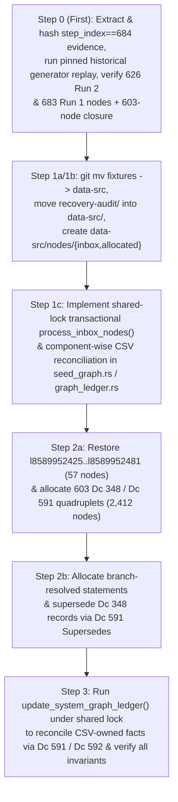

Original problem: Some node IDs were allocated twice by deleting them after assignment and then checking out the pre-assignment state of the graph from Git. This causes those nodes to be ambiguous, which is meant to never happen by making the graph strictly append-only. As that was not enforced in any technical way, it left room for this type of blunder. To prevent this reoccurring, I've added scripts which *should* enforce through technical means that the .ctbnodes files are strictly append-only. Since the .ctbnbdl files are, I believe, generated from the .ctbnodes files, that should also ensure that the union of the active and history .ctbnbdl files should also be append-only going forward. To address the now-ambiguous node IDs as best as possible, I'm looking into how to model this situation precisely in the graph.

Thanks, I think we're back and it's set up now! Great.

Next, let's look at recovering from the duplicated node IDs. So, I *think* the best way to approach this will need a few steps:
1. Come up with a new system for inserting graph nodes that *aren't* derived from the CSVs. I think:
  1a. Rename src/formats/dcdata/fixtures/ to src/formats/dcdata/data-src/.
  1b. Add new folders: src/formats/dcdata/data-src/nodes/{inbox,allocated}.
  1c. Add a build step that looks at all files in the 'inbox' folder, determines their filetype from a list of permitted types (maybe f635 .dcsh right now would be the best pick?), checks if any existing node has the same data and is not self-referential (I think? I want to avoid adding duplicate nodes, but in some cases duplicate nodes are *necessary* for one reason or another, for instance all the ordinary Dc IDs are 0-byte nodes, and if a node has been replaced and then its data needs to be referenced again, I guess it would need to be inserted again - how that should interact with atomic/data nodes, I'm not sure), and if they pass checks, allocates them a new node ID and appends them to the current .ctbnodes file, and moves them into the 'allocated' folder, prefxing their filename with their assigned node ID.
2. For every node ID that was assigned twice:
  2a. Insert new nodes for each body given to each overwritten node. E.g. if 123 was given body of string "abc" and overwritten with "is a, foo, bar" insert four new nodes: a new "abc", a new "is a, foo, bar" node (the latter being an intentional duplicate of 123), a node stating 348 "Ambiguous values" with a [list] of the other two nodes, and a node stating 591 "Supersedes" pointing to the original overwritten node and to the new "Ambiguous values" node, so that the original statement is correctly documented as ambiguous between the two values it was assigned.
  2b. *Somehow* figure out how to *disambiguate which ambiguous node values* were used for each of the above duplicated statements - e.g. if the "is a, foo, bar" referred to a node 234 for "foo" which was one of these ambiguous nodes, we would need to add, I *think*, a subsequent 591 "Supersedes" statement replacing the "is a, foo, bar" with "is a, foo, bar" but with the "foo" reference changed from the now-ambiguous 234 to whatever it was *meant* to point to.
3. Finally, re-run the graph CSV derivation, letting it automatically insert any needed new 591 "Supersedes" and 592 "Retracts" statements to leave the graph coherenent to the intended data.

Does that sound like the correct recovery path? How can we go about this with really careful auditing and precision to make sure it's recovered correctly and doesn't make even more of a mess? I think the source data where you found the original and overwritten graph values should be copied using a checked-in/committed script (*not* regenerating them but scripting what to copy out of the session transcript or wherever you found it using an auditable, committed script), and every step should also be implemented as a script, with all scripts and data committed to Git with every edit and step, so that the full process can be reproduced and audited after the fact.
 [/plan](slashCommand;plan)

# Append-Only Graph Ledger Recovery & Manual Node Allocation Plan

## Goal Description

In session `23f9eaf6-7cd6-416e-8470-852b9878ea88`, two separate graph derivation runs were executed against the commit `3345d2dff` baseline (`17,207` nodes, `l8589934592`..`l8589951798`):
1. **Run 1 (`task-680`, started at `step_index == 679` / finished at `step_index == 687`)**: Appended `683` nodes (`l8589951799`..`l8589952481`, `17,890` total nodes), which included 19 invented file extensions (`57` nodes = `19 × 3`) and an earlier `Dc 573 "Description"` string for `f95` (`Dce`).
2. **Run 2 (`task-693`, started at `step_index == 693` / finished at `step_index == 698`, committed in `a90464028`)**: After resetting `assets/data/graph/`, appended `626` nodes (`l8589951799`..`l8589952424`, `17,833` total nodes), overwriting `l8589951799`..`l8589952424` and erasing `l8589952425`..`l8589952481`.

This plan implements a permanent, auditable, strictly append-only recovery and manual node ingestion pipeline in the following strict order:
1. **Step 0 (Evidence Preservation & Pinned Historical Replay First — Before Any Code Refactoring)**:
   - Extract and hash the exact transcript and Git evidence (`step_index == 684` on physical JSONL line `685` of `transcript_full.jsonl`), run the **unmodified historical generator code** (`a90464028` / `3345d2dff` baseline) to prove 100% token-for-token and comment-for-comment replay exactness against all `626` surviving Run 2 nodes (`l8589951799`..`l8589952424`), deterministically reconstruct the `683` Run 1 nodes (`l8589951799`..`l8589952481`), and verify the transitive dependency-ambiguity closure and classification counts.
2. **Step 1 (Rename `fixtures/` -> `data-src/` & Shared-Lock Resumable Allocator)**:
   - Rename `src/formats/dcdata/fixtures/` to `src/formats/dcdata/data-src/`, move Step 0's audit directory into `src/formats/dcdata/data-src/recovery-audit/`, and add `src/formats/dcdata/data-src/nodes/{inbox,allocated}` with a **shared-lock, resumable, crash-safe** allocator for non-CSV graph nodes in `f635 "Dc shorthand ASCII list"` (`.dcsh`) format.
3. **Step 2 (Restore Erased Tail & Disambiguate Overwritten Node IDs via `nodes/inbox/`)**:
   - **Step 2a**: Restore the `57` erased Run 1 tail nodes (`l8589952425`..`l8589952481`) at their original IDs first, then for each of the `603` dependency-ambiguous IDs (`l8589951802`, `l8589951813`, and `l8589951824`..`l8589952424`), allocate its literal Run 1 candidate `l<r1_raw(N)>`, its literal Run 2 candidate `l<r2_raw(N)>`, a `Dc 348 "Ambiguous values"` list node (`348 310 275 l<r1_raw(N)> 312 l<r2_raw(N)> 311` using `Dc 310 "Begin list (ordered, contiguous, typed)"`, `Dc 275 "Built-in type identifier: * (Object or any subtype)"`, `Dc 312 "List element separator"`, `Dc 311 "End list"`), and a single `Dc 591 "Supersedes"` statement (`591 l<ambig_raw(N)> l<N>`).
   - **Step 2b**: Disambiguate every statement from Run 1 and Run 2 that references any of the `603` ambiguous IDs by allocating branch-resolved replacement statements (`l<r1_resolved(N)>`, `l<r2_resolved(N)>`) linked via `Dc 591 "Supersedes"`, **and** superseding `l<ambig_raw(N)>` with `l<ambig_resolved(N)> = 348 310 275 l<r1_resolved(N)> 312 l<r2_resolved(N)> 311` so the terminal `Dc 348 "Ambiguous values"` record for `l<N>` points directly at the branch-resolved candidates.
4. **Step 3 (CSV-Provenance-Driven Graph Reconciliation)**:
   - Re-run `update_system_graph_ledger` under the shared ledger lock to reconcile active CSV-owned statements against `DesiredGraphState` using `Dc 591 "Supersedes"` and `Dc 592 "Retracts"` while preserving shared statement IDs (such as `f95`'s shared `Dc 584 "Has a"` node `l8589951812`).

---

## Confirmed Design Decisions & Reviewer Fixes (Rounds 1, 2, & 3)

1. **Step 0 Executed First with Pinned Historical Generator (Fixes R1-F3 & R2-F6)**:
   - Step 0 runs **before** any `fixtures -> data-src` rename or `seed_graph.rs` / `graph_ledger.rs` modifications so historical replay uses the exact unmodified generator logic from `a90464028` / `3345d2dff` (recording the exact Git commit SHA and SHA-256 digests of `seed_graph.rs`, `graph_ledger.rs`, `transcript_full.jsonl`, and all input CSVs in `provenance_manifest.json`).
   - Step 0 queries `transcript_full.jsonl` by JSON field `step_index == 684` (physical line `685`, 1-indexed), proves generator replay exactness token-for-token and comment-for-comment against all `626` surviving Run 2 nodes (`l8589951799`..`l8589952424`), reconstructs the `683` Run 1 nodes (`l8589951799`..`l8589952481`), and verifies all classification counts (`23` unambiguous, `603` ambiguous, `57` erased tail) as explicit assertions rather than unverified assumptions.

2. **Full Dependency-Ambiguity Closure (`603` Ambiguous IDs vs. `23` Unambiguous IDs — Fixes R1-F1)**:
   - A node `l<N>` in `l8589951799`..`l8589952424` is in the ambiguity closure if either (a) `run1.tokens != run2.tokens` (`602` nodes: `l8589951802` and `l8589951824`..`l8589952424`) or (b) its Run 1 or Run 2 tokens transitively reference an ambiguous node (`1` additional node: `l8589951813 = 610 l8589951812 l8589951802`, whose target `l8589951802` had two different meanings).
   - Every node in the `603`-node closure receives a `Dc 348 "Ambiguous values"` record and a single `Dc 591 "Supersedes"` statement (`591 l<ambig_raw(N)> l<N>`).
   - We enforce a hard ledger invariant that no two active `Dc 591 "Supersedes"` statements may target the same `old_id`, and no `Dc 591 "Supersedes"` statement may self-supersede (`new_id == old_id`) or form a cycle.

3. **Explicit Multi-Target `# @allow-duplicate-of` Authorization (Fixes R1-Q3 & R3-F3)**:
   - Duplicate checking is **never** globally disabled. By default, `process_inbox_nodes` rejects any non-empty inbox node whose token sequence matches one or more currently active (`!inactive_ids.contains(&id)`) nodes (excluding `586 615 <class_dc>` seed entity declarations using `Dc 586 "Is an instance of"` and `Dc 615 "Enclosing document"`).
   - Prevalidation maintains a dynamic index `active_nodes_by_tokens: HashMap<Vec<DcShorthand>, BTreeSet<u128>>` of all currently active node IDs for each token sequence, removing `old_id` immediately when a `Dc 591 "Supersedes"` (`591 <new> l<old_id>`) or `Dc 592 "Retracts"` (`592 615 l<old_id>`) node is processed in the batch.
   - A `.dcsh` file may include `# @allow-duplicate-of: l<id1>[, l<id2>, ...]` specifying a comma-separated list of active node IDs (`BTreeSet<u128>`). When `active_matches = active_nodes_by_tokens.get(&tokens)` is non-empty:
     - Prevalidation requires `declared_allowed_ids == *active_matches` (**exact set equality**: every currently active node with those tokens must be explicitly listed, and no non-matching or inactive ID may be listed).
     - In Step 2a, when allocating `l<r1_raw(N)>` and `l<r2_raw(N)>` (prior to `l<sup_raw(N)> = 591 l<ambig_raw(N)> l<N>` marking `l<N>` inactive):
       - Any candidate whose tokens match one or more currently active nodes (for example, `l<r2_raw(N)>` duplicating `l<N>` and any earlier still-active `l<r1_raw(M)>` with identical shifted tokens; or for `N = 8589951813`, `l<r1_raw(8589951813)>` declaring `# @allow-duplicate-of: l8589951813` and `l<r2_raw(8589951813)>` declaring `# @allow-duplicate-of: l8589951813, l<r1_raw(8589951813)>`) explicitly lists that exact active set in `# @allow-duplicate-of`.

4. **Shared Exclusive Lock Across All Ledger Writers (Fixes R1-F2 & R2-F1)**:
   - Every code path that writes to `assets/data/graph/*.ctbnodes` or `assets/data/graph/**/*.ctbnbdl` — both `process_inbox_nodes` and `update_system_graph_ledger` — must acquire the **same** exclusive advisory file lock (`flock` on `src/formats/dcdata/data-src/nodes/.ledger-writer.lock`) **before** reading the ledger from disk, and hold that lock until `.ctbnodes` appends, shadow-ledger syncs (`.git/ctb-graph-ledger-highwater` and `/root/.gemini/ctb-graph-ledger-highwater`), `.ctbnbdl` compilations, and journal updates are finished.
   - Under this lock, `update_system_graph_ledger` (and ordinary `validate_tables`) refuses to proceed if `nodes/inbox/` contains any non-dotfile entries **or** if `allocation-journal.jsonl` contains an unfinished `BATCH_PENDING` transaction.

5. **Resumable Preconditions, Complete Crash-State Journal, & Torn-Record Recovery (Fixes R2-F2, R2-F3, R3-F1, & R3-F2)**:
   - **Journal Format & Checksum Integrity (`nodes/allocated/allocation-journal.jsonl`)**:
     - Each line in `allocation-journal.jsonl` is a single JSON object (`BATCH_PENDING` or `BATCH_COMMITTED`) containing a `record_sha256` checksum over its canonical fields and terminated by `\n`.
     - **Complete-Record Corruption Rule**: Every complete line (terminated by `\n`) in `allocation-journal.jsonl` must parse as valid JSON and match its `record_sha256`. Any checksum mismatch or invalid JSON in a `\n`-terminated line (whether non-final or final) is treated as **hard journal corruption** and aborts immediately without modifying any files.
     - **Torn Trailing Line Classification (Unterminated Final Line Only)**:
       Only a final line **lacking a terminating `\n`** is treated as an interrupted journal write, with two distinct cases based on the preceding complete records:
       1. **Torn trailing `BATCH_PENDING` line** (the last complete `\n`-terminated record is `BATCH_COMMITTED`, or there are 0 complete records):
          - Because `BATCH_PENDING` is written and `fsync`ed before any `.ctbnodes` or file-move mutation begins, verify that the on-disk `.ctbnodes` ledger matches the last `BATCH_COMMITTED` state (or clean baseline) and that no `nodes/inbox/` files were moved. If the ledger was mutated without an intact `BATCH_PENDING`, abort with a corruption error. Otherwise, repair `allocation-journal.jsonl` by removing the unterminated trailing bytes back to the last `\n` and `fsync`ing `allocation-journal.jsonl`.
       2. **Torn trailing `BATCH_COMMITTED` line** (the last complete `\n`-terminated record is an intact, checksum-verified `BATCH_PENDING` record, followed by an unterminated trailing line):
          - A crash occurred while writing `BATCH_COMMITTED` after item processing had begun or finished. Repair `allocation-journal.jsonl` by removing the unterminated trailing bytes back to the end of the intact `BATCH_PENDING` line (`fsync`), and then proceed directly into the standard `BATCH_PENDING` resume flow below (which verifies that all items are durably appended, shadow-synced, and moved, verify `final_ledger_sha256`, and then writes a complete checksummed `BATCH_COMMITTED` line + `\n` and `fsync`).
   - **Resumable Precondition Verification**:
     - When no active `BATCH_PENDING` exists, `--expected-last-id` and `--expected-ledger-sha256` are checked directly against the current on-disk ledger.
     - When resuming an intact `BATCH_PENDING` transaction (`final_last_id` and `final_ledger_sha256` precomputed in `BATCH_PENDING`), `--expected-last-id` and `--expected-ledger-sha256` are checked against `BATCH_PENDING.baseline_last_id` and `BATCH_PENDING.baseline_ledger_sha256`, and the current on-disk ledger is verified to equal the exact `baseline_ledger_sha256` prefix (`<= baseline_last_id`) followed by an **exact verified byte prefix** of `BATCH_PENDING.items` (rejecting any unrelated or diverged edits).
     - `--dry-run` is **strictly read-only** in all states (including when a `BATCH_PENDING` or torn record exists): it reports the planned recovery/allocation actions without mutating `.ctbnodes`, shadow ledgers, `nodes/inbox/`, `nodes/allocated/`, or `allocation-journal.jsonl`.
   - **Per-Item Execution Loop Followed by Single Batch Commit (Fixes R3-F1)**:
     1. **Phase 1 — Per-item loop**: For each `item` in `BATCH_PENDING.items` (in order):
        - **Step 1a (Primary `.ctbnodes` chunk)**:
          - If `item.ctbnodes_line` is already completely present at its expected line in `target_chunk_file`, verify byte-for-byte equality and skip appending.
          - If a **partial trailing line** is present at the end of `target_chunk_file`, verify that those trailing bytes are a strict prefix of `item.ctbnodes_line`, append **only the remaining suffix bytes** via `O_WRONLY | O_APPEND` (never truncating!), and `fsync` the chunk file. (If the trailing bytes are not a prefix of `item.ctbnodes_line`, abort with a corruption error.)
          - If not yet present, append `item.ctbnodes_line` via `O_WRONLY | O_APPEND` and `fsync` the chunk file (and parent directory if newly created).
        - **Step 1b (Shadow high-water ledgers)**:
          - Apply the exact same idempotent prefix/suffix completion + `fsync` to `.git/ctb-graph-ledger-highwater/<chunk>` and `/root/.gemini/ctb-graph-ledger-highwater/<chunk>`.
        - **Step 1c (Inbox -> Allocated file move)**:
          - If `inbox` exists and `allocated` does not: verify `sha256(inbox) == item.inbox_sha256`, `fs::rename(inbox, allocated)`, and `fsync` both `nodes/inbox/` and `nodes/allocated/` directories.
          - If `inbox` does not exist and `allocated` already exists (crash occurred after `rename` for this item): verify `sha256(allocated) == item.inbox_sha256` and treat this item's move as complete.
          - If both exist with matching `item.inbox_sha256`: remove `inbox` and `fsync` `nodes/inbox/`.
     2. **Phase 2 — Whole-batch verification & single `BATCH_COMMITTED` write (outside the per-item loop)**:
        - After **all** items in `BATCH_PENDING.items` have completed Steps 1a–1c, verify that the on-disk `.ctbnodes` ledger's last node ID equals `BATCH_PENDING.final_last_id` and its SHA-256 equals `BATCH_PENDING.final_ledger_sha256`, and that every item's `allocated` file exists in `nodes/allocated/`.
        - Write **one** `BATCH_COMMITTED` record (with `batch_id`, `final_last_id`, `final_ledger_sha256`, and `record_sha256`) + `\n` to `allocation-journal.jsonl` and `fsync` `allocation-journal.jsonl`.

6. **Branch-Resolved Ambiguity Lists in Step 2b (Fixes R1-F4)**:
   - Whenever `l<r1_raw(N)>` or `l<r2_raw(N)>` references any of the `603` ambiguous IDs and is superseded in Step 2b by `l<r1_resolved(N)>` or `l<r2_resolved(N)>`, Step 2b also allocates `l<ambig_resolved(N)> = 348 310 275 l<r1_resolved(N)> 312 l<r2_resolved(N)> 311` (`Dc 348 "Ambiguous values"`) and supersedes `l<ambig_raw(N)>` via `591 l<ambig_resolved(N)> l<ambig_raw(N)>` (`Dc 591 "Supersedes"`).

7. **Component-Wise CSV Reconciliation Preserving Shared Statement IDs (Fixes R1-F5 & R2-F4)**:
   - For `f95` (`Dce`), the `Dc 584 "Has a"` node `l8589951812` (`584 f95 573`, property `Dc 573 "Description"`) is one of the `23` preserved unambiguous nodes shared by both Run 1 and Run 2! Only its attached `Dc 610 "Has value"` statement `l8589951813` (`610 l8589951812 l8589951802`) was ambiguous (`l<r1_resolved(8589951813)>` vs. `l<r2_resolved(8589951813)>`, both pointing to `l8589951812`).
   - Therefore, `SeedGraphIndex` will index **all** active `Dc 610 "Has value"` statements (`all_active_has_val_by_stmt: BTreeMap<u128, Vec<(u128, DcShorthand)>>`) and all active `Dc 570 "Preferred"` qualifiers per `has_a_id`, and track all active property groups `(has_a_id, has_val_id, val_tok, pref_id)` per `(subj, prop)`.
   - In Step 3, when `LedgerBuilder::apply_desired_state` reconciles a canonical CSV-matching property group `(canon_has_a_id, canon_has_val_id, canon_pref_id)` against another active group `(other_has_a_id, other_has_val_id, other_pref_id)` for the same CSV-owned property:
     - **Preserve shared `has_a_id`**: Only emit `591 l<canon_has_a_id> l<other_has_a_id>` (`Dc 591 "Supersedes"`) if `canon_has_a_id != other_has_a_id`. When `canon_has_a_id == other_has_a_id` (as for `l8589951812`), `l8589951812` is preserved untouched!
     - **Supersede distinct `has_val_id`**: Emit `591 l<canon_has_val_id> l<other_has_val_id>` (`Dc 591 "Supersedes"`) when `canon_has_val_id != other_has_val_id`.
     - **Reconcile `pref_id`**: If `other_pref_id == Some(op)`, supersede with `canon_pref_id` if present and distinct (`cp != op`), or retract via `592 615 l<op>` (`Dc 592 "Retracts"`) if `canon_pref_id.is_none()`.

8. **Explicit Distinction Between Ledger-Effective Activity and Runtime-Bundle Membership (Fixes R1-F6, R2-F5, & R3-F4)**:
   - Among the `23` preserved unambiguous nodes (`l8589951799`..`l8589951801`, `l8589951803`..`l8589951812`, `l8589951814`..`l8589951823`), `l8589951819` (`591 l8589951818 l8589941912`) is a `Dc 591 "Supersedes"` revision statement superseding `l8589941912` with `l8589951818`.
   - Per [`partition_active_and_inactive_nodes_with`](file:///workspaces/ctoolbox/src/build_support/ctbnbdl.rs#L1029-L1051), all `Dc 591 "Supersedes"` and `Dc 592 "Retracts"` revision statements are placed in the historical archive bundle (`assets/data/graph/system/85899_34942.ctbnbdl`), while their revision effect remains active in the full ledger (`!full_index.inactive_ids.contains(&8589951819)`).
   - Our verification tests explicitly distinguish:
     1. **Ledger-effective (`!full_index.inactive_ids.contains(&id)`)**: Holds for all `23` preserved unambiguous nodes (including `l8589951819`), with `l8589951819` continuing to supersede `l8589941912` with `l8589951818`.
     2. **Runtime-bundle membership (`assets/data/graph/85899_34592.ctbnbdl`)**: Contains the `22` non-revision unambiguous nodes (`l8589951799`..`l8589951801`, `l8589951803`..`l8589951812`, `l8589951814`..`l8589951818`, `l8589951820`..`l8589951823`), while `l8589951819` resides in `assets/data/graph/system/85899_34942.ctbnbdl`.

---

## Proposed Execution Sequence

---

### Step 0 (Executed First): Pinned Forensic Extraction & Historical Replay Verification

#### [NEW] `scripts/graph-recovery/step0_extract_transcript_data.py`
- Runs **before** any modifications to `src/formats/dcdata/` so that replay uses the exact historical generator code from commit `a90464028` / `3345d2dff`:
  1. Verifies and records the current Git commit SHA and the SHA-256 digests of `src/formats/dcdata/seed_graph.rs`, `src/formats/dcdata/graph_ledger.rs`, `/root/.gemini/antigravity/brain/23f9eaf6-7cd6-416e-8470-852b9878ea88/.system_generated/logs/transcript_full.jsonl`, and every CSV file in `src/formats/dcdata/fixtures/` at `3345d2dff` and `a90464028`.
  2. Queries `transcript_full.jsonl` by JSON field `step_index`:
     - `step_index == 679` (physical line `680`): Run 1 command invocation.
     - `step_index == 684` (physical line `685`): `edit_file` on `document.csv` with `Target` (Run 1 slice) and `Replacement` (Run 2 slice).
     - `step_index == 687` (physical line `688`): `task-680` output (`17890 total nodes (683 appended, 1 superseded, 0 retracted, 7 chunk files updated)`).
     - `step_index == 698` (physical line `699`): `task-693` output (`17833 total nodes (626 appended, 1 superseded, 0 retracted, 7 chunk files updated)`).
  3. Verifies via `git diff 3345d2dff..a90464028` that `document.csv` was the **only** modified input CSV table in `src/formats/dcdata/fixtures/`, and that substituting `step_index == 684`'s `Target` for `Replacement` in `a90464028`'s `document.csv` produces the exact Run 1 `document.csv`.
  4. Runs the pinned historical `update_ledger_in_memory` against `(commit 3345d2dff 17,207-node baseline + Run 2 document.csv)` and asserts **100% token-for-token and comment-for-comment equality** with all `626` surviving Run 2 nodes (`l8589951799`..`l8589952424`).
  5. Runs the pinned historical `update_ledger_in_memory` against `(commit 3345d2dff 17,207-node baseline + Run 1 document.csv)` to reconstruct the `683` Run 1 nodes (`l8589951799`..`l8589952481`) and asserts the exact `step_index == 687` summary metrics (`17,890 total / 683 appended / 1 superseded / 0 retracted`).
  6. Computes the transitive dependency-ambiguity closure over `l8589951799`..`l8589952424`, asserting `23` unambiguous nodes (`l8589951799`..`l8589951801`, `l8589951803`..`l8589951812`, `l8589951814`..`l8589951823`), `603` ambiguous nodes (`l8589951802`, `l8589951813`, `l8589951824`..`l8589952424`), and `57` erased tail nodes (`l8589952425`..`l8589952481`).
  7. Writes `provenance_manifest.json`, `run1_document_csv_slice.csv`, `run2_document_csv_slice.csv`, `run1_reconstructed_nodes_8589951799_8589952481.ctbnodes`, `run2_surviving_nodes_8589951799_8589952424.ctbnodes`, and `collision_manifest.json`, and commits Step 0.

---

### Component 1: Rename `fixtures/` to `data-src/` & Shared-Lock Transactional Pipeline (`Steps 1a–1c`)

#### [MODIFY] `src/formats/dcdata/fixtures/` -> `src/formats/dcdata/data-src/` (`Steps 1a & 1b`)
- Move via `git mv src/formats/dcdata/fixtures src/formats/dcdata/data-src` (including `recovery-audit/`).
- Create `src/formats/dcdata/data-src/nodes/inbox/.keep` and `src/formats/dcdata/data-src/nodes/allocated/.keep`.
- Update all `src/formats/dcdata/fixtures` paths to `src/formats/dcdata/data-src` across [dcdata.rs](file:///workspaces/ctoolbox/src/formats/dcdata/dcdata.rs), [graph_ledger.rs](file:///workspaces/ctoolbox/src/formats/dcdata/graph_ledger.rs), [updater.rs](file:///workspaces/ctoolbox/src/formats/dcdata/updater.rs), [validation.rs](file:///workspaces/ctoolbox/src/formats/dcdata/validation.rs), [format.rs](file:///workspaces/ctoolbox/src/formats/dcdata/format.rs), [syntax.rs](file:///workspaces/ctoolbox/src/formats/dcdata/syntax.rs), and [modify-columns.py](file:///workspaces/ctoolbox/scripts/modify-columns.py), and commit Steps 1a & 1b.

#### [MODIFY] [graph_ledger.rs](file:///workspaces/ctoolbox/src/formats/dcdata/graph_ledger.rs), [seed_graph.rs](file:///workspaces/ctoolbox/src/formats/dcdata/seed_graph.rs), & [validate_tables.rs](file:///workspaces/ctoolbox/src/formats/dcdata/bin/validate_tables.rs) (`Step 1c`)
1. **Shared Exclusive Ledger Writer Lock (`acquire_ledger_writer_lock`)**:
   - Acquires `flock(LOCK_EX)` on `src/formats/dcdata/data-src/nodes/.ledger-writer.lock`.
   - Used by **both** `process_inbox_nodes` and `update_system_graph_ledger` prior to reading `assets/data/graph/*.ctbnodes`, and held until all `.ctbnodes` writes, shadow-ledger syncs, `.ctbnbdl` bundle compilations, and journal commits finish.
2. **Resumable Crash-Safe Inbox Allocator (`process_inbox_nodes`)**:
   - Invoked explicitly via `validate_tables --process-inbox [--expected-last-id l<id>] [--expected-ledger-sha256 <hex>] [--dry-run]`.
   - Implements the `BATCH_PENDING` / `BATCH_COMMITTED` journal protocol in `src/formats/dcdata/data-src/nodes/allocated/allocation-journal.jsonl` with:
     - `record_sha256` checksum verification on all `\n`-terminated records (treating any complete record with bad JSON or mismatched `record_sha256` as hard corruption);
     - torn-record recovery for unterminated trailing `BATCH_PENDING` (verified against unmutated baseline) and unterminated trailing `BATCH_COMMITTED` (verified via the preceding intact `BATCH_PENDING` record and completed on-disk items);
     - dynamic `active_nodes_by_tokens: HashMap<Vec<DcShorthand>, BTreeSet<u128>>` tracking with exact-set `# @allow-duplicate-of: l<id1>[, l<id2>, ...]` validation;
     - resumable baseline + verified output-prefix checking for `--expected-last-id` and `--expected-ledger-sha256`;
     - strictly read-only `--dry-run` simulation in all states;
     - per-item durable primary `.ctbnodes` suffix/line append, shadow-ledger sync, and `rename` loop, followed **outside the per-item loop** by whole-batch `final_last_id` / `final_ledger_sha256` verification and a single `BATCH_COMMITTED` record + `fsync`.
3. **Active Value Node Indexing & Component-Wise CSV Reconciliation**:
   - In [`SeedGraphIndex::from_nodes_with_single_props`](file:///workspaces/ctoolbox/src/formats/dcdata/seed_graph.rs#L442-L459):
     - Skip `inactive_ids` when populating `value_node_by_tokens`.
     - Track all active `Dc 610 "Has value"` statements (`all_active_has_val_by_stmt`) and `Dc 570 "Preferred"` qualifiers per `has_a_id`, and expose `find_duplicate_or_conflicting_active_statements()` and `get_ambiguous_candidates(id)`.
   - In [`LedgerBuilder::apply_desired_state`](file:///workspaces/ctoolbox/src/formats/dcdata/graph_ledger.rs#L1180-L1520):
     - Reconcile active CSV-owned property groups `(has_a_id, has_val_id, pref_id)` component-wise against `DesiredGraphState`, preserving shared statement IDs (such as `f95`'s `has_a_id = l8589951812`) while superseding distinct `has_val_id` / `has_a_id` / `pref_id` components via `Dc 591 "Supersedes"`, retracting absent Run 1 statements via `Dc 592 "Retracts"`, and forbidding self-supersession (`new_id == old_id`) and cycles.

---

### Component 2: Step-by-Step Recovery Scripts (`Steps 2a, 2b, 3`)

#### [NEW] `scripts/graph-recovery/step2a_stage_ambiguous_nodes.py`
- Reads `src/formats/dcdata/data-src/recovery-audit/collision_manifest.json` and stages `.dcsh` files into `src/formats/dcdata/data-src/nodes/inbox/`:
  1. **Tail restoration (`l8589952425`..`l8589952481`, `57` nodes)**: Restores the `57` erased Run 1 tail nodes at `l8589952425`..`l8589952481` (including `# @allow-duplicate-of: l<active_ids>` for any tail node whose tokens match a still-active shifted node in `l8589951824`..`l8589952424`).
  2. **Ambiguous node quadruplets (`603` IDs: `l8589951802`, `l8589951813`, `l8589951824`..`l8589952424` × 4 nodes = `2,412` nodes at `l8589952482`..`l8589954893`)**:
     For each ambiguous node `l<N>`:
     - `l<r1_raw(N)>`: literal Run 1 token body of `l<N>` (with `# @allow-duplicate-of: <exact active matching IDs>` whenever its tokens match currently active nodes, e.g. `# @allow-duplicate-of: l8589951813` for `N = 8589951813`)
     - `l<r2_raw(N)>`: literal Run 2 token body of `l<N>` (with `# @allow-duplicate-of: <exact active matching IDs>`, e.g. `l<N>` plus any active `l<r1_raw(M)>` with identical tokens, such as `# @allow-duplicate-of: l8589951813, l<r1_raw(8589951813)>` for `N = 8589951813`)
     - `l<ambig_raw(N)>`: `348 310 275 l<r1_raw(N)> 312 l<r2_raw(N)> 311` (`Dc 348 "Ambiguous values"`)
     - `l<sup_raw(N)>`: `591 l<ambig_raw(N)> l<N>` (`Dc 591 "Supersedes"`, which immediately marks `l<N>` inactive in `active_nodes_by_tokens`)
- Runs `validate_tables --process-inbox --expected-last-id l8589952424 --dry-run` first, then executes the allocation and commits Step 2a.

#### [NEW] `scripts/graph-recovery/step2b_stage_disambiguations.py`
- In ascending topological order of original node ID `N`:
  - For each of the `603` ambiguous IDs `N`:
    - If `l<r1_raw(N)>` references any of the `603` ambiguous IDs `l<X>`, stages `l<r1_resolved(N)>` (rewriting `l<X> -> l<r1_resolved(X)>`, with `# @allow-duplicate-of` if its resolved tokens match an already-active node) and `591 l<r1_resolved(N)> l<r1_raw(N)>` (`Dc 591 "Supersedes"`). Otherwise `l<r1_resolved(N)> = l<r1_raw(N)>`.
    - If `l<r2_raw(N)>` references any of the `603` ambiguous IDs `l<X>`, stages `l<r2_resolved(N)>` (rewriting `l<X> -> l<r2_resolved(X)>`, with `# @allow-duplicate-of` if its resolved tokens match an already-active node) and `591 l<r2_resolved(N)> l<r2_raw(N)>` (`Dc 591 "Supersedes"`). Otherwise `l<r2_resolved(N)> = l<r2_raw(N)>`.
    - Whenever `l<r1_resolved(N)> != l<r1_raw(N)>` or `l<r2_resolved(N)> != l<r2_raw(N)>`, stages `l<ambig_resolved(N)> = 348 310 275 l<r1_resolved(N)> 312 l<r2_resolved(N)> 311` (`Dc 348 "Ambiguous values"`) and `591 l<ambig_resolved(N)> l<ambig_raw(N)>` (`Dc 591 "Supersedes"`).
  - For each restored Run 1 tail node `N` in `l8589952425`..`l8589952481` that references any of the `603` ambiguous IDs `l<X>`:
    - Stages `l<r1_resolved(N)>` (rewriting `l<X> -> l<r1_resolved(X)>`) and `591 l<r1_resolved(N)> l<N>` (`Dc 591 "Supersedes"`).
- Runs `validate_tables --process-inbox --expected-last-id l8589954893 --dry-run` first, then executes the allocation and commits Step 2b.

#### [NEW] `scripts/graph-recovery/step3_reconcile_csv_graph.sh`
- Runs `./scripts/validate-data-tables` (`update_system_graph_ledger`), which acquires the shared ledger lock, reconciles all active CSV-owned statement groups component-wise against `DesiredGraphState` via `Dc 591 "Supersedes"` and `Dc 592 "Retracts"`, and compiles `assets/data/graph/85899_34592.ctbnbdl` and `assets/data/graph/system/85899_34942.ctbnbdl`.
- Runs `./scripts/validate-data-tables` a second time to verify `0` nodes are appended, then commits Step 3.

---

## Verification Plan

### Automated Invariant & Fault-Injection Tests
1. **Allocator Transactional & Fault-Injection Tests (`cargo test -p ctb-formats-dcdata --lib graph_ledger`)**:
   - **Whole-batch prevalidation failure**: Verify syntax error, self-reference, forward reference, unpermitted active duplicate, incomplete `# @allow-duplicate-of` set (e.g. omitting one of two active matching IDs), self-supersession (`591 l<a> l<a>`), supersession cycle, or duplicate `Dc 591 "Supersedes"` target aborts before writing `BATCH_PENDING` or touching `.ctbnodes`.
   - **Fault-injection across all crash boundaries**:
     1. Torn trailing `BATCH_PENDING` line (unterminated line before ledger mutation) -> repaired cleanly on retry; complete (`\n`-terminated) record with bad `record_sha256` -> rejected as hard corruption error.
     2. Partial `.ctbnodes` line (interrupted mid-line write) -> resumed retry verifies prefix and appends only the remaining suffix bytes via `O_APPEND` without truncating, using the original `--expected-last-id` and `--expected-ledger-sha256`.
     3. **Multi-item batch interruption**: In a 3-item batch, simulate a crash after item 1 completes its `.ctbnodes` append, shadow sync, and `rename` to `nodes/allocated/`, before item 2 is written -> verify `BATCH_COMMITTED` was **not** written yet, and resuming completes items 2 and 3 without re-allocating item 1, then writes `BATCH_COMMITTED`.
     4. **Torn trailing `BATCH_COMMITTED` line**: After all items in `BATCH_PENDING` are appended, shadow-synced, and moved to `nodes/allocated/`, append an unterminated prefix of `BATCH_COMMITTED` -> verify resume validates the preceding intact `BATCH_PENDING` record and completed on-disk items, repairs the torn suffix, and writes the complete checksummed `BATCH_COMMITTED` record.
     5. `--dry-run` during `BATCH_PENDING` or torn journal state -> verifies zero files are mutated.
   - **Shared lock & pending-transaction guard**: Verify `update_system_graph_ledger` acquires `.ledger-writer.lock` and refuses to proceed if `nodes/inbox/` is non-empty or `BATCH_PENDING` is uncommitted.
2. **Recovery & Live vs. Historical Graph Invariant Tests (`cargo test -p ctb-formats-dcdata --lib seed_graph`)**:
   - **Unchanged Prefix Invariant**: `l8589934592`..`l8589952424` (`17,833` nodes) match commit `a90464028` byte-for-byte.
   - **Exact Tail Restoration Invariant**: `l8589952425`..`l8589952481` (`57` nodes) match the reconstructed Run 1 tail nodes token-for-token.
   - **Preserved Unambiguous Nodes (`23` nodes)**:
     - All `23` nodes (`l8589951799`..`l8589951801`, `l8589951803`..`l8589951812`, `l8589951814`..`l8589951823`) remain **ledger-effective** (`!full_index.inactive_ids.contains(&id)`), including `f95`'s shared `Dc 584 "Has a"` node `l8589951812` and the revision statement `l8589951819` (`591 l8589951818 l8589941912`).
     - The `22` non-revision unambiguous nodes are present in the runtime bundle (`assets/data/graph/85899_34592.ctbnbdl`), while the revision statement `l8589951819` is present in the history bundle (`assets/data/graph/system/85899_34942.ctbnbdl`) with its supersession of `l8589941912` by `l8589951818` active.
   - **Complete `603`-Node Ambiguity Closure Invariant**:
     - Every node in the `603`-node ambiguity closure (`l8589951802`, `l8589951813`, `l8589951824`..`l8589952424`) resolves via `get_ambiguous_candidates(id)` to a terminal `Dc 348 "Ambiguous values"` list of 2 branch-resolved candidates `[l<r1_resolved(N)>, l<r2_resolved(N)>]`, neither of which references any of the `603` ambiguous IDs.
   - **Live Runtime Bundle Purity & Uniqueness Invariant**:
     - Zero nodes from the `603`-node ambiguous set are present in `assets/data/graph/85899_34592.ctbnbdl` or referenced by any node in `assets/data/graph/85899_34592.ctbnbdl`.
     - `find_duplicate_or_conflicting_active_statements()` returns empty (strictly 1 active statement group per CSV fact, zero duplicate `Dc 610 "Has value"` statements on `l8589951812` or any other `has_a_id`, zero duplicate `Dc 591 "Supersedes"` targets).
     - `reconstruct_dc_defns()` and `reconstruct_format_defns()` round-trip the CSV dataset with zero drift.
   - **Active + History Union & Idempotency Invariant**:
     - `assets/data/graph/85899_34592.ctbnbdl` and `assets/data/graph/system/85899_34942.ctbnbdl` partition 100% of `.ctbnodes` with zero overlap and identical reconstructed semantic state, and a second `update_system_graph_ledger` run appends `0` nodes.
3. **Repository Lints & Kernel Guard Canary**:
   - `cargo run --manifest-path src/build_support/Cargo.toml --bin ctb-lint -- all --quick`
   - `./scripts/lock-graph-append-only --test-canary`

Question 1: If those 23 were unambiguous, it sounds fine to leave them as-is even if they were deleted and recreeated in a bit-for-bit-, meaning-for-meaning-identical way.
Question 2: It sounds like those 57 nodes should be restored to their original definitions, yes.
Question 3: I think that sounds good.
