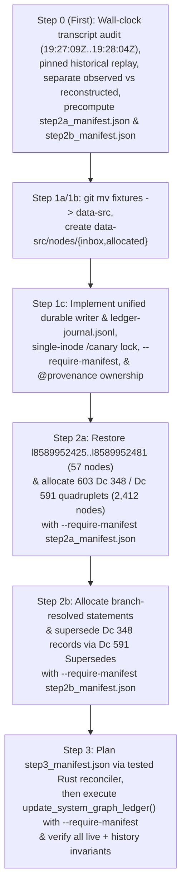

Original problem: Some node IDs were allocated twice by deleting them after assignment and then checking out the pre-assignment state of the graph from Git. This causes those nodes to be ambiguous, which is meant to never happen by making the graph strictly append-only. As that was not enforced in any technical way, it left room for this type of blunder. To prevent this reoccurring, I've added scripts which *should* enforce through technical means that the .ctbnodes files are strictly append-only. Since the .ctbnbdl files are, I believe, generated from the .ctbnodes files, that should also ensure that the union of the active and history .ctbnbdl files should also be append-only going forward. To address the now-ambiguous node IDs as best as possible, I'm looking into how to model this situation precisely in the graph.

Thanks, I think we're back and it's set up now! Great.

Next, let's look at recovering from the duplicated node IDs. So, I *think* the best way to approach this will need a few steps:
1. Come up with a new system for inserting graph nodes that *aren't* derived from the CSVs. I think:
  1a. Rename src/formats/dcdata/fixtures/ to src/formats/dcdata/data-src/.
  1b. Add new folders: src/formats/dcdata/data-src/nodes/{inbox,allocated}.
  1c. Add a build step that looks at all files in the 'inbox' folder, determines their filetype from a list of permitted types (maybe f635 .dcsh right now would be the best pick?), checks if any existing node has the same data and is not self-referential (I think? I want to avoid adding duplicate nodes, but in some cases duplicate nodes are *necessary* for one reason or another, for instance all the ordinary Dc IDs are 0-byte nodes, and if a node has been replaced and then its data needs to be referenced again, I guess it would need to be inserted again - how that should interact with atomic/data nodes, I'm not sure), and if they pass checks, allocates them a new node ID and appends them to the current .ctbnodes file, and moves them into the 'allocated' folder, prefxing their filename with their assigned node ID.
2. For every node ID that was assigned twice:
  2a. Insert new nodes for each body given to each overwritten node. E.g. if 123 was given body of string "abc" and overwritten with "is a, foo, bar" insert four new nodes: a new "abc", a new "is a, foo, bar" node (the latter being an intentional duplicate of 123), a node stating 348 "Ambiguous values" with a [list] of the other two nodes, and a node stating 591 "Supersedes" pointing to the original overwritten node and to the new "Ambiguous values" node, so that the original statement is correctly documented as ambiguous between the two values it was assigned.
  2b. *Somehow* figure out how to *disambiguate which ambiguous node values* were used for each of the above duplicated statements - e.g. if the "is a, foo, bar" referred to a node 234 for "foo" which was one of these ambiguous nodes, we would need to add, I *think*, a subsequent 591 "Supersedes" statement replacing the "is a, foo, bar" with "is a, foo, bar" but with the "foo" reference changed from the now-ambiguous 234 to whatever it was *meant* to point to.
3. Finally, re-run the graph CSV derivation, letting it automatically insert any needed new 591 "Supersedes" and 592 "Retracts" statements to leave the graph coherenent to the intended data.

Does that sound like the correct recovery path? How can we go about this with really careful auditing and precision to make sure it's recovered correctly and doesn't make even more of a mess? I think the source data where you found the original and overwritten graph values should be copied using a checked-in/committed script (*not* regenerating them but scripting what to copy out of the session transcript or wherever you found it using an auditable, committed script), and every step should also be implemented as a script, with all scripts and data committed to Git with every edit and step, so that the full process can be reproduced and audited after the fact.
 [/plan](slashCommand;plan)

# Append-Only Graph Ledger Recovery & Manual Node Allocation Plan

## Goal Description

In session `23f9eaf6-7cd6-416e-8470-852b9878ea88`, two separate graph derivation runs were executed against the commit `3345d2dff` baseline (`17,207` nodes, `l8589934592`..`l8589951798`):
1. **Run 1 (`task-680`, launched at `step_index == 679` [`19:27:09Z`] / process exited at `19:28:04Z` [notification queued and delivered at `step_index == 687` at `19:28:48Z`])**: Appended `683` nodes (`l8589951799`..`l8589952481`, `17,890` total nodes), which included 19 invented file extensions (`57` nodes = `19 × 3`) and an earlier `Dc 573 "Description"` string for `f95` (`Dce`).
2. **Run 2 (`task-693`, launched at `step_index == 692` [`19:29:15Z`] / process exited at `19:30:01Z` [notification delivered at `step_index == 698` at `19:30:58Z`], committed in `a90464028`)**: After resetting `assets/data/graph/`, appended `626` nodes (`l8589951799`..`l8589952424`, `17,833` total nodes), overwriting `l8589951799`..`l8589952424` and erasing `l8589952425`..`l8589952481`.

This plan implements a permanent, auditable, strictly append-only recovery and manual node ingestion pipeline in the following strict sequence:
1. **Step 0 (Evidence Preservation, Wall-Clock Mutation-Window Audit, & Precomputed Step 2a/2b Manifests First — Before Any Code Refactoring)**:
   - Audit **every** step (`step_index == 1..699`) and wall-clock execution interval (`Created At`, `Completed At`, `[Message] timestamp`) in `23f9eaf6/transcript_full.jsonl` from commit `3345d2dff` through `a90464028`, verifying that `task-680`'s process execution window (`19:27:09Z`..`19:28:04Z`) finished `39 seconds` before `step_index == 685` modified `document.csv` on disk (`19:28:43Z`..`19:28:46Z`).
   - Strictly separate **directly observed evidence** (`step_index == 684` `Target` and `Replacement` payloads from physical JSONL line `685`, `step_index == 687` & `698` task stdout logs, commit `3345d2dff` git tree, and commit `a90464028` surviving `.ctbnodes` bytes) from **reconstructed Run 1 output** (`reconstructed_run1_nodes_8589951799_8589952481.ctbnodes`), documenting explicitly that because Run 1's `.ctbnodes` files were never read into the transcript before being overwritten, Run 1's node bodies are reconstructed via deterministic replay of the unmodified `a90464028` / `3345d2dff` generator and corroborated by the `19:28:04Z` summary metrics (`17,890 total / 683 appended / 1 superseded / 0 retracted`).
   - Precompute and commit the deterministic manifests for **Step 2a** (`step2a_manifest.json`) and **Step 2b** (`step2b_manifest.json`).
2. **Step 1 (Shared Durable Transactional Ledger Writer, Single-Inode Watcher Lock, & `fixtures/` -> `data-src/` Pipeline)**:
   - Rename `src/formats/dcdata/fixtures/` to `src/formats/dcdata/data-src/` and create `src/formats/dcdata/data-src/nodes/{inbox,allocated}`.
   - Route **all** ledger writers (`process_inbox_nodes` and `update_system_graph_ledger`) through a single shared durable transactional writer (`execute_durable_ledger_transaction`), locking the **single permanent lock inode** `.git/ctb-append-only-canary` (mounted at `/canary` in the watcher container) and writing to the **unified journal** (`src/formats/dcdata/data-src/nodes/allocated/ledger-journal.jsonl`, mounted read-only at `/journal-dir/ledger-journal.jsonl` in the watcher container).
   - Enforce `--require-manifest <path>` **inside `execute_durable_ledger_transaction` under the writer lock before writing `BATCH_PENDING`**.
3. **Step 2 (Restore Erased Tail & Disambiguate Overwritten Node IDs via `nodes/inbox/` with `--require-manifest`)**:
   - **Step 2a**: Stage and allocate the `57` restored Run 1 tail nodes (`l8589952425`..`l8589952481`) + `603` `Dc 348 "Ambiguous values"` / `Dc 591 "Supersedes"` quadruplets (`2,412` nodes at `l8589952482`..`l8589954893`), verified inside the transaction via `--require-manifest step2a_manifest.json`.
   - **Step 2b**: Stage and allocate the branch-resolved statements (`l<r1_resolved(N)>`, `l<r2_resolved(N)>`) + `Dc 591 "Supersedes"` links + updated `Dc 348 "Ambiguous values"` records (`l<ambig_resolved(N)>`), verified inside the transaction via `--require-manifest step2b_manifest.json`.
4. **Step 3 (Generate & Execute Ownership-Scoped CSV Reconciliation Manifest)**:
   - Using the tested Step 1c Rust reconciliation planner (`validate_tables --plan-reconciliation-manifest step3_manifest.json`), generate and review `step3_manifest.json` against the committed Step 2b ledger, then execute `validate_tables --require-manifest step3_manifest.json` under the shared lock to reconcile CSV-owned statements against `DesiredGraphState` via `Dc 591 "Supersedes"` and `Dc 592 "Retracts"`.

---

## Confirmed Design Decisions & Reviewer Fixes (Rounds 1–5)

1. **Step 0 Wall-Clock Execution Window Audit & Explicit Epistemic Boundary (Fixes R1-F3, R2-F6, R4-F1, & R5-F1)**:
   - Step 0 audits both `step_index` and the exact wall-clock timestamps recorded in `23f9eaf6/transcript_full.jsonl`:
     - `step_index == 675..678` (`19:26:43Z`..`19:27:09Z`): Edited `ctoolbox.magic` and `document.csv` prior to launching Run 1.
     - `step_index == 679` (`19:27:09Z`): Launched `./scripts/validate-data-tables` (`task-680`), which backgrounded at `step_index == 680` (`19:27:33Z`).
     - `step_index == 682..683` (`19:27:45Z`..`19:28:01Z`): Ran read-only `grep -rn "\.dce\b\|\.3_0" old/`.
     - **`19:28:04Z` (`task-680` actual process completion)**: As recorded in the `<SYSTEM_MESSAGE>` header `[Message] timestamp=2026-10-31T19:28:04Z sender=23f9eaf6-7cd6-416e-8470-852b9878ea88/task-680` (delivered to the conversation at `step_index == 687` after the model's `step_index == 684..686` turn finished at `19:28:48Z`), `task-680` finished executing at `19:28:04Z`.
     - `step_index == 684..686`: While the planner was generating `step_index == 684` (`19:28:01Z`..`19:28:43Z`), `task-680` exited at `19:28:04Z`. The `edit_file` tool execution on `document.csv` (`step_index == 685`) started at `Created At: 2026-10-31T19:28:43Z` and finished at `Completed At: 2026-10-31T19:28:46Z` — **39 seconds after `task-680` had already completed at `19:28:04Z`**.
   - **Explicit Epistemic Boundary**:
     - Because `task-680` ran in an unmonitored shell without per-syscall file-access tracing and its `.ctbnodes` output was overwritten at `step_index == 688..693` before being read into the transcript, the exact historical `.ctbnodes` bytes of Run 1 were not directly captured in `transcript_full.jsonl`.
     - Instead, Step 0 establishes from the transcript and git history that no tracked or logged mutations occurred during `19:27:09Z`..`19:28:04Z`, proves 100% token-for-token and comment-for-comment generator determinism on the surviving `626` Run 2 nodes (`l8589951799`..`l8589952424`), and labels `reconstructed_run1_nodes_8589951799_8589952481.ctbnodes` explicitly as **deterministic reconstruction corroborated by the `19:28:04Z` task summary metrics (`17,890 total / 683 appended / 1 superseded / 0 retracted / 7 chunk files updated`)**, noting the absence of direct historical `.ctbnodes` byte capture as an explicit, documented boundary.

2. **In-Transaction `--require-manifest` Verification Under Lock & Post-Step-1 Reconciliation Planning (Fixes R5-F2)**:
   - Rather than relying on an external `--dry-run` before execution and a post-hoc hash check afterward, `execute_durable_ledger_transaction` accepts `--require-manifest <manifest.json>` and verifies **inside the transaction, while holding the exclusive writer lock and before writing `BATCH_PENDING`**:
     1. Current on-disk `baseline_last_id` and `baseline_ledger_sha256` equal the manifest's `baseline_last_id` and `baseline_ledger_sha256`.
     2. The SHA-256 digests of all input files (`nodes/inbox/*.dcsh` for inbox runs; all CSV tables and `NodeProvenanceMap` for CSV reconciliation runs) equal the manifest's `pinned_input_sha256s`.
     3. The in-memory planned append items (`node_id`, `target_chunk_file`, `ctbnodes_line`, `provenance`) and `final_ledger_sha256` match the manifest's `planned_items` and `final_ledger_sha256` **byte-for-byte**.
     - If any check fails, the transaction aborts before writing `BATCH_PENDING` or touching `.ctbnodes`.
   - Step 0 precomputes `step2a_manifest.json` and `step2b_manifest.json` (which depend purely on the Run 1 and Run 2 node sets). Step 3's `step3_manifest.json` is generated **after Step 1c and Step 2b** by running the tested Rust reconciliation planner (`validate_tables --plan-reconciliation-manifest src/formats/dcdata/data-src/recovery-audit/step3_manifest.json`), reviewed and committed, and then enforced under the lock via `validate_tables --require-manifest .../step3_manifest.json`.

3. **Single Permanent Lock Inode (`.git/ctb-append-only-canary`) & Explicit Watcher Container Mounts (Fixes R4-F2 & R5-F3)**:
   - **Single Lock Inode (No Fallback Lock Path)**:
     - Both the Rust transactional writer (`execute_durable_ledger_transaction`) and the Python watcher (`lock_pass` in [lock-graph-append-only](file:///workspaces/ctoolbox/scripts/lock-graph-append-only#L77-L91)) acquire `flock(LOCK_EX)` on the **single permanent file** `${REPO_ROOT}/.git/ctb-append-only-canary` (mounted at `/canary` inside the watcher container).
     - `ensure_canary_file` in `scripts/lock-graph-append-only` creates `.git/ctb-append-only-canary` before any container starts, and the Rust writer opens `.git/ctb-append-only-canary` (requiring it to exist or creating that exact path if running in a fresh git checkout) with **zero fallback lock paths**.
     - Because `flock(fd, LOCK_EX)` operates on an `O_RDONLY` file descriptor and is unaffected by `FS_APPEND_FL` (`+a`), both the host/container watcher (`/canary`) and the workspace writer (`.git/ctb-append-only-canary`) lock the exact same kernel inode!
   - **Explicit Helper/Watcher Container Mounts in `scripts/lock-graph-append-only`**:
     - Update `run_host_init()` and `run_unlock()` in [lock-graph-append-only](file:///workspaces/ctoolbox/scripts/lock-graph-append-only#L140-L189) to ensure `${JOURNAL_DIR}` (`${REPO_ROOT}/src/formats/dcdata/data-src/nodes/allocated`) exists and mount `-v "${JOURNAL_DIR}:/journal-dir:ro"` into both the one-shot helper container and the persistent `ctb-graph-append-only-watcher` container, passing `/journal-dir/ledger-journal.jsonl` to `PYTHON_LOCK_SCRIPT`.
     - While holding `flock(LOCK_EX)` on `/canary`, `lock_pass` inspects `/journal-dir/ledger-journal.jsonl` (if present): if the last record in `ledger-journal.jsonl` is not a complete `\n`-terminated `BATCH_COMMITTED` record, `lock_pass` refuses to transition any chunk file to `FS_IMMUTABLE_FL` (`+i`). Furthermore, `lock_pass` only seals a chunk file with `+i` when it contains **100 complete, `\n`-terminated lines matching `^l[0-9]+:( .*)?\n$`** and zero trailing unterminated bytes.

4. **Shared Effective-State Resolver for Dynamic Duplicate Checking (Fixes R1-Q3, R3-F3, & R5-F5)**:
   - Prevalidation in `process_inbox_nodes` never disables duplicate checking and does **not** use a naive remove-only set for `active_nodes_by_tokens`.
   - Instead, prevalidation calls the shared reverse-chronological effective-state resolver (`compute_effective_inactive_ids(&nodes[..current_idx])`, extracted from [`SeedGraphIndex::from_nodes_with_single_props`](file:///workspaces/ctoolbox/src/formats/dcdata/seed_graph.rs#L402-L432)) so that if a revision statement is itself retracted (`592 615 l<rev_id>`), its original target is immediately re-activated in `active_nodes_by_tokens`.
   - In addition, `process_inbox_nodes` rejects any inbox statement that attempts to supersede or retract an earlier `591`/`592` revision statement unless `# @allow-revision-cancellation: l<rev_id>` is explicitly declared.
   - Whenever `active_matches` (the set of currently effective non-empty, non-seed-declaration node IDs with identical tokens) is non-empty, `# @allow-duplicate-of: l<id1>[, l<id2>, ...]` must equal `*active_matches` (**exact set equality**).

5. **Compile-Time Provenance Boundary, Cross-Ownership Protection, & Recovery Revision Ownership (Fixes R1-F5, R2-F4, R4-F5, R5-F4, & R5-Clarification)**:
   - **Compile-Time vs. Runtime Boundary**:
     - Runtime consumers (`SeedGraphIndex::shared()` and `SeedGraphIndex::load_with_history_from_asset_bundle()`) load only the compiled `.ctbnbdl` asset bundles and do **not** read `ledger-journal.jsonl` or `nodes/allocated/*.dcsh`.
     - Provenance metadata (`NodeProvenanceMap: BTreeMap<u128, NodeProvenance>`) is a **compile-time / repository-tool input** passed explicitly into `LedgerBuilder::from_nodes_with_provenance` and `process_inbox_nodes`.
   - **Provenance Categories & Strict Validation**:
     - Every node ID in `assets/data/graph/*.ctbnodes` is mapped to one of 5 provenance variants:
       1. `CsvDerived`: Baseline nodes `l8589934592`..`l8589951798`, the `23` preserved unambiguous nodes (`l8589951799`..`l8589951801`, `l8589951803`..`l8589951812`, `l8589951814`..`l8589951823`), and nodes appended by `update_system_graph_ledger` (`kind: "csv_reconciliation"` in `ledger-journal.jsonl`).
       2. `OverwrittenCollision`: The `603` overwritten ambiguous IDs (`l8589951802`, `l8589951813`, `l8589951824`..`l8589952424`), all of which are superseded by `AmbiguityRecord` nodes in Step 2a.
       3. `CsvRecoveryRun1`: Step 2a/2b Run 1 branch nodes (`l8589952425`..`l8589952481`, `l<r1_raw(N)>`, `l<r1_resolved(N)>`) with `# @provenance: csv-recovery-run1`.
       4. `CsvRecoveryRun2`: Step 2a/2b Run 2 branch nodes (`l<r2_raw(N)>`, `l<r2_resolved(N)>`) with `# @provenance: csv-recovery-run2`.
       5. `AmbiguityRecord`: Step 2a/2b `Dc 348 "Ambiguous values"` list nodes (`l<ambig_raw(N)>`, `l<ambig_resolved(N)>`) **and** all Step 2a/2b `Dc 591 "Supersedes"` revision nodes (`l<sup_raw(N)>`, `591 l<r1_resolved(N)> l<r1_raw(N)>`, `591 l<r2_resolved(N)> l<r2_raw(N)>`, `591 l<ambig_resolved(N)> l<ambig_raw(N)>`) with `# @provenance: ambiguity-record`.
       6. `Manual`: General non-CSV nodes allocated via `nodes/inbox/` with `# @provenance: manual` (the default for `nodes/inbox/` files when `# @provenance` is omitted).
     - **Missing / Conflicting Provenance Validation**:
       - `load_and_validate_node_provenance(repo_root, &nodes)` requires every node ID `>= l8589952425` to have a committed entry in `ledger-journal.jsonl`, and requires every `kind: "inbox_allocation"` journal entry to have a matching `nodes/allocated/<grouped_id>_<name>.dcsh` file whose `# @provenance` header matches the journal entry's provenance. Any missing provenance entry for an ID `>= l8589952425`, unknown provenance tag, or mismatch between `.dcsh` and `ledger-journal.jsonl` fails immediately as a hard validation error.
   - **Cross-Ownership Boundary & Dependency Protection (`R5-F4`)**:
     1. In `process_inbox_nodes`, a `# @provenance: manual` statement is forbidden from attaching a `Dc 610 "Has value"` (`610 l<target> <val>`) or `Dc 570 "Preferred"` (`584 l<target> 570`) statement to a non-`Manual` (`CsvDerived`, `CsvRecoveryRun1`, `CsvRecoveryRun2`) statement `l<target>`, and is forbidden from superseding (`591`) or retracting (`592`) a non-`Manual` node.
     2. In `LedgerBuilder::apply_desired_state`, only CSV-owned active statements (`CsvDerived`, `CsvRecoveryRun1`, `CsvRecoveryRun2`) are reconciled against `DesiredGraphState`; `AmbiguityRecord` and `Manual` nodes are never retracted or superseded.
     3. Furthermore, before retracting or superseding any CSV-owned node `l<csv_id>`, `apply_desired_state` verifies that no active `Manual` node references `l<csv_id>` in its tokens, and verifies that no active `Manual` property statement asserts a single-valued `(subj, prop)` that is also present in `DesiredGraphState`. If either cross-ownership conflict occurs, `apply_desired_state` aborts with an explicit cross-ownership error instead of silently deactivating or shadowing the `Manual` node.

6. **Unified Durable Journal & Complete `fsync` Protocol (Fixes R2-F2, R2-F3, R3-F1, R3-F2, R4-F3, R4-F4, & R4-Medium)**:
   - Both `process_inbox_nodes` and `update_system_graph_ledger` use `execute_durable_ledger_transaction`, locking `.git/ctb-append-only-canary` and journaling to `src/formats/dcdata/data-src/nodes/allocated/ledger-journal.jsonl`.
   - Includes checksum verification on all `\n`-terminated records, torn trailing `BATCH_PENDING` and torn trailing `BATCH_COMMITTED` repair, suffix-only `O_APPEND` completion of partial lines, **unconditional `sync_all()` re-establishment on resume** for all touched primary/shadow chunks, `allocated` files, and directories (`assets/data/graph/`, `nodes/inbox/`, `nodes/allocated/`), atomic `.ctbnbdl` bundle rebuild + `sync_all()`, and a single `BATCH_COMMITTED` write outside the per-item loop.

---

## Proposed Execution Sequence

---

### Step 0 (Executed First): Wall-Clock Audit, Historical Replay, & Precomputed Step 2a/2b Manifests

#### [NEW] `scripts/graph-recovery/step0_extract_transcript_data.py`
- Runs **before** any modifications to `src/formats/dcdata/` or `src/build_support/`:
  1. Audits all steps (`step_index == 1..699`) and wall-clock timestamps (`Created At`, `Completed At`, `[Message] timestamp`) in `/root/.gemini/antigravity/brain/23f9eaf6-7cd6-416e-8470-852b9878ea88/.system_generated/logs/transcript_full.jsonl` and `git diff 3345d2dff..a90464028`, writing `invocation_and_mutation_window_audit.json` documenting:
     - `task-680`'s process execution window (`19:27:09Z`..`19:28:04Z`) completed `39s` before `step_index == 685` edited `document.csv` (`19:28:43Z`..`19:28:46Z`).
     - `task-693`'s process execution window (`19:29:15Z`..`19:30:01Z`) completed `17s` before `step_index == 695` edited `src/formats/dcstring/Cargo.toml` (`19:30:18Z`).
     - The explicit epistemic boundary between **observed transcript/git evidence** and **reconstructed Run 1 `.ctbnodes` output**.
  2. Saves observed evidence (`observed_step684_record.json`, `observed_step687_and_698_logs.json`, `observed_run1_document_csv_slice.csv`, `observed_run2_document_csv_slice.csv`, `observed_run2_nodes_8589951799_8589952424.ctbnodes`).
  3. Replays the unmodified historical generator on `(commit 3345d2dff + Run 2 document.csv)` and asserts 100% token-for-token and comment-for-comment identity with `observed_run2_nodes_8589951799_8589952424.ctbnodes`.
  4. Replays the unmodified historical generator on `(commit 3345d2dff + Run 1 document.csv)` to produce `reconstructed_run1_nodes_8589951799_8589952481.ctbnodes` and verifies the `19:28:04Z` summary metrics (`17,890 total / 683 appended / 1 superseded / 0 retracted / 7 chunk files updated`).
  5. Computes the transitive dependency-ambiguity closure (`23` unambiguous, `603` ambiguous, `57` erased tail) and writes `collision_manifest.json`, `step2a_manifest.json`, and `step2b_manifest.json`.
  6. Commits Step 0.

---

### Component 1: Unified Durable Transactional Writer, Single-Inode Watcher Lock, & `data-src` Pipeline (`Steps 1a–1c`)

#### [MODIFY] `src/formats/dcdata/fixtures/` -> `src/formats/dcdata/data-src/` (`Steps 1a & 1b`)
- Move via `git mv src/formats/dcdata/fixtures src/formats/dcdata/data-src` and create `src/formats/dcdata/data-src/nodes/{inbox,allocated}/.keep`.
- Update `src/formats/dcdata/fixtures` path references to `src/formats/dcdata/data-src` across [dcdata.rs](file:///workspaces/ctoolbox/src/formats/dcdata/dcdata.rs), [graph_ledger.rs](file:///workspaces/ctoolbox/src/formats/dcdata/graph_ledger.rs), [updater.rs](file:///workspaces/ctoolbox/src/formats/dcdata/updater.rs), [validation.rs](file:///workspaces/ctoolbox/src/formats/dcdata/validation.rs), [format.rs](file:///workspaces/ctoolbox/src/formats/dcdata/format.rs), [syntax.rs](file:///workspaces/ctoolbox/src/formats/dcdata/syntax.rs), and [modify-columns.py](file:///workspaces/ctoolbox/scripts/modify-columns.py), and commit Steps 1a & 1b.

#### [MODIFY] [lock-graph-append-only](file:///workspaces/ctoolbox/scripts/lock-graph-append-only), [ctbnbdl.rs](file:///workspaces/ctoolbox/src/build_support/ctbnbdl.rs), [graph_ledger.rs](file:///workspaces/ctoolbox/src/formats/dcdata/graph_ledger.rs), [seed_graph.rs](file:///workspaces/ctoolbox/src/formats/dcdata/seed_graph.rs), & [validate_tables.rs](file:///workspaces/ctoolbox/src/formats/dcdata/bin/validate_tables.rs) (`Step 1c`)
1. **Single-Inode Lock & Watcher Container Mounts (`scripts/lock-graph-append-only`)**:
   - Both Rust writers and Python `lock_pass` lock `.git/ctb-append-only-canary` (`/canary` inside the watcher container) via `flock(LOCK_EX)` with zero fallback lock paths.
   - Update `run_host_init()` and `run_unlock()` in `scripts/lock-graph-append-only` to mount `-v "${REPO_ROOT}/src/formats/dcdata/data-src/nodes/allocated:/journal-dir:ro"` into the helper and watcher containers.
   - `lock_pass` refuses to transition any chunk file to `FS_IMMUTABLE_FL` (`+i`) while `/journal-dir/ledger-journal.jsonl` has an uncommitted `BATCH_PENDING` or torn trailing record, and requires 100 complete, `\n`-terminated lines matching `^l[0-9]+:( .*)?\n$`.
2. **Unified Durable Transactional Writer with In-Lock `--require-manifest` (`ctbnbdl.rs` & `graph_ledger.rs`)**:
   - Used by both `process_inbox_nodes` (`kind: "inbox_allocation"`) and `update_system_graph_ledger` (`kind: "csv_reconciliation"`), journaling to `src/formats/dcdata/data-src/nodes/allocated/ledger-journal.jsonl`.
   - Verifies `--require-manifest <path>` **under `.git/ctb-append-only-canary` `LOCK_EX` before writing `BATCH_PENDING`**.
   - Supports `--plan-reconciliation-manifest <path>` (read-only under lock) to serialize the exact planned `csv_reconciliation` manifest (`baseline_last_id`, `baseline_ledger_sha256`, `pinned_input_sha256s`, `planned_items`, `final_last_id`, `final_ledger_sha256`).
   - Implements checksummed `BATCH_PENDING` / `BATCH_COMMITTED` records, parent-directory `fsync`, torn-record repair, suffix-only `O_APPEND` completion, unconditional `sync_all()` re-establishment on resume, and atomic `.ctbnbdl` rebuild + `sync_all()` before writing `BATCH_COMMITTED`.
3. **Effective-State Duplicate Checking & Provenance Ownership Contract (`seed_graph.rs` & `graph_ledger.rs`)**:
   - Reuse `compute_effective_inactive_ids` in `process_inbox_nodes` so revision cancellations accurately update `active_nodes_by_tokens`.
   - Enforce `NodeProvenanceMap` validation (rejecting missing/conflicting provenance), cross-ownership dependency/conflict checks (forbidding `Manual` value/qualifier attachments to CSV-owned `has_a_id`s and aborting if CSV reconciliation would deactivate or collide with an active `Manual` node), and component-wise `CsvRecoveryRun2`-preferred reconciliation preserving shared IDs (`l8589951812`).

---

### Component 2: Step-by-Step Recovery Execution (`Steps 2a, 2b, 3`)

#### [NEW] `scripts/graph-recovery/step2a_stage_ambiguous_nodes.py`
- Stages the precomputed Step 2a `.dcsh` files (`57` restored Run 1 tail nodes at `l8589952425`..`l8589952481` + `603` quadruplets = `2,412` nodes at `l8589952482`..`l8589954893`) into `src/formats/dcdata/data-src/nodes/inbox/`.
- Executes `validate_tables --process-inbox --require-manifest src/formats/dcdata/data-src/recovery-audit/step2a_manifest.json` (which verifies baseline hash, input hashes, and byte-for-byte planned output under the writer lock before writing `BATCH_PENDING`), and commits Step 2a.

#### [NEW] `scripts/graph-recovery/step2b_stage_disambiguations.py`
- Stages the precomputed Step 2b `.dcsh` files (branch-resolved statements `l<r1_resolved(N)>`, `l<r2_resolved(N)>`, `Dc 591 "Supersedes"` links, updated `Dc 348 "Ambiguous values"` records `l<ambig_resolved(N)>`, and disambiguated tail statements) into `src/formats/dcdata/data-src/nodes/inbox/`.
- Executes `validate_tables --process-inbox --require-manifest src/formats/dcdata/data-src/recovery-audit/step2b_manifest.json`, and commits Step 2b.

#### [NEW] `scripts/graph-recovery/step3_reconcile_csv_graph.sh`
- Runs `validate_tables --plan-reconciliation-manifest src/formats/dcdata/data-src/recovery-audit/step3_manifest.json` using the tested Rust reconciliation planner to produce and inspect the exact Step 3 reconciliation manifest (`Dc 591 "Supersedes"` and `Dc 592 "Retracts"` statements).
- Executes `./scripts/validate-data-tables --require-manifest src/formats/dcdata/data-src/recovery-audit/step3_manifest.json` under the shared lock to apply Step 3 and rebuild `.ctbnbdl` bundles.
- Runs `./scripts/validate-data-tables` a second time to verify `0` nodes are appended, then commits Step 3.

---

## Verification Plan

### Automated Invariant & Fault-Injection Tests
1. **Unified Durable Writer, Watcher, & Fault-Injection Tests (`cargo test -p ctb-formats-dcdata --lib graph_ledger`)**:
   - **Prevalidation, revision cancellation, & `--require-manifest` guards**:
     - Syntax error, self/forward reference, unpermitted active duplicate, incomplete `# @allow-duplicate-of` set, self-supersession (`591 l<a> l<a>`), supersession cycle, or duplicate `Dc 591 "Supersedes"` target aborts before `BATCH_PENDING`.
     - **Revision cancellation duplicate test (`R5-F5`)**: Retracting a prior `591`/`592` revision statement reactivates its original target in `active_nodes_by_tokens`, rejecting an unauthorized duplicate of the reactivated node.
     - **`--require-manifest` mismatch test (`R5-F2`)**: Any discrepancy in baseline hash, input file hash, or planned `.ctbnodes` line aborts under the lock before `BATCH_PENDING` is written.
   - **Crash & durability boundaries**:
     1. Torn trailing `BATCH_PENDING` line (both on initial batch and after an intervening `csv_reconciliation` commit in `ledger-journal.jsonl`) -> repaired cleanly on retry; complete (`\n`-terminated) record with bad `record_sha256` -> rejected as hard corruption.
     2. **100th-line torn write + kernel watcher interaction**: Write 99 complete lines + a torn 100th line (without `\n`), run `lock-graph-append-only` (`lock_pass`), verify the chunk remains `FS_APPEND_FL` (`+a`), then run journal recovery to complete the 100th line's suffix via `O_APPEND` and verify a subsequent `lock_pass` seals it with `+i`.
     3. Multi-item batch interruption after item 1 completes move, before item 2 -> verify `BATCH_COMMITTED` is not written until items 2 and 3 complete.
     4. Crash after write/rename but **before `fsync`** -> verify resume unconditionally invokes `sync_all()` on all touched primary/shadow chunks, `allocated` files, and directories, rebuilds `.ctbnbdl` bundles, and writes `BATCH_COMMITTED`.
     5. Torn trailing `BATCH_COMMITTED` line after completed items -> verify resume validates intact `BATCH_PENDING` and completed items, repairs torn suffix, and writes complete `BATCH_COMMITTED`.
     6. `--dry-run` in clean, `BATCH_PENDING`, and torn-journal states -> zero file mutations.
   - **Provenance & Cross-Ownership Protection Tests (`R5-F4` & `R5-Clarification`)**:
     - Verify a self-contained `# @provenance: manual` statement is preserved untouched across `update_system_graph_ledger` runs.
     - Verify attaching a `# @provenance: manual` `Dc 610 "Has value"` or `Dc 570 "Preferred"` node to a CSV-owned `has_a_id` is rejected by prevalidation, and that if a CSV-owned node referenced by a `Manual` node is scheduled for withdrawal, `apply_desired_state` aborts with an explicit cross-ownership conflict error rather than silently deactivating the `Manual` node.
     - Verify missing or conflicting provenance between `nodes/allocated/*.dcsh` and `ledger-journal.jsonl` fails validation.
2. **Recovery & Live vs. Historical Graph Invariant Tests (`cargo test -p ctb-formats-dcdata --lib seed_graph`)**:
   - **Unchanged Prefix Invariant**: `l8589934592`..`l8589952424` (`17,833` nodes) match commit `a90464028` byte-for-byte.
   - **Exact Tail Restoration Invariant**: `l8589952425`..`l8589952481` (`57` nodes) match `reconstructed_run1_nodes_8589951799_8589952481.ctbnodes` token-for-token.
   - **Preserved Unambiguous Nodes (`23` nodes)**:
     - All `23` nodes (`l8589951799`..`l8589951801`, `l8589951803`..`l8589951812`, `l8589951814`..`l8589951823`) remain **ledger-effective** (`!full_index.inactive_ids.contains(&id)`), including `f95`'s shared `Dc 584 "Has a"` node `l8589951812` and revision statement `l8589951819` (`591 l8589951818 l8589941912`).
     - The `22` non-revision unambiguous nodes are in `assets/data/graph/85899_34592.ctbnbdl`, while `l8589951819` is in `assets/data/graph/system/85899_34942.ctbnbdl` with its supersession of `l8589941912` by `l8589951818` active.
   - **Complete `603`-Node Ambiguity Closure & Post-Reconciliation Branch Inspectability Invariant**:
     - Every node in the `603`-node ambiguity closure (`l8589951802`, `l8589951813`, `l8589951824`..`l8589952424`) resolves via `full_index.get_ambiguous_candidates(id)` to `[l<r1_resolved(N)>, l<r2_resolved(N)>]`, neither candidate references any of the `603` ambiguous IDs, and both `full_index.get_node(r1_resolved(N))` and `full_index.get_node(r2_resolved(N))` remain intact and inspectable in the historical index after Step 3 reconciliation.
   - **Live Runtime Bundle Purity, Uniqueness, & Idempotency Invariant**:
     - Zero nodes from the `603`-node ambiguous set are present in or referenced by `assets/data/graph/85899_34592.ctbnbdl`.
     - `find_duplicate_or_conflicting_active_statements()` returns empty.
     - `reconstruct_dc_defns()` and `reconstruct_format_defns()` round-trip the CSV dataset with zero drift, active + history `.ctbnbdl` bundles partition 100% of `.ctbnodes`, and a second `update_system_graph_ledger` run appends `0` nodes.
3. **Repository Lints & Kernel Guard Canary**:
   - `cargo run --manifest-path src/build_support/Cargo.toml --bin ctb-lint -- all --quick`
   - `./scripts/lock-graph-append-only --test-canary`

Question 1: If those 23 were unambiguous, it sounds fine to leave them as-is even if they were deleted and recreeated in a bit-for-bit-, meaning-for-meaning-identical way.
Question 2: It sounds like those 57 nodes should be restored to their original definitions, yes.
Question 3: I think that sounds good.
