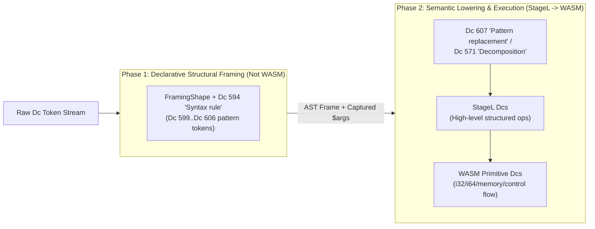
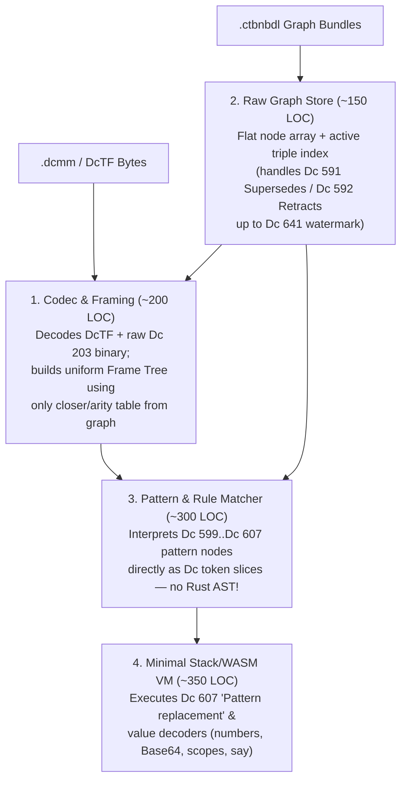

I'd like to try to make the Dc document format more simple and self-describing. Recent work has reduced the number of special-case-handled Dcs, but I feel like there's still a lot of complexity in the format. It's also really slow to parse compared to a typical character encoding or binary file format. graph_ledger.rs for instance is very long and gets into a lot of detail. I'm thinking I'd probably like it to be a bit closer to WASM: a set of primitives that other Dcs are implemented in terms of (maybe even the same ones as WASM, so each WASM instruction would be assigned a corresponding Dc, and then running a document would in effect compile to WASM?), so new implementations or ports to other languages would be fairly trivial. (That was where I started with the StageL language - I tried to implement this in that language and then transpile it to other languages. It was also extremely slow, far slower than this version, though it did work for simple documents.) I'd also like to define a new textual language for programming Dc documents - I'm not really happy with the Ember Language syntax (currently unimplemented, but was intended to be that) - that may be helpful in achieving the goal of moving more of the implementation into Dc documents itself. Could you review the state and goals of the project and advise on how I can continue working towards these goals and approach it most practically?


Ran check HEAD and list project files
Created handoff-notes.md
Ran list remaining project files
Ran find dc, graph, ember, and stage files in src
Ran check line counts of key Dc and language files
Ran check line counts across dcdata, dcstring, dctf, and docs
Analyzed dc-runtime.md:L1-12
Analyzed dc-parser.md:L1-115
Analyzed dc-parser-semantic-definition.md:L1-124
Analyzed dc-parser-semantic-definition-impl-plan.md:L1-52
Analyzed 2026-10-24-node-encoding-design.md:L1-156
Analyzed dc-string-api.md:L1-320
Ran check line counts of additional docs and fixtures
Edited handoff-notes.md
Analyzed 2026-10-24-UTF-8e-128-2.md:L1-142
Analyzed renderer-flow.md:L1-20
Analyzed dct_el.rs:L1-52
Analyzed stagel2.rs:L1-202
Analyzed el.csv:L1-55
Analyzed README-named-types.csv:L1-25
Ran check line counts of dcdata CSVs and stagel fixture
Edited handoff-notes.md
Analyzed semantic.csv:L1-318
Analyzed encapsulation.csv:L1-73
Analyzed format-ascii.stagel:L1-89
Analyzed ember.eite:L1-10
Analyzed graph_ledger.rs:L1-800
Edited handoff-notes.md
Analyzed graph_ledger.rs:L801-1600
Analyzed graph_ledger.rs:L1601-2200
Analyzed seed_graph.rs:L1-800
Analyzed navigator.rs:L1-600
Edited handoff-notes.md
Analyzed navigator.rs:L601-1400
Analyzed eval.rs:L1-800
Analyzed resolver.rs:L1-800
Edited handoff-notes.md
Analyzed dctext.rs:L1-768
Analyzed dcal.rs:L1-526
Analyzed dcts.rs:L1-384
Edited handoff-notes.md
Analyzed dc.generated.rs:L1-386
Ran verify Dc names via character_description CLI
Edited handoff-notes.md

### 1. Diagnosis: Why the Current Format & Parser Feel Complex and Slow

After reviewing [`graph_ledger.rs`](file:///workspaces/ctoolbox/src/formats/dcdata/graph_ledger.rs), [`seed_graph.rs`](file:///workspaces/ctoolbox/src/formats/dcdata/seed_graph.rs), [`resolver.rs`](file:///workspaces/ctoolbox/src/formats/dcdata/syntax/resolver.rs), and [`navigator/`](file:///workspaces/ctoolbox/src/formats/dcstring/navigator.rs), the complexity and slowness trace back to **four structural bottlenecks**:

1. **Parsing Requires Database-Driven Backtracking (`eval.rs` & `navigator.rs`)**:
   - In a fast binary or character format (like UTF-8, CBOR, or WebAssembly), finding the boundary of a token or container is an $O(1)$ header check that requires **zero** schema knowledge.
   - In the current Dc format, constructs use a mix of paired delimiters (`Dc 590 "Is a closing delimiter of syntactic block for"`), variable-arity prefix rules (`:~ ...`), infix operators (`Dc 269 "Assignment operator"`), and trailing parameter blocks (`Dc 258 "Begin parameter"`..`Dc 259 "End parameter"`).
   - Because of this, [`DcDocumentNavigator::scan_sibling_stub_with_resolver`](file:///workspaces/ctoolbox/src/formats/dcstring/navigator.rs#L901-L1120) and [`DcDocumentNavigator::eval_pattern`](file:///workspaces/ctoolbox/src/formats/dcstring/navigator/eval.rs#L343-L569) must run a backtracking pattern interpreter at parse time—cloning [`NavigatorCheckpoint`](file:///workspaces/ctoolbox/src/formats/dcstring/navigator/eval.rs#L273-L280) (including `VecDeque<DcChar>`) on every sequence element and alternation branch, and maintaining five separate `HashMap`/`HashSet` caches in [`NavScanCache`](file:///workspaces/ctoolbox/src/formats/dcstring/navigator.rs#L126-L135) to avoid exponential blowup.
2. **Per-Token Wrapper & Splicing Interception**:
   - At virtually every token step in [`eval_term_single`](file:///workspaces/ctoolbox/src/formats/dcstring/navigator/eval.rs#L581-L735), the parser checks whether the stream is spliced by `Dc 256 "void lang.say([string] text)"`, wrapped in `Dc 315 "Optional value present"` / `Dc 316 "Optional value absent"`, or wrapped in `Dc 397 "Equivalent representations"` / `Dc 561 "Partially equivalent representations"`. Mixing **runtime evaluation/splicing** into **syntactic boundary scanning** forces the parser to act as a partial evaluator on every token.
3. **Multi-Token Framing Overhead for Primitives**:
   - Even with `DcTF` ([`codec.rs`](file:///workspaces/ctoolbox/src/formats/dctf/codec.rs)) shrinking individual Short Dcs from 6 bytes to 4 bytes, a single small integer encoded via [`u128_to_dc_number_chars`](file:///workspaces/ctoolbox/src/formats/dcdata/dc_number_minimal.rs#L114-L146) requires a 4+ token frame (`Dc 6 "Begin number"`, `f199` (`Integer number`), `Dc 127 "Base 64 encapsulation digit 0"`..`Dc 190 "Base 64 encapsulation digit 63"`, `Dc 7 "End number"`), turning a 1-byte integer into 17+ bytes and a multi-token state machine.
4. **Transitional "Dual-World" Overhead in `graph_ledger.rs` (3,512 lines) & `seed_graph.rs` (2,690 lines)**:
   - Right now, the codebase lives in two worlds at once: CSV tables with textual mini-languages (`:<syntax>`, `@implies(...)`, format chains) on one side, and the System-block graph (`.ctbnodes` / `.ctbnbdl`) on the other.
   - [`graph_ledger.rs`](file:///workspaces/ctoolbox/src/formats/dcdata/graph_ledger.rs) spends ~1,500 lines translating `DcDefn` struct fields and `SyntaxPattern` ASTs into `.Semantic:Pattern` graph tokens (`Dc 599 "Self reference"`..`Dc 607 "Pattern replacement"`) and diffing 6 different property maps in [`LedgerBuilder::apply_desired_state`](file:///workspaces/ctoolbox/src/formats/dcdata/graph_ledger.rs#L1162-L1681).
   - Then at runtime startup, [`SeedGraphIndex::from_nodes_with_single_props`](file:///workspaces/ctoolbox/src/formats/dcdata/seed_graph.rs#L376-L676) and [`DatasetRuleResolver`](file:///workspaces/ctoolbox/src/formats/dcdata/syntax/resolver.rs#L648-L663) decode those `.ctbnbdl` graph nodes *back* into 18+ in-memory `HashMap`s and `SyntaxPattern` ASTs.

---

### 2. Why StageL Was Slow — and Why the WASM Primitive Idea Works If Layered Correctly

Your instinct about StageL is spot-on. Looking at [`format-ascii.stagel`](file:///workspaces/ctoolbox/src/formats/stagel/fixtures/format-ascii.stagel), StageL was slow for two reasons:
1. **Granularity mismatch**: It processed byte arrays and Dc arrays one element at a time using high-level dynamic variables and array-append copies (`while lt n/c n/l ... set an/res append an/res ...`).
2. **No direct mapping to hardware/VM primitives**: Transpiling a custom high-level AST to JS/Bash/etc. with dynamic type checks on every operation (`assertIsByteArray`, `anFromN`) adds massive per-op overhead.

By contrast, **WebAssembly (WASM)** is fast and portable because:
- Its primitives are **fixed-width machine types** (`i32`, `i64`, `f32`, `f64`, `v128`) and **linear memory** (`i32.load8_u`, `memory.copy`), plus structured control flow (`block`, `loop`, `br`, `if`, `call`).
- A port to a new host language does **not** have to reimplement 600+ Dcs; it only needs a tinyDc-to-WASM lowering pass (or a 500-line stack machine interpreter) and a standard WASM runtime.

#### How to Map Dc to WASM Without Losing Dc's Semantic Power
The key architectural insight is to **strictly separate two layers of Dcs**:

1. **Layer 0: Physical Framing & Primitive Execution Dcs (The "Kernel" / WASM Layer)**
   - **Self-delimiting physical framing (zero database lookups to scan/skip)**:
     - EveryDc token stream should be parseable into a tree of frames **without consulting the Dc database**.
     - If every compound construct either (a) uses a single universal pair of structural delimiters (or a bit/range rule where opener/closer pairs are arithmetic, e.g., opener $2k$, closer $2k+1$, or universal `Dc 298 "Begin associativity group"`..`Dc 299 "End associativity group"` S-expression framing) or (b) uses length-prefixed encapsulation like `Dc 203 "Begin encapsulated binary data"`, then **scanning, skipping, and framing a Dc document becomes as fast as UTF-8 / WASM binary parsing**—a tight loop with zero `HashMap` lookups and zero backtracking.
   - **WASM Instruction Dcs**:
     - Assign a contiguous block of Dcs (e.g., in a `.WASM` or `.Execution:Primitive` script) 1-to-1 to WASM core instructions and value types (`i32.const`, `i64.add`, `local.get`, `local.set`, `i32.load8_u`, `block`, `loop`, `br_if`, `call`, etc.).
     - Because WASM is a stack machine (which is naturally a flat postfix token stream, or an S-expression tree in WAT folded form!), a sequence of WASM Dcs **is literally a tokenizeable WASM module**.
     - Compiling an executable Dc block to actual `.wasm` bytecode becomes a trivial 1-pass translation of Dc IDs to WASM opcodes!
   - **Capability-Gated Host Imports (`memories/dc-runtime.md`)**:
     - In WASM, all I/O and ambient authority must come through explicit `(import "env" ...)` functions. This matches your capability model in [`renderer-flow.md`](file:///workspaces/ctoolbox/docs/renderer-flow.md) and [`dc-runtime.md`](file:///workspaces/ctoolbox/memories/dc-runtime.md): pure WASM instructions run unprivileged with a fuel/step counter, while emitting to the renderer snapshot, reading graph nodes, or doing I/O are WASM host imports gated by your permission/mocking system.

2. **Layer 1: High-Level Semantic & Ontology Dcs (Defined *in terms of* Layer 0)**
   - High-level Dcs (file metadata `Dc 317 "Begin file"`..`Dc 318 "End file"`, dates `Dc 390 "Begin time moment description"`..`Dc 391 "End time moment description"`, relationships `Dc 584 "Has a"`, `Dc 610 "Has value"`, etc.) remain compact semantic identifiers in documents.
   - Instead of hardcoding procedural Rust decoders for every Dc in `navigator/eval.rs`, high-level Dcs are defined in the System graph via:
     - **Declarative structural patterns** (`Dc 594 "Syntax rule"` using `Dc 599 "Self reference"`..`Dc 607 "Pattern replacement"`), and
     - **Executable decompositions / lowerings** (`Dc 571 "Decomposition"` / `Dc 611 "Canonical decomposition"`) that expand or compile high-level Dcs into Layer 0 WASM Dcs!

---

### 3. Designing the New Textual Language (Replacing Ember)

The reason the old Ember Language (`.EL`) Dcs in [`el.csv`](file:///workspaces/ctoolbox/src/formats/dcdata/fixtures/categories/el.csv) feel awkward is that `Dc 246 "Begin single-line source comment on current line"` through `Dc 254 "Braced block in source"`, `Dc 267 "Whitespace in source"`, and `Dc 272 "Leave block level"` tried to **encode surface-syntax formatting trivia** (whether a user typed a `;`, a `\`, `{...}`, or indentation) as semantic Dcs. Meanwhile, `Dcts` (`@123@`) and `.ctbnodes` (`584 269 572`) are too low-level for writing real logic or schemas.

Look at what WebAssembly did with **WAT (WebAssembly Text Format)** and what Lisps/Clojure/Datalog do:

#### Recommended Design for the New Textual Language
Make the language a **Homoiconic S-Expression / WAT-style + Triple language** that maps **1-to-1** to Dc streams without needing special "whitespace/semicolon/brace" Dcs:

1. **Every construct is a prefix form `(head arg1 arg2 ...)` (or bare atom)**:
   - In the Dc stream, `(op a b)` maps directly to `Dc 298 "Begin associativity group"` `op` `a` `b` `Dc 299 "End associativity group"` (or if `op` is a known paired opener like `Dc 310 "Begin list (ordered, contiguous, typed)"`, its corresponding closer `Dc 311 "End list"`).
   - **Why this changes everything for parsing**: If the surface language and the underlying Dc format both use uniform prefix/grouped framing, the parser **never has to backtrack or look up infix precedence rules**!
2. **First-class readable names *and* raw Dc shorthands**:
   - You can write either the programmatic identifier / canonical name or the shorthand:
     - `(HasAAssignCanonicalName)` or `(has-a @269@ canonical-name)` $\leftrightarrow$ `584 269 572` (`Dc 584 "Has a"`, `Dc 269 "Assignment operator"`, `Dc 572 "Canonical name"`).
   - Local variables use `$ident` (`Dc 270 "Begin identifier"`..`Dc 271 "End identifier"` / `Dc 540 "Reference bound value"`), matching both WAT (`(local.get $x)`) and your existing pattern captures (`Dc 606 "Pattern capture"` `[number $length]`)!
3. **First-class Literals (Strings, Numbers, Binary, Dates, Lists, Maps)**:
   - `"hello"` $\to$ `Dc 260 "Begin literal value"` `Dc 262 "Begin type definition"` `Dc 264 "Built-in type identifier: String"` `Dc 263 "End type definition"` `u68 u65 u6c u6c u6f` `Dc 261 "End literal value"` (or unframed Unicode in text contexts).
   - `42` $\to$ `Dc 6 "Begin number"` `f199` ... `Dc 7 "End number"`.
   - `[1 2 3]` $\to$ `Dc 310 "Begin list (ordered, contiguous, typed)"` ... `Dc 311 "End list"`.
   - `{key1: val1, key2: val2}` $\to$ `Dc 559 "Begin key-value array (ordered)"` ... `Dc 514 "Key-value pair (tuple)"` `key1` `Dc 312 "List element separator"` `val1` `Dc 515 "End key-value pair"` ... `Dc 560 "End key-value array"`.
4. **Unified Syntax for Ontology Triples, Pattern Rules, and WASM Code**:
   - **Graph nodes & triples** (replacing both `.ctbnodes` and CSV rows!):
     ```lisp
     (node l8589934593
       (HasA @269@ CanonicalName)
       (HasValue ~ "Assignment operator"))
     ```
   - **Pattern / Syntax rules** (`Dc 594 "Syntax rule"` with `Dc 599 "Self reference"`..`Dc 607 "Pattern replacement"`):
     ```lisp
     (SyntaxRule @269@
       (seq (capture $ident [identifier]) ~ (capture $val [value]))
       (replace (lang.assign $ident $val)))
     ```
   - **WASM / Executable routines** (using folded WAT S-expressions that desugar directly to WASM Dcs):
     ```lisp
     (func $is_ascii_digit (param $b i32) (result i32)
       (i32.and
         (i32.ge_u (local.get $b) (i32.const 48))
         (i32.le_u (local.get $b) (i32.const 57))))
     ```
     Notice how `is_ascii_digit` in [`format-ascii.stagel`](file:///workspaces/ctoolbox/src/formats/stagel/fixtures/format-ascii.stagel#L42-L45) took 5 lines of dynamically-typed StageL variables, whereas in folded WAT-Dc it is 4 tokens of pure `i32` WASM instructions that execute in **2 CPU clock cycles**!

---

### 4. Practical Step-by-Step Roadmap (How to Get There Without Breaking the World)

To avoid a massive all-at-once rewrite, here is the most practical sequence of milestones:

#### Step 1: Make Framing Self-Describing Without the Database (Fast Two-Tier Parser)
- **Goal**: Separate **Layer 0 Physical Framing** from **Layer 1 Grammar/Type Validation**.
- **How**:
  1. Ensure every multi-token construct in Dc streams has unambiguous physical boundaries without running [`eval_pattern`](file:///workspaces/ctoolbox/src/formats/dcstring/navigator/eval.rs#L343):
     - Paired containers (`Dc 590 "Is a closing delimiter of syntactic block for"`) and `Dc 203 "Begin encapsulated binary data"` already have clear boundaries.
     - Normalize prefix/infix constructs so they either use explicit grouping (`Dc 298 "Begin associativity group"`..`Dc 299 "End associativity group"` / `Dc 616 "Evaluate value as atom"`) or a deterministic token-class arity rule (e.g., relationship verbs in `.Semantic:Relationship` always take 2 `[atom_dc]` operands).
  2. Move stream splicing (`Dc 256 "void lang.say([string] text)"`) out of the low-level token scanner into the **runtime evaluation pass**. Parsing/inspecting a static document should never invoke `eval_stream_splice` on every token peek.
  3. Add a compact binary/varint fast-path for numbers inside `Dc 6 "Begin number"`..`Dc 7 "End number"` (or an inline integer representation) so numbers don't require 4+ tokens of Base64 Short Dc decoding.

#### Step 2: Build the New Textual Language in `src/formats/dct_el/` as a Direct Transpiler to Dc
- **Goal**: Replace the empty [`src/formats/dct_el/dct_el.rs`](file:///workspaces/ctoolbox/src/formats/dct_el/dct_el.rs) stub with a clean, ~500-line S-expression / WAT-like reader and pretty-printer for Dc documents.
- **How**:
  - Because an S-expression / WAT-like syntax has no complex operator precedence or whitespace sensitivity, its parser and formatter are tiny.
  - Give it access to [`SeedGraphIndex`](file:///workspaces/ctoolbox/src/formats/dcdata/seed_graph.rs) so it can resolve `@ident` names (`HasA`, `CanonicalName`, `BeginList`) to their `DcChar` IDs when compiling text $\to$ Dc, and print human-readable names when decompiling Dc $\to$ text!
  - Deprecate the unused Ember formatting-trivia Dcs (`Dc 246 "Begin single-line source comment on current line"`..`Dc 254 "Braced block in source"`, `Dc 267 "Whitespace in source"`, `Dc 272 "Leave block level"`), keeping only a single semantic comment/annotation construct if needed.

#### Step 3: Slim Down `graph_ledger.rs` & `seed_graph.rs` by Authoring Definitions Directly in the New Language
- **Goal**: Eliminate the 6,200-line CSV $\to$ `DcDefn` $\to$ `DesiredDatasetState` $\to$ `.ctbnodes` $\to$ `SeedGraphIndex` $\to$ `DatasetRuleResolver` round-trip.
- **How**:
  1. Once Step 2's textual language can express graph nodes and patterns readability, `.ctbnodes` (or `.dctel` source files) become the **primary human-editable source of truth**, rather than compiling 44 CSV files through [`graph_ledger.rs`](file:///workspaces/ctoolbox/src/formats/dcdata/graph_ledger.rs).
  2. Precompute the active statement tables and starter sets at build time in [`src/build_support/graph_index.rs`](file:///workspaces/ctoolbox/src/build_support/graph_index.rs) into static arrays/tables, so runtime startup in [`seed_graph.rs`](file:///workspaces/ctoolbox/src/formats/dcdata/seed_graph.rs) is zero-copy instead of rebuilding 18 `HashMap`s.

#### Step 4: Introduce the WASM Primitive Dc Block & Compiler
- **Goal**: Make Dc documents executable at native speed and trivially portable.
- **How**:
  1. Allocate a block of Dcs corresponding to the core WebAssembly 1.0/2.0 instruction set (roughly ~170 core instructions + control flow + memory/table ops).
  2. Write a small, self-contained **Dc-WASM $\leftrightarrow$ `.wasm` binary codec** (since each WASM Dc maps 1-to-1 to a standard WASM opcode + immediate operands, this is only a few hundred lines of code).
  3. Define high-level `.EL Routines` and format converters (like the ASCII/UTF-8 converters you previously wrote in StageL in [`format-ascii.stagel`](file:///workspaces/ctoolbox/src/formats/stagel/fixtures/format-ascii.stagel)) in the new WAT-like Dc language, compile them to WASM Dcs, and store them as nodes in the System graph!

---

### Key Questions to Align On

1. **Surface Syntax Direction**: How does a **WAT / S-expression + Datalog-triple hybrid** (where `(HasA @269@ CanonicalName)`, literals `"..."`, `$vars`, `[lists]`, `{maps}`, and folded `(i32.add ...)` expressions all share a uniform prefix structure) feel to you as a replacement for Ember? Or do you prefer an algebraic/C/Rust-like surface syntax that compiles down to grouped Dc frames?
2. **Physical Framing Unification**: Are you open to making **all** compound/multi-token expressions in Dc streams explicitly framed (or fixed-arity by token range) so a low-level parser can scan and skip any unknown or future Dc construct in $O(1)$ without consulting the ontology database?
3. **Starting Point**: Which of the four steps above would you like to prototype first—e.g., sketching the concrete grammar of the new textual language in [`src/formats/dct_el/`](file:///workspaces/ctoolbox/src/formats/dct_el/dct_el.rs), or designing the WASM instruction Dc block and physical framing rules?


Thanks. Physical framing unification is probaly the most key issue I'm identifying here. I don't want to break backwards compatibility with existing Dcs and documents, but I'm open to imposing new validation rules for future Dcs. I'm guessing that the existing Dcs could be parsed more quickly by reducing the generalization.

I kind of agree about stream splicing, but I'm nervous about limiting its expressivity, and potential correctness issues - since stream splicing can affect the tree structure of the document (which elements are contained within which other elements could look different depending on whether it's parsed with or without splicing) I'm not clear how correct the results would be.
 Could you consider these questions?

In terms of the language, there should probably be a simple/minimal language for the base implementation (a la WAT), but for actual programming I'd like to use a higher-level language which translates to higher-level Dcs (including the existing EL Dcs). I have some ideas in mind for the syntax of that language - it's not very filled out,  but the basic principle is that it's a more general-purpose language - an English-like VSO language like StageL meant to be speakable and usable as a general semantic language as well as machine-parseable, so the same syntax would be used for writing code and text for localization and then translated to the corresponding semantic Dcs, which would then be transpiled into any implemented natural languages. So all text in the UI would be written using the same language as the code, and by implementing output translators for programming languages, natural languages, machine code, etc. it would serve as a general-purpose language with a similar principle to Dcs of primarily representing semantic statements. Short examples:

- Doing see I you. Is to dipre meet I you par good. Let var foo add 3 4. Let var int32 var bar var foo. Set var bar mul var bar dipre daun. // I am seeing you. It is good to meet you. let foo = 3+4; let i32 bar = foo; bar = bar*bar;

Or in more programming-like syntax, which would mostly be what would be relevant (vaguely StageL-like):

doing see I you
is to is meet I you } good
let /foo add 3 4 // implied * - foo is of * (any) type
let i32/bar foo
set /bar mul /bar /bar

Maybe an odd (perhaps bad?) idea. It seems to align well with what I have in mind for this project, though.


Ran find all syntax rules in dcdata fixtures
Ran list syntax rules in short Dc category CSVs
Analyzed output.txt:L1-145
Analyzed handoff-notes.md:L1-110
Canceled verify Dc names for 301-303 and 374-377
Killed task Verify Dc names for 301-303 and 374-377

### 1. Backward-Compatible Framing Unification & Fast Parsing

Your intuition that **existing Dcs can be parsed much faster by reducing over-generalization** is spot-on.

I audited all 141 `: ~` syntax rules across [src/formats/dcdata/fixtures/categories/](file:///workspaces/ctoolbox/src/formats/dcdata/fixtures/categories/). Despite [`eval_pattern`](file:///workspaces/ctoolbox/src/formats/dcstring/navigator/eval.rs#L17-L115) being implemented as a general-purpose backtracking regex/PEG interpreter over arbitrary `SyntaxPattern` ASTs, **100% of existing short Dcs with syntax rules fall into just 5 fixed structural framing classes**:

1. **Paired Opener..Closer Containers (`Dc 590 "Is a closing delimiter of syntactic block for"`)**:
   - E.g. `Dc 6 "Begin number"`..`Dc 7 "End number"`, `Dc 191 "Begin encapsulated UTF-8"`..`Dc 192 "End encapsulated UTF-8"`, `Dc 203 "Begin encapsulated binary data"`..`Dc 204 "End encapsulated binary data"`, `Dc 258 "Begin parameter"`..`Dc 259 "End parameter"`, `Dc 260 "Begin literal value"`..`Dc 261 "End literal value"`, `Dc 262 "Begin type definition"`..`Dc 263 "End type definition"`, `Dc 270 "Begin identifier"`..`Dc 271 "End identifier"`, `Dc 298 "Begin associativity group"`..`Dc 299 "End associativity group"`, `Dc 310 "Begin list (ordered, contiguous, typed)"`..`Dc 311 "End list"`, `Dc 511 "Begin file path"`..`Dc 512 "End file path"`, `Dc 559 "Begin key-value mapping"`..`Dc 560 "End key-value mapping"`, `Dc 617 "Begin reified statement"`..`Dc 618 "End reified statement"`.
   - Only one paired container has a trailing post-closer suffix: `Dc 543 "Begin checksummed section"`..`Dc 544 "End checksummed section"` followed by `Dc 545 "Section digest"`.
2. **Fixed 1-Arity Prefix Tags (`:~ <1 construct>`)**:
   - Over 75% of all non-paired Dcs (`Dc 315 "Optional value present"`, `Dc 397 "Equivalent representations"`, `Dc 540 "Lexical scope"`, `Dc 561 "Partially equivalent representations"`, `Dc 616 "Has inline value"`, and almost all file/document metadata properties) take **exactly 1** following construct (`[number]`, `[string]`, `[date]`, `[data]`, `[boolean]`, `[list]`, `[identifier]`, `[value]`, or `[format]`).
   - One minor variant: `Dc 276 "Reference named object"` (`:~ [type]? [identifier]`), which takes 2 frames if the next token starts a `[type]`, otherwise 1 frame.
3. **Fixed 2-Arity Prefix Operators (`:~ <arg1> <arg2>`)**:
   - Every `.Semantic:Relationship` verb (`Dc 584 "Has a"`, `Dc 590 "Is a closing delimiter of syntactic block for"`, `Dc 591 "Supersedes"`, `Dc 592 "Retracts"`, `Dc 610 "Has value"`, etc.) takes **2** `[atom_dc]` arguments.
   - `Dc 300 "Type union"` and `Dc 516 "Type intersection"` take **1** frame if the next token is `Dc 310 "Begin list (ordered, contiguous, typed)"` (`[list:type]`), or **2** `[type]` frames otherwise.
4. **Prefix Head + Trailing `Dc 258 "Begin parameter"`..`Dc 259 "End parameter"` List**:
   - `Dc 535 "Format parameter application"`, `Dc 279 "Routine invocation"`, and the `.EL` built-in routines (`Dc 256 "void lang.say([string] text)"`, `Dc 265 "void lang.invoke([string] routineName)"`, `Dc 268 "void lang.assign([identifier] identifier, [value] value)"`, `Dc 307 "void lang.invoke([Routine] routine | [Routine name] routineName)"`).
5. **Single Infix Operator (2 total)**:
   - Only `Dc 269 "Assignment operator"` (`[identifier] 269 [value]`) and `Dc 4 "Range"` (`[start] 4 [end]`).

#### How to use this for a huge parser speedup without breaking compatibility
Right now, [`DcDocumentNavigator`](file:///workspaces/ctoolbox/src/formats/dcstring/navigator.rs#L118-L215) treats every prefix Dc as if it might contain an arbitrary nested regex requiring checkpoints, `VecDeque` clones, and backtracking just to find where the sibling ends (`scan_sibling_stub_with_resolver`).

Instead, we can separate **Structural Framing (finding boundaries)** from **Semantic Type Validation (checking subtype constraints)**:
- **Compile a static `FramingShape` lookup table** (or derive it once when loading `SeedGraphIndex`):
  ```rust
  enum FramingShape {
      Atom,                                  // Self-contained single token
      Paired { closer: DcChar, trailing: u8 }, // e.g. 6..7 (trailing 0), 543..544 (trailing 1)
      Closer,                                // e.g. 7, 259, 311
      PrefixArity(u8),                       // 1 or 2 child frames
      PrefixTypeOrList,                      // 300, 516: 1 if next is 310, else 2
      PrefixOptTypeIdent,                    // 276: 2 if next is [type], else 1
      PrefixWithParamBlocks { head_arity: u8 }, // 256, 265, 268, 279, 307, 535
      InfixRhs,                              // 4, 269: consumes 1 RHS frame and binds to preceding LHS
  }
  ```
- With `FramingShape`, finding the end of any construct or skipping a sibling becomes a **non-backtracking, allocation-free linear counter loop** (an explicit small stack of expected child frame counts and expected closer Dcs).
- **Validation rule for future Dcs**: Enforce in [`graph_ledger.rs`](file:///workspaces/ctoolbox/src/formats/dcdata/graph_ledger.rs) / dataset tests that every new Dc syntax rule must compile to one of the deterministic `FramingShape` variants (Specifically: either a paired `Dc 590 "Is a closing delimiter of syntactic block for"` container or a fixed-arity `PrefixArity(N)` construct—no new infix operators, no unclosed variadic sequences without `Dc 310 "Begin list (ordered, contiguous, typed)"`..`Dc 311 "End list"` or `Dc 298 "Begin associativity group"`..`Dc 299 "End associativity group"`).

---

### 2. Stream Splicing (`Dc 256 "void lang.say([string] text)"`) Expressivity vs. Correctness

Your concern here is completely valid: if a stream-splicing call like `Dc 256 "void lang.say([string] text)"` emits an unmatched opener (such as `Dc 310 "Begin list (ordered, contiguous, typed)"`) or a closer (`Dc 311 "End list"`), **the containment tree of the document changes depending on whether splicing is evaluated or not**.

That is not a bug in your mental model—it is a fundamental property of any language with token-stream splicing (like TeX's `\expandafter`, Forth parsing words, or the C preprocessor). The key to making it both **100% expressive** and **unambiguously correct** is to stop asking a single parser pass to be both trees at once:

1. **Recognize that a Dc document with splicing genuinely has two distinct trees**:
   - **Mode A: Unevaluated Source Tree (Lexical / CST mode)** — `splicing = false`.
     - Used by source-level editing operations (`replace_field`, `replace_annotation`, syntax highlighting, code formatters, raw AST inspection).
     - In this mode, `Dc 256 "void lang.say([string] text)"` `Dc 258 "Begin parameter"` ... `Dc 259 "End parameter"` is simply a routine call construct whose argument is a quoted string literal (`Dc 260 "Begin literal value"`..`Dc 261 "End literal value"`). It never alters surrounding container boundaries.
     - What if a document intentionally uses `Dc 256 "void lang.say([string] text)"` to splice only *half* of a container (e.g., emitting `Dc 310 "Begin list (ordered, contiguous, typed)"` inside `lang.say` and closing it with a literal `Dc 311 "End list"` outside)? In **Source Mode**, that raw unclosed `Dc 311 "End list"` is an unexpanded template fragment—source editors can still edit the `lang.say` call itself, while semantic projection uses Mode B.
   - **Mode B: Evaluated / Spliced Stream (Runtime / Semantic Projection mode)** — `splicing = true`.
     - Used when executing, validating semantic types, or projecting the document for rendering (per [memories/dc-runtime.md](file:///workspaces/ctoolbox/memories/dc-runtime.md)).
     - In this mode, splicing happens at the **token stream layer** before structural framing sees the tokens, so spliced openers and closers seamlessly combine with surrounding tokens to form the evaluated tree.

2. **Why splicing currently hurts performance even when unused (and how to fix it)**:
   - Right now, in [`navigator.rs`](file:///workspaces/ctoolbox/src/formats/dcstring/navigator.rs#L482-L558), *every single call* to `peek_token()` and `read_next_token()` calls `default_syntax_resolver()` and runs `splice_stream_invocation`, and every checkpoint clones `spliced_tokens: VecDeque<DcChar>`.
   - Yet 99.9% of tokens in a document are not `Dc 256 "void lang.say([string] text)"` (or an `<equiv>` of it), and when `spliced_tokens` is empty, `peek_token()` only needs to check a single precomputed bit/flag (`is_splice_trigger(dc)`) before touching the resolver!
   - Even better: when a splice *does* happen, instead of pushing decoded `DcChar`s into a heap `VecDeque<DcChar>` that gets cloned on every checkpoint, the evaluator can maintain a small **cursor stack of `DcStr` slices** (pushing the inner slice when entering `Dc 256 "void lang.say([string] text)"` and popping when exhausted). Checkpointing a cursor stack of 1–4 `(slice_id, byte_offset)` pairs is `Copy` and zero-allocation.

---

### 3. The VSO / Polish Prefix Language: Why It Is Actually a Great Fit

Far from being a bad idea, an English-like **VSO (Verb-Subject-Object) / Polish prefix** language is **structurally isomorphic to the Dc format itself**. In fact, it solves several of the hardest problems in both Ember Language and `graph_ledger.rs` at once:

#### A. It matches Dc's native token order 1-to-1
Look at how Dc already encodes both relationships and operations:
- **Semantic Relationships in Dc are already VSO**:
  - `Dc 584 "Has a"` `<subject>` `<object>` = `<Verb> <Subject> <Object>`!
  - `Dc 610 "Has value"` `<subject>` `<value>` = `<Verb> <Subject> <Object>`!
- **Expressions and Statements in Polish Prefix need zero precedence tables and minimal delimiters**:
  - In `let /foo add 3 4` and `set /bar mul /bar /bar`, because `let` (arity 2), `set` (arity 2), `add` (arity 2), and `mul` (arity 2) have known fixed arities, **the parser never needs parentheses around `add 3 4` or `mul /bar /bar`**.
  - A Polish prefix stream parses into a tree in a single $O(N)$ left-to-right pass using an arity counter stack—the exact same `FramingShape` machine described in Section 1!
  - Explicit closing delimiters (`par` in speech / `}` in code, mapping directly to `Dc 299 "End associativity group"`) are **only** needed when closing a variadic or explicitly grouped clause (like `is to is meet I you } good`), which is the same principle used in Lojban (`ku`/`kei`) to keep speech unambiguous without drowning in brackets.

#### B. Pronouns / Backreferences (`dipre`, `daun`) solve the Dc graph reification bloat!
Look closely at what your `dipre` ("the previous clause/statement") and `daun` ("the previous argument/operand") words do in your example:
- `Set var bar mul var bar dipre daun` (`bar = bar * bar`)
- `Is to dipre meet I you par good` ("To [meet I you] is good")

Recall from [docs/chats/2026-10-24-node-encoding-design.md](file:///workspaces/ctoolbox/docs/chats/2026-10-24-node-encoding-design.md) that the #1 source of bloat in [`graph_ledger.rs`](file:///workspaces/ctoolbox/src/formats/dcdata/graph_ledger.rs) is having to mint thousands of System-block Node IDs or repeat long identifiers just to refer to the previous statement or the current subject!
If you have dedicated **anaphoric / backreference Dcs** (the semantic equivalents of `dipre` and `daun`, or stack-relative references like "previous statement", "previous subject", "previous operand"):
1. In `set /bar mul /bar /bar`, the third `/bar` doesn't have to re-encode `Dc 276 "Reference named object"` `Dc 270 "Begin identifier"` `b` `a` `r` `Dc 271 "End identifier"` (6 tokens / 24 bytes); it is a **single 1-token backreference Dc** (`daun` = "repeat previous operand")!
2. In ontology definitions (`graph_ledger.rs`), chaining 10 statements about the same Dc entity or attaching metadata to the immediately preceding statement (`dipre`) takes **1 token** instead of minting a global node ID or repeating a `Dc 617 "Begin reified statement"`..`Dc 618 "End reified statement"` block.

#### C. Unifying Code, Ontology, and UI Localization
Because Dc already has ontological categories for natural-language semantics alongside `.EL` and `.Semantic:Relationship`:
- **One surface parser, two syntactic profiles (Speakable vs. Compact Code)**:
  - The speakable profile (`Let var int32 var bar var foo.`) and the compact programming profile (`let i32/bar foo`) lex into the **exact same token stream** (`var int32 var bar` $\equiv$ `i32/bar`; `par` $\equiv$ `}`; sentence period `.` $\equiv$ newline statement boundary).
- **UI Localization as Semantic Dc Projection**:
  - Instead of `gettext` string keys or English format strings with brittle `{0}` placeholders, UI messages are authored in this VSO semantic language (`doing see I you`), compiled into semantic Dc statements at build time, and rendered into English ("I see you"), Spanish, Japanese, etc. by the renderer's natural-language projection pass.
  - Because the UI text is a Dc expression, embedding live program variables or plural/gender/tense agreement into UI text uses the **exact same variable reference (`Dc 276 "Reference named object"`) and semantic property Dcs** as the surrounding code!

---

### Recommended Practical Roadmap

1. **Step 1: Fast-Path `DcDocumentNavigator` via `FramingShape` & Lazy Splicing (Immediate Speedup, 100% Backwards-Compatible)**
   - Add a precomputed `FramingShape` table for the 5 structural classes of existing Dcs so boundary scanning (`scan_sibling_stub_with_resolver`) doesn't run the general backtracking `eval_pattern` engine unless validating complex inner constraints.
   - Gate `splice_stream_invocation` in `peek_token()` / `read_next_token()` behind a fast O(1) trigger check (`Dc 256 "void lang.say([string] text)"` and its `<equiv>` set) and replace the cloned `VecDeque<DcChar>` with a zero-copy slice cursor stack.
   - Add a dataset validation test enforcing that any *new* Dc added to the CSVs must conform to `Paired` or `PrefixArity(N)` framing.

2. **Step 2: Define the Two-Tier Textual Languages**
   - **Tier 0 (Base WAT-Dc / `Dcsh`+)**: Extend the existing `Dcsh` converter ([`dcal.rs`](file:///workspaces/ctoolbox/src/formats/dcstring/converters/dcal.rs)) with `@ident` lookup from `dc.generated.rs`, inline `"strings"`, inline numbers, and `{ ... }` automatic closer insertion (looking up `Dc 590 "Is a closing delimiter of syntactic block for"`). This takes ~200 lines of Rust and gives you an immediate human-writable assembler for low-level/WASM primitive Dcs.
   - **Tier 1 (The VSO / Polish Prefix Language in `ctb-formats-dct-el`)**:
     - Implement the lexer/parser in [src/formats/dct_el/dct_el.rs](file:///workspaces/ctoolbox/src/formats/dct_el/dct_el.rs) supporting both the speakable tokens (`var`, `par`, `dipre`, `daun`, `.`) and their compact code punctuation aliases (`/`, `}`, newlines).
     - Because the grammar is Polish prefix / VSO, the parser only needs a lexicon mapping words to their Dc + arity (`let` $\to$ arity 2, `add` $\to$ arity 2, `is` $\to$ arity 2, `/` or `var` $\to$ `Dc 276 "Reference named object"` / `Dc 270 "Begin identifier"`..`Dc 271 "End identifier"`, `}` or `par` $\to$ `Dc 299 "End associativity group"`).

Would you like to start by prototyping the **`FramingShape` + zero-copy splicing speedup** in `DcDocumentNavigator`, or would you like to sketch out the concrete lexicon and Dc mappings for the **VSO / Polish prefix language** (`let`, `set`, `/`, `dipre`, `daun`, `par`/`}`) first?


### 2. Known Gaps & What's Left

#### A. What Remains in Step 1 (`Partially Implemented`)
1. **`FramingShape` fast-path in [`DcDocumentNavigator::scan_sibling_stub_with_resolver`](file:///workspaces/ctoolbox/src/formats/dcstring/navigator.rs#L1293-L1338) only covers `PrefixAtomArity(2)` on plain atoms**:
   - [`FramingShape`](file:///workspaces/ctoolbox/src/formats/dcdata/syntax/ast.rs#L624-L651) and [`classify_rule_framing_shape`](file:///workspaces/ctoolbox/src/formats/dcdata/syntax/ast.rs#L834-L980) are implemented and precomputed into [`DatasetRuleResolver::framing_shapes`](file:///workspaces/ctoolbox/src/formats/dcdata/syntax/resolver.rs#L750).
   - However, [`scan_sibling_stub_with_resolver`](file:///workspaces/ctoolbox/src/formats/dcstring/navigator.rs#L1293-L1322) only fast-paths `FramingShape::PrefixAtomArity(2)` when both operands satisfy `is_plain_atom_dc`.
   - `FramingShape::PrefixArity(1)` (which covers >75% of prefix Dcs), `FramingShape::PrefixArity(N)`, and `FramingShape::PrefixAtomArity` with `Dc 616 "Evaluate value as atom"` still fall through at [`navigator.rs:1331-1338`](file:///workspaces/ctoolbox/src/formats/dcstring/navigator.rs#L1331-L1338) to the general backtracking [`eval_pattern`](file:///workspaces/ctoolbox/src/formats/dcstring/navigator/eval.rs#L351) interpreter.
   - Paired containers ([`navigator.rs:1245-1253`](file:///workspaces/ctoolbox/src/formats/dcstring/navigator.rs#L1245-L1253)) also still run [`check_container_grammar_with_resolver`](file:///workspaces/ctoolbox/src/formats/dcstring/navigator.rs#L1246) (`eval_pattern`) eagerly during sibling boundary scanning.
   - [`classify_rule_framing_shape`](file:///workspaces/ctoolbox/src/formats/dcdata/syntax/ast.rs#L727-L818) still hardcodes several raw Dc IDs in Rust (`Dc 258 "Begin parameter"`..`Dc 259 "End parameter"`, `Dc 279 "Routine invocation"`, `Dc 376 "Extent byte offset"`, `Dc 377 "Extent byte length"`, `Dc 388 "Begin file flags description"`..`Dc 389 "End file flags description"`, `Dc 406 "Mac OS Finder flags"`, `Dc 511 "Begin Dc representation of format"`..`Dc 512 "End Dc representation of format"`, `Dc 562 "Mac OS extended Finder flags"`) instead of deriving sub-frame structure generically from `opener_to_closer`.
2. **Splicing trigger check & zero-copy slice cursor stack in [`navigator.rs`](file:///workspaces/ctoolbox/src/formats/dcstring/navigator.rs#L169)**:
   - [`peek_token`](file:///workspaces/ctoolbox/src/formats/dcstring/navigator.rs#L288-L290) and [`read_next_token`](file:///workspaces/ctoolbox/src/formats/dcstring/navigator.rs#L328-L330) gate [`splice_stream_invocation`](file:///workspaces/ctoolbox/src/formats/dcstring/navigator.rs#L387) behind `ch == ctb_formats_dcdata::dc::DC_LANG_SAY || default_syntax_resolver().is_special_wrapper_token(ch.to_u128())`. Because [`is_special_wrapper_token`](file:///workspaces/ctoolbox/src/formats/dcdata/syntax/resolver.rs#L1074-L1091) also includes `Dc 315 "Optional value present"`, `Dc 316 "Optional value absent"`, `Dc 397 "Equivalent representations"`, and `Dc 561 "Partially equivalent representations"`, encountering any of those non-splice wrappers enters the splice slow-path only for `splice_stream_invocation` to return `Ok(false)`.
   - [`DcDocumentNavigator::spliced_tokens`](file:///workspaces/ctoolbox/src/formats/dcstring/navigator.rs#L169) and [`NavigatorCheckpoint::spliced_tokens`](file:///workspaces/ctoolbox/src/formats/dcstring/navigator/eval.rs#L297) still use a heap-allocated `VecDeque<DcChar>` cloned on every [`save_checkpoint`](file:///workspaces/ctoolbox/src/formats/dcstring/navigator.rs#L444-L450) rather than a zero-copy slice cursor stack.
3. **Completed portion of Step 1**:
   - The dataset validation rule enforcing that any newly allocated Short Dc (`> 634`, [`MAX_LEGACY_FRAMING_SHORT_DC_ID`](file:///workspaces/ctoolbox/src/formats/dcdata/syntax/ast.rs#L620)) with a syntax rule must use deterministic `Paired`, `Closer`, `PrefixAtomArity`, or `PrefixArity` framing is implemented in [`validation.rs:2280-2330`](file:///workspaces/ctoolbox/src/formats/dcdata/validation.rs#L2280-L2330).

#### B. What Remains in Mutable Rust Code Instead of the Append-Only Graph
Even though [`DatasetRuleResolver::from_seed_graph`](file:///workspaces/ctoolbox/src/formats/dcdata/syntax/resolver.rs#L1426) loads `Dc 594 "Syntax rule"` patterns (`Dc 599 "Self reference"`..`Dc 607 "Pattern replacement"`) from `.ctbnbdl`, **four layers of parsing and semantics still live only in mutable Rust code**:
1. **String-Encoded Subtype Constraints & Procedural Leaf Evaluators ([`eval.rs:1031-1142`](file:///workspaces/ctoolbox/src/formats/dcstring/navigator/eval.rs#L1031-L1142), [`eval.rs:3100-3484`](file:///workspaces/ctoolbox/src/formats/dcstring/navigator/eval.rs#L3100-L3484))**:
   - In [`eval_term_single`](file:///workspaces/ctoolbox/src/formats/dcstring/navigator/eval.rs#L1031-L1142), named constructs (`[number]`, `[string]`, `[Routine]`, `[identifier]`, `[data]`, `[typed_data]`, `[type]`, `[format]`, `[script]`) bypass their graph `SyntaxPattern` and dispatch to ~1,500 lines of procedural Rust (`eval_number_frame`, `eval_literal_frame`, `eval_identifier_frame`, `eval_data_construct`, `eval_typed_data_construct`).
   - Worse for backwards compatibility: subtype constraints like `[number:>=0]`, `[data:f84;bytes=32]`, and `[list(2):type]` are stored in graph pattern nodes as **opaque string value nodes** (`">=0"`, `"f84;bytes=32"`) and parsed at runtime by Rust string parsers ([`number_satisfies_subtype`](file:///workspaces/ctoolbox/src/formats/dcstring/navigator/eval.rs#L3226-L3283), [`parse_bound`](file:///workspaces/ctoolbox/src/formats/dcstring/navigator/eval.rs#L3055-L3224), `parse_data_constraint`).
2. **Implicit Rules Synthesized at Load Time in Rust ([`resolver.rs:1517-1588`](file:///workspaces/ctoolbox/src/formats/dcdata/syntax/resolver.rs#L1517-L1588), [`resolver.rs:1674-1718`](file:///workspaces/ctoolbox/src/formats/dcdata/syntax/resolver.rs#L1674-L1718))**:
   - [`DatasetRuleResolver::from_seed_graph`](file:///workspaces/ctoolbox/src/formats/dcdata/syntax/resolver.rs#L1571-L1588) uses heuristics to synthesize rules that are not explicitly stated in the graph: auto-detecting `Dc 590 "Is a closing delimiter of syntactic block for"` from the final token of a sequence (`detect_container_closer`), copying named-construct rules onto their first `CharRef` token ([`resolver.rs:1675-1716`](file:///workspaces/ctoolbox/src/formats/dcdata/syntax/resolver.rs#L1675-L1716)), and scraping English canonical names of `.EL Types` characters (`extract_el_type_name`) to synthesize `:260 262 <sid> 263 [^261]+ 261` rules ([`resolver.rs:1321-1370`](file:///workspaces/ctoolbox/src/formats/dcdata/syntax/resolver.rs#L1321-L1370)).
3. **Hardcoded Wrapper & Splicing Semantics ([`eval.rs:756-862`](file:///workspaces/ctoolbox/src/formats/dcstring/navigator/eval.rs#L756-L862))**:
   - How `Dc 255 "Ignore following Dc"`, `Dc 256 "void lang.say([string] text)"`, `Dc 315 "Optional value present"`, `Dc 316 "Optional value absent"`, `Dc 397 "Equivalent representations"`, `Dc 561 "Partially equivalent representations"`, and `Dc 616 "Evaluate value as atom"` unwrap or splice tokens during parsing is hardcoded in Rust rather than expressed as graph rules or decompositions.
4. **Unpinned / Always-HEAD Graph Resolution ([`seed_graph.rs:238-272`](file:///workspaces/ctoolbox/src/formats/dcdata/seed_graph.rs#L238-L272))**:
   - [`SeedGraphIndex::load_from_asset_bundle`](file:///workspaces/ctoolbox/src/formats/dcdata/seed_graph.rs#L291-L307) always resolves the latest active `Dc 594 "Syntax rule"` at `HEAD`. When a syntax rule is updated via `Dc 591 "Supersedes"` or `Dc 592 "Retracts"`, existing documents have no header protocol to bind to the graph state they were authored against.

---

### 3. Deferred Items
- None modified in this turn (this is a read-only architectural assessment).

---

### 4. Assessment: Next Most Important Steps for Rock-Solid Dc Backwards Compatibility

Your concern is completely well-founded: as long as document validity depends on mutable Rust helpers (`eval_number_frame`, `detect_container_closer`, `parse_bound`) and always-`HEAD` syntax rules, any code or CSV tweak can silently invalidate an existing file.

Here are the highest-leverage next steps to eliminate that risk, ordered by impact on backwards compatibility:

#### Priority 1: Pin Documents to an Append-Only Graph Most Recent (Your Document Version Protocol Idea)
Normally, adding a format version number (`v1`, `v2`, `v3`) requires maintaining parallel legacy parsers in code forever. **Because your Global Graph is strictly append-only, you can get exact, fine-grained version pinning almost for free**:
- **How the graph already tracks history**:
  - In the System block (`l8589934592..`), node IDs are allocated monotonically. A `Dc 594 "Syntax rule"` statement is never mutated in place; changing a rule appends a new statement node plus a `Dc 591 "Supersedes"` or `Dc 592 "Retracts"` node with a higher ID, and superseded nodes move to `system_graph_history.rsrc` (`assets/data/graph/system/*.ctbnbdl`).
  - [`SeedGraphIndex::load_with_history_from_asset_bundle`](file:///workspaces/ctoolbox/src/formats/dcdata/seed_graph.rs#L313-L350) and [`compute_effective_inactive_ids`](file:///workspaces/ctoolbox/src/formats/dcdata/seed_graph.rs#L238-L272) *already* merge active and historical `.ctbnbdl` bundles and walk `Dc 591 "Supersedes"` / `Dc 592 "Retracts"`!
- **The Protocol**:
  - Allow a document (inside `Dc 235 "Begin document"`..`Dc 236 "End document"` or `Dc 340 "Begin environment description"`..`Dc 341 "End environment description"`) to declare the **System-block graph most_recent node ID** (e.g., `l8589958539`, the highest allocated System node ID when the document was written).
  - When [`compute_effective_inactive_ids`](file:///workspaces/ctoolbox/src/formats/dcdata/seed_graph.rs#L238) builds the resolver for that document, it simply ignores any node with `node.id > most_recent_id`.
  - **Why this solves the syntax-evolution dilemma**: You never have to prematurely freeze `Dc 594 "Syntax rule"` definitions globally, and yet **any document carrying its graph most_recent is guaranteed to be parsed against the exact set of graph statements that existed the day it was written**.

#### Priority 2: Eliminate Implicit Rust Rule Synthesis & String-Encoded Constraints in the Graph
Even with a graph most_recent, historical reconstruction only works if the rules are *in the graph* rather than synthesized by Rust heuristics:
1. **Emit all implicit rules explicitly into `.ctbnodes`**:
   - Stop inferring `Dc 590 "Is a closing delimiter of syntactic block for"` via `detect_container_closer` in [`resolver.rs:1571-1588`](file:///workspaces/ctoolbox/src/formats/dcdata/syntax/resolver.rs#L1571-L1588); emit explicit `Dc 590 "Is a closing delimiter of syntactic block for"` statements into the graph for every paired opener/closer.
   - Stop scraping English names of `.EL Types` Dcs in [`resolver.rs:1326-1370`](file:///workspaces/ctoolbox/src/formats/dcdata/syntax/resolver.rs#L1326-L1370) to synthesize literal rules; store their `Dc 594 "Syntax rule"` or `Dc 587 "Is a subtype of"` links explicitly in the graph.
2. **Replace string-encoded subtype constraints (`">=0"`, `"f84;bytes=32"`) with structured graph pattern tokens**:
   - Right now, [`graph_ledger.rs`](file:///workspaces/ctoolbox/src/formats/dcdata/graph_ledger.rs) serializes `[number:>=0]` or `[data:f84;bytes=32]` by storing `">=0"` or `"f84;bytes=32"` as a UTF-8 string node in the graph, forcing [`eval.rs`](file:///workspaces/ctoolbox/src/formats/dcstring/navigator/eval.rs#L3226) to parse mini-DSLs out of strings in Rust.
   - Instead, encode value bounds and header field constraints directly using graph tokens (`Dc 601 "Pattern conjunction"`, `Dc 4 "Range"`, `Dc 585 "Is equal to"`, `Dc 606 "Pattern capture"`), so `eval.rs` doesn't need custom string parsers for `[number:...]` and `[data:...]`.
3. **Finish Step 1's `FramingShape` fast-path**:
   - Extend [`scan_sibling_stub_with_resolver`](file:///workspaces/ctoolbox/src/formats/dcstring/navigator.rs#L1293-L1322) from just `PrefixAtomArity(2)` to `PrefixArity(1)` and `PrefixArity(N)` (recursively scanning $N$ child stubs without invoking `eval_pattern`), and replace `spliced_tokens: VecDeque<DcChar>` with a slice cursor stack.

---

### 5. How StageL Dcs and WASM Dcs Fit In (Handling Syntax vs. Execution)

Your observation that *"most Dcs aren't exactly programs — they also have syntax rules etc. that interact with the surrounding document"* goes to the heart of the architecture. Trying to make every Dc an imperative WASM function that reads raw tokens from the surrounding document would recreate Forth/TeX parsing hazards (where you have to execute arbitrary code just to find where a sibling node ends).

Instead, the cleanest architecture separates a Dc's graph definition into **two distinct properties**, only the second of which uses StageL / WASM:



1. **Phase 1 — Surrounding Document Interaction is 100% Declarative (`Dc 594 "Syntax rule"` + `Dc 590 "Is a closing delimiter of syntactic block for"`)**:
   - How a Dc interacts with the surrounding token stream (how many operands it consumes, what closing delimiter closes it, and what names `Dc 606 "Pattern capture"` binds to its arguments) is purely declarative data in the graph.
   - Because new Dcs (> `634`) are restricted to `Paired` or fixed `PrefixArity(N)` / `PrefixAtomArity(N)` framing, a tiny, fixed framing engine (~200 lines of code that never needs to change) can parse *any* document into a tree of frames and captured `$args` without executing any user/Dc code.

2. **Phase 2 — Behavior & Validation Inside a Frame is Defined in StageL Dcs, Which Lower to WASM Dcs**:
   - Once Phase 1 has isolated a frame and captured its `$args` (for example, `Dc 269 "Assignment operator"` capturing `$ident` and `$val`, or `Dc 6 "Begin number"`..`Dc 7 "End number"` capturing `$format` and `$digits`, or `Dc 543 "Begin checksummed document section"`..`Dc 544 "End checksummed document section"` capturing `$body` and `$digest`), what does that construct *mean* or *validate*?
   - Notice that your graph ontology **already has the bridge between syntax and code**: `Dc 607 "Pattern replacement"`! For example, `Dc 269 "Assignment operator"` already has `: [identifier $ident] ~ [value $val]: lang.assign($ident, $val)` encoded in the graph via `Dc 607 "Pattern replacement"`.
   - Right now, `lang.assign` or number/checksum decoding has to be implemented in Rust because there are no primitive execution Dcs in the graph.
   - If you define:
     1. **A small block of WASM Primitive Dcs** (`i32.const`, `i64.add`, `local.get`, `local.set`, `memory.load`, `block`, `loop`, `br_if`, `call`) whose semantics are fixed by the WebAssembly spec, and
     2. **StageL Dcs** whose graph nodes define their `Dc 607 "Pattern replacement"` / `Dc 571 "Decomposition"` in terms of those WASM Dcs,
   - Then you never have to write raw WASM by hand: you write Dc behaviors, format converters, and complex semantic validators (like Base64 number decoding or checksum verification) in **StageL Dcs**, store them as append-only nodes in the graph, and the runtime compiles them straight to WASM!

Would you like to finish the remaining pieces of **Step 1** (`PrefixArity` fast-path in `scan_sibling_stub_with_resolver` and the slice cursor stack for splicing) first, or start designing the **document graph-most_recent header** and eliminating the implicit Rust rule synthesis in `DatasetRuleResolver::from_seed_graph`?


### 1. Current State & Gaps (`dcdata` + `dcstring`)
- **Failing / Skipped Tests or Lints**: None modified in this turn (planning/architectural audit).
- **Known Gaps & Why the Recent Commits Grew the Codebase (+400 lines)**:
  - `src/formats/dcdata/` is currently **33,636 lines** (including 15,056 lines in `support/`) and `src/formats/dcstring/` is **48,938 lines**.
  - **Root cause of the line-count growth**: The recent commits moved individual classification checks out of hardcoded Rust `match` arms into graph queries (`is_opaque_container`, `is_type_constructor`, `FramingShape`, `SubtypeConstraint`), **without retiring the intermediate Rust representations or the domain-specific Rust evaluators**.
  - Today, every syntactic or semantic concept is represented **four separate times**:
    1. **CSV DSL & Rust AST** ([`syntax/parser.rs`](file:///workspaces/ctoolbox/src/formats/dcdata/syntax/parser.rs), [`syntax/ast.rs`](file:///workspaces/ctoolbox/src/formats/dcdata/syntax/ast.rs) — 2,766 lines).
    2. **Graph Ledger Compiler** ([`support/graph_ledger.rs`](file:///workspaces/ctoolbox/src/formats/dcdata/support/graph_ledger.rs) — 7,260 lines including `inbox.rs`) translating `SyntaxPattern` ASTs into `.Semantic:Pattern` Dc token sequences (`Dc 599 "Self reference"`..`Dc 607 "Pattern replacement"`).
    3. **Runtime Graph-to-Rust-AST Decoder** ([`seed_graph.rs`](file:///workspaces/ctoolbox/src/formats/dcdata/seed_graph.rs) + [`syntax/resolver.rs`](file:///workspaces/ctoolbox/src/formats/dcdata/syntax/resolver.rs) — 7,093 lines) decoding `.ctbnbdl` Dc tokens *back* into Rust `SyntaxPattern` / `SubtypeConstraint` structs and 20+ `HashMap`s on startup, and exposing a 30-method [`SyntaxRuleResolver`](file:///workspaces/ctoolbox/src/formats/dcdata/syntax/resolver.rs#L62-L400) trait with methods like `is_representation_set`, `container_header_elements`, `trailing_after_closer`, `is_assignment_construct`, `token_satisfies_type`, and `base64_digit_value`.
    4. **Three Overlapping Parsers/Interpreters in `dcstring`** ([`navigator.rs`](file:///workspaces/ctoolbox/src/formats/dcstring/navigator.rs), [`navigator/eval.rs`](file:///workspaces/ctoolbox/src/formats/dcstring/navigator/eval.rs), [`navigator/scan.rs`](file:///workspaces/ctoolbox/src/formats/dcstring/navigator/scan.rs), [`navigator/arena.rs`](file:///workspaces/ctoolbox/src/formats/dcstring/navigator/arena.rs) — 11,533 lines) plus [`dc_mixed_serde.rs`](file:///workspaces/ctoolbox/src/formats/dcstring/dc_mixed_serde.rs) (5,785 lines) and [`ctb_dc_macro`](file:///workspaces/ctoolbox/src/formats/dcstring/ctb_dc_macro/src/lib.rs) (4,938 lines), where Rust still hardcodes `DcSyntaxKind::{Literal, Identifier, Number, Assignment, Container, Tagged, Binary}` and procedural evaluators (`eval_literal_frame`, `eval_number_frame`, `eval_identifier_frame`, `eval_data_construct`, `identifier_bound_to_type_in_scope`).
- **Deferred Items**: No code edits made yet; awaiting confirmation on the architectural plan below before executing.

---

### 2. What a ~1,000-Line Reference Dc Implementation Actually Looks Like

If someone were implementing Dc in Python, C, or JS in a few days (~1,000 lines total), they would **never** build `SyntaxPattern`, `SubtypeConstraint`, `DcRole`, `SyntaxRuleResolver`, or `DcSyntaxKind::{Literal, Identifier, Number, Assignment}`.

Instead, a ~1,000-line implementation has **four tiny components**, where **everything is just Dc tokens and Uniform Nodes**:



#### Why the current Rust code is 40x larger than that diagram:
1. **The runtime decodes the graph into a Rust-only AST instead of interpreting graph nodes directly**:
   - In `.ctbnbdl`, every `Dc 594 "Syntax rule"` is *already* a parsed tree of Dc tokens (`Dc 298 "Begin associativity group"`..`Dc 299 "End associativity group"`, `Dc 599 "Self reference"`..`Dc 607 "Pattern replacement"`, `Dc 643 "Range"`).
   - Decoding those tokens into `SyntaxPattern` / `SyntaxTerm` / `SubtypeConstraint` in [`seed_graph.rs:2299-2750`](file:///workspaces/ctoolbox/src/formats/dcdata/seed_graph.rs#L2299-L2750) only to interpret `SyntaxPattern` in [`eval.rs`](file:///workspaces/ctoolbox/src/formats/dcstring/navigator/eval.rs) is like a WASM runtime decompiling `.wasm` bytecode into a Rust `syn::Expr` AST at startup and tree-walking `syn::Expr`!
2. **`eval.rs` intercepts named constructs in Rust instead of running their graph rules**:
   - Look at [`eval.rs:1139-1246`](file:///workspaces/ctoolbox/src/formats/dcstring/navigator/eval.rs#L1139-L1246): when `eval_term_single` sees `data`, `typed_data`, `script`, `format`, `type`, `string`, `Routine`, `value`, `identifier`, or `number`, it **skips** the graph rule and calls 1,500 lines of hand-written Rust (`eval_literal_frame`, `eval_number_frame`, `eval_identifier_frame`, `eval_data_construct`, `identifier_bound_to_type_in_scope`).
3. **`DcSyntaxKind` bakes high-level domain types into the CST**:
   - In [`arena.rs:208-244`](file:///workspaces/ctoolbox/src/formats/dcstring/navigator/arena.rs#L208-L244), the CST has dedicated enum variants for `Assignment`, `Literal`, `Identifier`, `Number`, plus special methods on `DcSyntaxArena` for `Dc 559 "Begin key-value array (ordered)"`..`Dc 560 "End key-value array"` and `Dc 312 "List element separator"`.
   - In a minimal ISA, a parsed Dc document has **only 3 node kinds**:
     - `Atom(DcChar)` (with `escaped: bool`)
     - `Binary { header: &[NodeId], payload: BinaryPayloadRef }` (for raw `.dcmm` `Dc 203 "Begin encapsulated binary data"` chunks)
     - `Frame { head: DcChar, closer: Option<DcChar>, children: &[NodeId] }` (for **all** paired containers, prefix constructs, and infix constructs!)
   - Numbers (`Dc 6 "Begin number"`..`Dc 7 "End number"`), Strings (`Dc 260 "Begin literal value"`..`Dc 261 "End literal value"`), Identifiers (`Dc 270 "Begin identifier"`..`Dc 271 "End identifier"`), Lists (`Dc 310 "Begin list (ordered, contiguous, typed)"`..`Dc 311 "End list"`), and Assignments (`Dc 269 "Assignment operator"`) are all just `Frame`s!

---

### 3. Actionable Plan: 4 Drastic Phases That Delete ~15,000+ Lines of Rust

Each phase below is designed to **delete entire subsystems** rather than adding another layer of helpers.

#### Phase 1: Collapse the CST (`DcSyntaxKind`) & Delete the Procedural Leaf Evaluators (~3,500 lines removed)
- **What we change**:
  1. **Replace `DcSyntaxKind`'s 8 domain variants with the 3 universal variants** (`Atom`, `Frame`, `Binary`).
     - Provide optional build-time-generated zero-cost view wrappers (or fast-path helpers) for Rust callers that want a decoded number or string from a `Frame`, without the parser/arena itself knowing what a "Literal", "Identifier", "Assignment", or "KvMap" is.
  2. **Delete `eval_literal_frame`, `eval_identifier_frame`, `eval_number_frame`, `eval_data_construct`, and `eval_typed_data_construct` from [`eval.rs`](file:///workspaces/ctoolbox/src/formats/dcstring/navigator/eval.rs#L1800-L2600)**:
     - Why do those 800 lines exist? Because `eval_pattern` currently needs custom Rust code to:
       1. Unescape `Dc 255 "Ignore following Dc"` inside `Dc 260 "Begin literal value"`..`Dc 261 "End literal value"` and `Dc 270 "Begin identifier"`..`Dc 271 "End identifier"` before checking a subpattern (`Dc 605 "Subpattern match"`).
       2. Decode Base64 digits (`Dc 127 "Base 64 encapsulation digit 0"`..`Dc 190 "Base 64 encapsulation digit 63"`) into an integer to check `Dc 643 "Range"` bounds or bind a `Dc 606 "Pattern capture"` variable (`$length`), or count Base64 bytes to check `Dc 642 "Data byte length"`.
     - If the pattern matcher has **one generic rule** for `Dc 605 "Subpattern match"` (evaluate the subpattern against the unescaped interior payload of the matched frame) and **one generic value-extraction hook** for `Dc 643 "Range"` / `Dc 642 "Data byte length"` / `Dc 606 "Pattern capture"`, then `[string]`, `[Routine]`, `[identifier]`, `[number]`, `[data]`, and `[typed_data]` are validated **100% by their graph `Dc 594 "Syntax rule"` patterns** with zero construct-specific Rust functions!

#### Phase 2: Interpret Graph `.Semantic:Pattern` Nodes Directly & Delete `SyntaxPattern` / `SyntaxRuleResolver` (~4,500 lines removed)
- **What we change**:
  1. **Stop decoding `.ctbnbdl` pattern nodes into Rust `SyntaxPattern` / `SyntaxTerm` / `SubtypeConstraint` ASTs at runtime**:
     - Move `SyntaxPattern`, `SyntaxTerm`, `SubtypeConstraint`, and `syntax/parser.rs` into `ctb_formats_dcdata::support` (used **only** offline when compiling human-edited CSVs into `.ctbnodes`).
     - At runtime, a `Dc 594 "Syntax rule"` in `SeedGraphIndex` is just its raw ` &[DcShorthand]` slice from the `.ctbnbdl` node!
  2. **Rewrite the pattern matcher in `dcstring` (~300 lines) to walk the graph's Dc token slice directly**:
     - Instead of matching on Rust `SyntaxTerm::CharSet`, `SyntaxTerm::NamedConstruct`, `SubtypeConstraint::Number`, etc., the matcher dispatches on the actual graph Dcs in the pattern node:
       - `Dc 599 "Self reference"`
       - `Dc 601 "Pattern conjunction"` / `Dc 602 "Pattern alternation"` / `Dc 603 "Pattern repetition"` / `Dc 604 "Negated pattern"` / `Dc 605 "Subpattern match"` / `Dc 606 "Pattern capture"` / `Dc 607 "Pattern replacement"`
       - `Dc 643 "Range"` (for both character ranges and numeric value bounds!)
       - `Dc 584 "Has a"` + `Dc 642 "Data byte length"` (for byte length constraints!)
       - `Dc 587 "Is a subtype of"` / `Dc 586 "Is an instance of"` (unifying `[format:...]`, `[script:...]`, and `[type:...]` into a single graph reachability check!)
  3. **Delete the 30-method `SyntaxRuleResolver` trait**:
     - Replace it with direct queries against the compact `SeedGraphIndex` (active triples + transitive `Dc 587 "Is a subtype of"` / `Dc 586 "Is an instance of"` + `Dc 611 "Canonical decomposition"` equivalence classes).

#### Phase 3: Unify `scan.rs`, `navigator.rs`, and `eval.rs` into a Two-Pass Frame Scanner + Graph Validator (~4,000 lines removed)
- **Why `navigator.rs` + `scan.rs` + `eval.rs` is currently 9,567 lines**:
  - Right now, boundary scanning (`scan_sibling_stub_with_resolver`) and full grammar validation (`eval_pattern`) are tangled together: scanning a sibling calls `check_container_grammar_with_resolver` and `eval_pattern`, while `eval_pattern` calls back into `next_sibling_stub_with_resolver`!
- **What we change**:
  1. **Pass 1: Pure Structural Framing (~250 lines)**:
     - Uses **only** the graph's `Dc 590 "Is a closing delimiter of syntactic block for"` map and operand arity (with `Dc 255 "Ignore following Dc"` escape handling and `Dc 203 "Begin encapsulated binary data"` length skipping) to slice a token stream into `Frame`s.
     - No subtype checking, no `eval_pattern`, no backtracking caches (`NavScanCache`'s 6 `HashMap`s disappear!).
  2. **Pass 2: Graph Pattern & Constraint Validation (~300 lines)**:
     - Validates any `Frame` against the head Dc's `Dc 594 "Syntax rule"` node in the graph.
     - Optional build-time codegen (`role.generated.rs` or fast-path tables) can accelerate common frames (like `Dc 310 "Begin list (ordered, contiguous, typed)"`..`Dc 311 "End list"`), but deleting the generated fast-path file leaves behavior 100% identical.

#### Phase 4: Minimal Execution ISA (WASM / Stack Primitives) for Graph-Defined Semantics (~3,000+ lines removed)
- **What still requires procedural Rust even after Phases 1–3?**
  1. Value decoding: turning `Dc 6 "Begin number"`..`Dc 7 "End number"` Base64 digits into an integer, or `Dc 203 "Begin encapsulated binary data"`..`Dc 204 "End encapsulated binary data"` into bytes.
  2. Lexical scope & bindings: `Dc 541 "Enter identifier scope"`..`Dc 542 "Exit identifier scope"`, `Dc 269 "Assignment operator"` $\to$ `Dc 268 "void lang.assign([identifier] identifier, [value] value)"`, `Dc 540 "Reference bound value"`, `Dc 276 "Reference named object"`, `Dc 638 "For each"` / `Dc 639 "This element"`.
  3. Stream splicing & alternative representations: `Dc 256 "void lang.say([string] text)"`, `Dc 397 "Equivalent representations"`, `Dc 561 "Partially equivalent representations"`.
- **How to move all three into the graph**:
  - Introduce a compact block of **Execution Primitive Dcs** (modeled directly on WASM's core value/control/memory ops + 4 host intrinsics: `read_frame_child`, `emit_token`, `env_bind`, `env_lookup`).
  - Attach executable graph bodies (`Dc 607 "Pattern replacement"` / `Dc 611 "Canonical decomposition"`) to `Dc 256 "void lang.say([string] text)"`, `Dc 268 "void lang.assign([identifier] identifier, [value] value)"`, `Dc 269 "Assignment operator"`, `Dc 540 "Reference bound value"`, `Dc 638 "For each"`, and Base64/number decoding.
  - Now `DefaultDcExpressionEvaluator` and `identifier_bound_to_type_in_scope` in `eval.rs` are replaced by a ~350-line VM that simply executes the `Dc 607 "Pattern replacement"` graph node of whatever Dc is encountered!

---

### Which Phase Should We Attack First?

If you want the **most immediate, drastic reduction in Rust complexity and line count** without needing to allocate new WASM Dcs first:
- **Start with Phase 2 + Phase 1 together**:
  1. Move `SyntaxPattern` / `SyntaxTerm` / `SubtypeConstraint` / `syntax/parser.rs` into offline `support/` (so the runtime never constructs a Rust syntax AST).
  2. Replace `eval.rs`'s 3,443-line `SyntaxPattern` interpreter + construct-specific evaluators (`eval_number_frame`, `eval_literal_frame`, `eval_identifier_frame`, `eval_data_construct`) with a ~400-line graph-token pattern interpreter that walks `.ctbnbdl` pattern nodes (`Dc 599 "Self reference"`..`Dc 607 "Pattern replacement"`) directly.
  3. Collapse `SyntaxRuleResolver`'s 30 ad-hoc methods into direct graph queries.

Does this 4-phase architecture match the "minimal ISA + graph-defined language" target you have in mind, and would you like to start by **retiring the runtime `SyntaxPattern` AST + procedural leaf evaluators in favor of direct `.ctbnbdl` pattern node execution**?