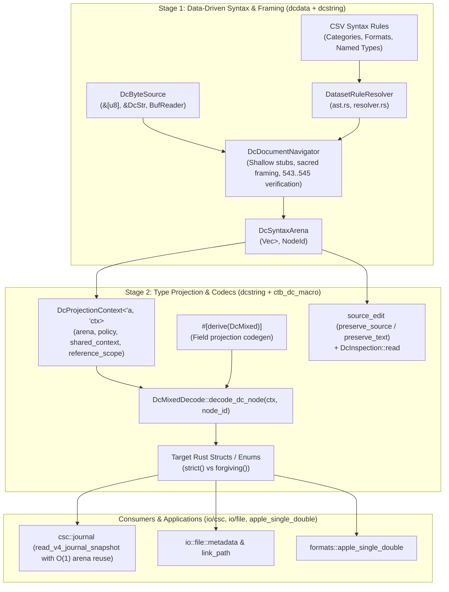

# Project: Dc Syntax Parser & DcSyntaxArena Deserialization/Projection Refactor

## Current Status (2026-10-17)

**Partially Implemented.** The correctness remediation below is a bounded
subset of the original refactor, not certification of feature completion.

### Remaining Gaps vs Original Request

- Textual encapsulation metadata retains a fixed 32-level nesting guard rather
    than a caller-configurable document resource budget.
- Unsupported temporal representations, including Panorama dates, now return
    errors rather than guessed epoch nanoseconds. Implementing their conversions
    remains separate work.
- Strict empty Apple metadata records still require a schema/representation
    decision; their current database grammar requires nonempty contents.
- Clippy completes with warnings, not a warning-clean result. Full workspace,
    cross-platform, and cumulative `5aafa2bf3762da8a6d719145cb71f362851c1c6e..HEAD`
    review remain deferred. Historical milestone/test claims below do not replace
    those checks.

### Correctness Remediation

- Generated struct and enum projectors perform single-pass iteration with zero
    lookahead; atom-based field tag/value pairs are normalized into parser-owned
    `Tagged` nodes during arena building.
- File-backed binary checksums are verified with bounded streaming reads;
    mismatches error under strict policy and warn under forgiving policy.
- Metadata and payload bounds are checked before allocation. Metadata uses
    fallible allocation and an explicit caller-configurable byte budget.
- Nested checksum metadata is parsed once per level and retains the caller's
    checksum policy. Deep assignment scanning is iterative and checks its RHS
    against the database grammar.
- Arena parsing and standalone validation share policy-aware grammar checks,
    including required headers, constrained fields, and container scope recovery.
- Document-level projection explicitly reports root consumption. Nested tuple,
    array, and flattened projections cannot consume unrelated document roots.
- Temporal codecs reject unsupported formats. Generic conversion derives
    forward document decoding, and Apple backup timestamps use a derived date
    representation instead of an unframed integer.

### Generated Static Syntax Table (2026-10-17)

- `DatasetRuleResolver::load()` now materializes the generated static syntax
    table `src/formats/dcdata/syntax/resolver/syntax_table.generated.rs`
    (checked in; regenerated via `./scripts/validate-data-tables`) instead of
    parsing the CSV dataset, parsing the syntax DSL, and recomputing derived
    tables at runtime on first resolver use.
- The table is emitted by `syntax::resolver::codegen` from the on-disk CSV
    dataset and contains the fully derived resolver state: character and
    format syntax rules, named type rules, script membership, opener/closer
    delimiter pairs, `<prefer>` deprecations, container header elements,
    trailing-after-closer elements, infix operator rules, named type starter
    sets, and opaque container sets.
- The CSV-driven indexing path is retained as
    `DatasetRuleResolver::load_from_dataset` /
    `load_from_embedded_dataset`; the generator and the dcdata test
    `syntax::resolver::tests::test_static_syntax_table_matches_csv_dataset`
    use it, and that test fails when the generated table diverges from the
    embedded CSV dataset (stale-table guard).
- Remaining nuance: first resolver use still performs a single
    materialization pass (`LazyLock`) building hash indexes from the
    compiled-in table literals. Zero-allocation static residency would
    require interning the syntax AST's owned strings and remains deferred.
- Remaining gap (build-time regeneration): `scripts/ci-build-inner` cleans
    every `*.generated.*` file and then requires each to be regenerated
    during `./build` with zero drift. `syntax_table.generated.rs` is
    currently regenerated only by the `validate-data-tables --write` bin,
    not during the build, so a clean CI build would fail to compile
    `ctb-formats-dcdata` (the generated module file is missing) before the
    bin can run. Closing this requires a build-time regeneration path; the
    established in-repo precedent is the kaitai crate's build script, which
    compiles the crate's own parser sources via `#[path]` includes.

### Verification

The following command passed on the current Linux container without suppressing
warnings: **655 passed, 0 failed, 0 ignored across 17 harnesses**. Integration
targets include the new projection regressions:

```sh
env RUSTFLAGS='' RUSTDOCFLAGS='' cargo test \
    -p ctb-formats-dcdata -p ctb-formats-dcstring -p ctb-dc-macro \
    -p ctb-io-file -p ctb-io-csc -p ctb-formats-apple-single-double \
    -p ctb-formats-conversion --lib --tests --no-fail-fast
```

Affected-crate Clippy (`--lib --tests --no-deps`) completed with warnings, not a
warning-clean result. The final modified file integration target was also
rechecked with Clippy. The expanded acceptance run initially found three file
challenge failures: malformed legacy/list fixtures and document projection
through the single-node API. Correcting those tests retained valid roundtrips,
malformed-input rejection, and consumption assertions; no grammar relaxation or
test skips were used. No cross-platform result or full-refactor completion is
implied.

## Architecture
The Document Character (`Dc`) subsystem in `ctoolbox` provides data-driven parsing, validation, serialization, and projection of structured documents, metadata, and journal logs.



## Feature Inventory
| # | Feature | Description | Milestone | Source |
|---|---------|-------------|-----------|--------|
| F1 | Clean up Commit `9105d5bae` | Revert the 7 dirty files to commit `314c3eb70` to remove 942 lines of broken merge/stash artifacts and duplicate lines. | M1 | Survey 1, ORIGINAL_REQUEST §R1 |
| F2 | Remove `suppress_trailing_dc_512` | Remove eager `Dc 512` consumption in format rule evaluation and eliminate `suppress_trailing_dc_512` hack across `navigator.rs`. | M1 | Survey 1, ORIGINAL_REQUEST §R1 |
| F3 | Remove `prefix_rule_fixed_arity` | Eliminate `prefix_rule_fixed_arity` and hardcoded short-Dc lists; drive `DcDocumentNavigator` directly from CSV `SyntaxPattern` ASTs via `DatasetRuleResolver`. | M1 | Survey 1, ORIGINAL_REQUEST §R1 |
| F4 | Enforce Navigator Document Validation | Ensure `framing.rs` and `matcher.rs` in `dcdata` remain deleted; route all document validation through `validate_dc_mixed_strict`, `validate_dc_str_strict`, `validate_dc_tokens_strict`. | M1 | Survey 1, ORIGINAL_REQUEST §R1 |
| F5 | `DcProjectionContext` Definition | Introduce `DcProjectionContext<'a, 'ctx>` over `DcSyntaxArena` tracking arena, policy, shared contexts, reference scopes, and field annotations. | M2 | Survey 2, ORIGINAL_REQUEST §R2 |
| F6 | `DcMixedDecode` Node Trait Migration | Refactor `DcMixedDecode` to `decode_dc_node(ctx: &mut DcProjectionContext, node_id: NodeId) -> Result<Self>`. | M2 | Survey 2, ORIGINAL_REQUEST §R2 |
| F7 | Primitive & Collection Node Projections | Implement `DcMixedDecode` over `DcSyntaxArena` for all primitive, collection, wrapper, and standard library types (including `Duration`, `String`, `bool`, integers, `Natural`, `Integer`, `Option<T>`, `Vec<T>`, `[T; N]`, `(A, B)`, `BTreeMap<K, V>`, `IpAddr`, `FormatId`, `PathBuf`, `SystemTime`, `BinaryPayload`, `Box<T>`, `Arc<T>`). | M2 | Survey 2, ORIGINAL_REQUEST §R2 |
| F8 | Transparent Universal Unwrapping | Transparently unwrap `397`/`561` equivalent lists, `315`/`316` optionals, `511..512` format representations, and `540`/`276` bound references during node projection. | M2 | Survey 2, ORIGINAL_REQUEST §R2 |
| F9 | Strict Syntax Enforcement | Enforce strict vs forgiving rules: reject bare strings and bare numbers in `strict()` mode for `PathBuf`, `LinkPath`, `FileTimestamps`, etc. | M2 | Survey 2, ORIGINAL_REQUEST §R2 |
| F10 | Rebase `source_edit` onto `DcSyntaxArena` | Rebase `preserve_source` and `preserve_text` directly onto `DcDocumentNavigator` + `DcSyntaxArena`, deleting `read_nodes`, `struct Node`, `struct Frame`, and `map_entries`. | M2 | Survey 2, ORIGINAL_REQUEST §R2 |
| F11 | Rebase `DcInspection` onto `DcSyntaxArena` | Update `DcInspection::read` to expand document frames into `DcSyntaxArena` and project via `DcProjectionContext`. | M2 | Survey 2, ORIGINAL_REQUEST §R2 |
| F12 | Delete `DcMixedReader` | Delete `struct DcMixedReader` and its ~35 pull-parsing and ad-hoc recovery methods from `dc_mixed_serde.rs`. | M2 | Survey 2, ORIGINAL_REQUEST §R2 |
| F13 | Refactor `#[derive(DcMixed)]` Codegen | Refactor `ctb_dc_macro` to generate `decode_dc_node(ctx, node_id)` projecting structs and enums directly from `DcSyntaxArena`. | M3 | Survey 2, ORIGINAL_REQUEST §R3 |
| F14 | Deduplicate Field Projection Codegen | Deduplicate struct field projection, `decode_field`, and enum named-variant field projection into a single shared `generate_field_projection_spec` codegen helper. | M3 | Survey 2, ORIGINAL_REQUEST §R3 |
| F15 | Migrate Manual Struct Projections | Migrate manual `DcMixedDecode` implementations (`FileTimestamps`, `AppleMetadata`, `NativeMetadata`, `LinkPath`, `StreamName`, `AppleSingleDoubleFile`) to `DcProjectionContext` + `NodeId`. | M3 | Survey 2, ORIGINAL_REQUEST §R3 |
| F16 | `csc::journal` Record Structs | Replace manual token loops in `journal.rs` and `legacy.rs` for `547..548` (session), `552..553` (error), and `554..555` (warning) with `#[derive(DcMixed)]` record structs. | M4 | Survey 3, ORIGINAL_REQUEST §R4 |
| F17 | $O(1)$ Arena Reuse in `read_v4_journal_snapshot` | Provide `nav.decode_frame_with_arena` and reuse a single `DcSyntaxArena` via `arena.clear()` per record in `read_v4_journal_snapshot`. | M4 | Survey 3, ORIGINAL_REQUEST §R4 |
| F18 | Legacy V4 Fixture Integrity & Roundtrip | Ensure `v4_dcmixed` test fixtures remain unmodified, error in `strict()` mode, recover in `forgiving()` mode, and valid newly written v4 journals roundtrip losslessly. | M4 | Survey 3, ORIGINAL_REQUEST §R4 |
| F19 | E2E Test Suite Infrastructure & Coverage | Independent requirement-driven test suite spanning Tiers 1-4 across all affected crates with zero regression. | M5 | Survey 3, ORIGINAL_REQUEST §Acceptance Criteria |
| F20 | Tier 5 Adversarial Coverage Hardening | Adversarial stress testing of malformed framing, checksum tampering, depth limits, and memory stability. | M5 | Survey 3, Plan §Phase 2 Hardening |

## Milestones
| # | Name | Scope | Dependencies | Status |
|---|------|-------|-------------|--------|
| M1 | Clean Up Commit `9105d5bae` & Finalize Stage 1 Parsing | Revert 7 files to `314c3eb70`, remove `suppress_trailing_dc_512` & `prefix_rule_fixed_arity`, finalize data-driven Stage 1 in `ctb_formats_dcdata` & `ctb_formats_dcstring`. | none | Partially Implemented |
| M2 | Rebase `DcMixedDecode`, `DcInspection`, `source_edit` onto `DcSyntaxArena` & Delete `DcMixedReader` | Introduce `DcProjectionContext`, implement `decode_dc_node` for all standard types, unwrap transparent wrappers, rebase `source_edit` / `DcInspection`, delete `DcMixedReader` & `read_nodes`. | M1 | Partially Implemented |
| M3 | Migrate Manual Structs (`apple_single_double` & `io/file`) | Migrate manual `DcMixedDecode` implementations in `apple_single_double` and `src/io/file/` (`metadata.rs`, `link_path.rs`, `streams.rs`) to `DcProjectionContext` + `NodeId`. | M2 | DONE |
| M4 | Migrate `csc::journal` & Verify V4 Fixtures | Replace manual loops with `#[derive(DcMixed)]` records in `ctb_io_csc`, implement $O(1)$ arena reuse, verify strict rejection/forgiving recovery of fixtures. | M3 | DONE |
| M5 | E2E Test Suite Verification & Adversarial Hardening | Pass 100% of E2E tests (Tiers 1-4) published in `TEST_READY.md`, followed by Tier 5 adversarial hardening with Challengers. | M4, TEST_READY.md | IN_PROGRESS |


## Interface Contracts

### 1. Stage 1 (`DcDocumentNavigator` & `DcSyntaxArena`) -> Stage 2 (`DcProjectionContext`)
```rust
// Defined in src/formats/dcstring/navigator.rs
pub struct DcSyntaxArena<'a> {
    pub fn new() -> Self;
    pub fn clear(&mut self);
    pub fn get(&self, id: NodeId) -> Option<&DcSyntaxNode<'a>>;
    pub fn alloc(&mut self, span: DcByteSpan, kind: DcSyntaxKind<'a>) -> NodeId;
}

pub struct DcProjectionContext<'a, 'ctx> {
    pub arena: &'a DcSyntaxArena<'a>,
    pub policy: &'ctx DcProjectionPolicy,
    pub shared_context: Option<&'ctx SharedValueContext>,
    pub reference_scope: SharedValueContext,
    pub annotations: Vec<DcFieldAnnotation>,
    pub annotating: bool,
    pub record_depth: usize,
}

pub trait DcMixedDecode: Sized {
    fn decode_dc_node(
        ctx: &mut DcProjectionContext<'_, '_>,
        node_id: NodeId,
    ) -> Result<Self>;
}
```

### 2. Stage 2 (`DcMixedDecode` / `#[derive(DcMixed)]`) -> `csc::journal`
```rust
// Defined on DcDocumentNavigator in src/formats/dcstring/navigator.rs
impl<'a, S: DcByteSource> DcDocumentNavigator<'a, S> {
    pub fn decode_frame_with_arena<T: DcMixedDecode>(
        &mut self,
        stub: &DcFrameStub,
        arena: &mut DcSyntaxArena<'a>,
        context: Option<&SharedValueContext>,
        policy: &DcProjectionPolicy,
    ) -> Result<T>;
}

// In src/io/csc/journal.rs
#[derive(Debug, Clone, PartialEq, Eq, ctb_formats_dcstring::DcMixed)]
#[dc(begin = 547, end = 548)]
pub struct JournalSessionRecord { ... }

#[derive(Debug, Clone, PartialEq, Eq, ctb_formats_dcstring::DcMixed)]
#[dc(begin = 552, end = 553)]
pub struct JournalErrorRecordPayload { ... }

#[derive(Debug, Clone, PartialEq, Eq, ctb_formats_dcstring::DcMixed)]
#[dc(begin = 554, end = 555)]
pub struct JournalWarningRecordPayload { ... }
```

## Code Layout
- `src/formats/dcdata/` (`ctb_formats_dcdata`):
  - `syntax/ast.rs`: AST representations for syntax rules, patterns, terms, elements.
  - `syntax/resolver.rs`: `DatasetRuleResolver` loading CSV syntax rules, container openers/closers, starter sets.
  - `syntax/validator.rs`: CSV schema validator (`validate_dc_syntax`).
- `src/formats/dcstring/` (`ctb_formats_dcstring`):
  - `navigator.rs`: `DcDocumentNavigator`, `DcSyntaxArena`, `DcSyntaxNode`, `NodeId`, `validate_dc_mixed_strict`.
  - `dc_mixed_serde.rs`: `DcProjectionContext`, `DcMixedDecode` trait and standard implementations.
  - `source_edit.rs`: In-place source rewriting (`preserve_source`, `preserve_text`) over `DcSyntaxArena`.
  - `dc_source.rs`: `DcInspection` over `DcSyntaxArena`.
  - `kv_map.rs`, `shared.rs`, `encapsulation.rs`: Encapsulation, key-value maps, lexical references.
  - `ctb_dc_macro/src/lib.rs`: Procedural macro `#[derive(DcMixed)]`.
- `src/io/csc/` (`ctb_io_csc`):
  - `journal.rs`: `JournalWriter`, `read_v4_journal_snapshot` with $O(1)$ arena reuse.
  - `legacy.rs`: Legacy journal format conversions.
- `src/io/file/` (`ctb_io`):
  - `metadata.rs`: `FileTimestamps`, `AppleMetadata`, `NativeMetadata`.
  - `link_path.rs`: `LinkPath`.
  - `streams.rs`: `StreamName`.
- `src/formats/apple_single_double/`:
  - `apple_single_double.rs`: `AppleSingleDoubleFile`, `DcMixedNumber`.

