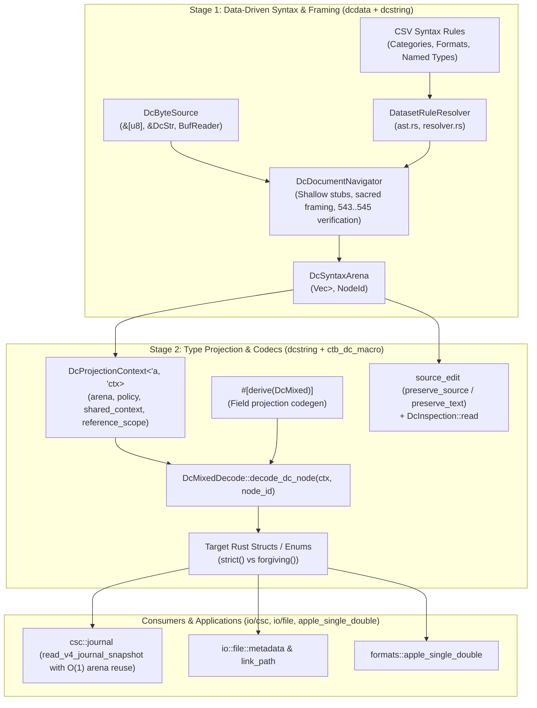

# Project: Dc Syntax Parser & DcSyntaxArena Deserialization/Projection Refactor

## Current Status (2026-10-17)

**Partially Implemented.** The correctness remediation below is a bounded
subset of the original refactor, not certification of feature completion.

- **Resolved `decode_field` tag alignment:** Removed `tag.saturating_add(1114112)`
  heuristic in `ctb_dc_macro`. In the Global Graph layout, `0..=1_114_111`
  represents Unicode codepoints, not short Dc offsets; `tag` passed at runtime
  is already the canonical Global Graph ID (`u128`), and compile-time shorthand
  attributes (`#[dc(...)]`) already resolve to canonical IDs per `README.shorthand.md`.

`
Overlayed Field Ambiguity (icon_id vs scroll_position / frScroll):

In Classic Mac OS (FXInfo for files vs DXInfo for folders), bytes 16–19 of the 32-byte Finder info record have dual meaning depending on whether the entity is a file or a folder:
Files: Byte offset 16–17 is fdIconID (custom icon ID, e.g. -16455), and bytes 18–19 are reserved/zero.
Folders: Bytes 16–19 are frScroll (Point containing vertical and horizontal scroll coordinates (v, h) for the folder window).
If scroll_position was previously parsed when scroll_h != 0, icon_id was left populated with v, causing custom icon ID Dc 492 to be emitted alongside coordinate Dc 407.
Resolution: parse_extended_finder_info now zeroes out icon_id when scroll_h != 0, and write_apple_single_double checks scroll_position first before falling back to icon_id.
`

This does not sound right solution - it sounds like it should be checking whether the file or a directory, not scroll_h.

- **Resolved empty flag struct encoding & roundtrip (406 388 389):** Empty flag
  structs now omit internal list containers (`310 275 ... 311`) when no flags
  are enabled, encoding cleanly as `388 389` (or `406 388 389` when prefixed).
  Both empty `388 389` and legacy empty list `388 310 275 311 389` decode to default
  in strict and forgiving modes, fully conforming with Dc 388 syntax
  `:~ ([list:Semantic:fileflag] | [539:] | [397:] | [561:])? 389` and roundtripping
  identically.


- **Mac Files Lossless Roundtrip & Overlay Disambiguation**:
  - Classic Mac OS and macOS extended attributes stored beyond offset 70 in Entry 9 (`FinderInfo`)
    are preserved as bit-for-bit exact streams in `FileEntity.streams` (`Dc 323..324`, `StreamKind::ExtendedAttribute`),
    avoiding speculative or lossy auto-merging into ad-hoc AppleMetadata fields.
  - Resolved overlay ambiguity in `ExtendedFinderInfo` bytes 16..20 (`fdIconID` vs `frScroll`):
    records are now unambiguously disambiguated using directory state (`finfo.window_bounds.is_some()`).
    Folders preserve exact QuickDraw scroll coordinates (including `(0, 0)`), while regular files
    preserve custom `icon_id` and zero reserved bytes without false scroll coordinate emissions.
  - Validated by empirical challenge test suite in `ctb_io_file::tests::challenge_m3_mac_lossless` across
    AppleDouble binary archives, `FileEntity`, and `DcMstring`.


### 17 October Review Remediation

**Partially Implemented.** This pass remediates a bounded subset of the
cumulative review; it does not certify the original refactor as finished.

- Section verification validates raw digest length before materialization and
    uses the declared supported hash algorithm. Invalid untyped checksums may be
    retained only as unverified frames under forgiving policy; no algorithm is
    inferred from a historical fixture.
- Type constructor evaluation is iterative, and shallow container scanning
    honors depth policy. Generated opaque-container classification prevents
    comment contents from opening unrelated structural frames.
- Flattened projection retains required-field presence and original field
    spans. Final conversion failures follow caller policy; named enum fields
    validate malformed duplicates, and unit variants check unused contents.
- Inspection honors parsing policy, decodes document-level values, and retains
    parser/projection diagnostics. Malformed source editing explicitly opts into
    forgiving inspection instead of bypassing strict syntax checks.
- Journal replay distinguishes typed incomplete EOF from malformed closed
    records, rejects escaped completion markers, invalidates prior completion
    after a later batch, and retains integrity-salvage warnings. Policy reaches
    flush-deleted and legacy embedded identity decoding. Document conversion
    explicitly selects forgiving historical projection; replay defaults remain
    strict. Corruption tests append payload bytes and include positive controls.
- Encoding compatibility no longer upgrades extension-only format candidates
    to structural certainty. Genuine descriptor magic retains high confidence.
- Authoritative grammar loading rejects invalid named rules and quantifiers;
    failed generation preserves the previous output. Cargo build-script paths
    now resolve the existing workspace resource bundle for validation.
- The operator approved two additional semantic concepts: Dc 563, File data
    format (`[format]`), and Dc 564, Archive member position
    (`[number:Natural0]`). Archive origins now use these instead of bundle-format
    and filesystem-inode tags, and `archive_format` is a typed `FormatId`.
    Canonical regeneration reported no validation diagnostics.

Verification on Linux musl: **852 passed, 0 failed, 0 ignored across 19
harnesses**, plus the separately passing Cargo build-script locator regression.
The affected crates were dcdata, dcstring, dc-macro, io-file, io-csc,
apple-single-double, conversion, and detection, using `--lib --tests
--no-fail-fast`, explicit `x86_64-unknown-linux-musl`, `--locked --offline`,
and empty `RUSTFLAGS`/`RUSTDOCFLAGS`. Affected-crate Clippy, also including
utilities, passed with warnings and no errors. Full logs for this session are
`/tmp/ctb-dc-refactor-final-tests.log` and
`/tmp/ctb-dc-refactor-final-clippy.log`. Full workspace, clean-bootstrap, and
non-Linux runtime checks were not run.

Historical FIXME audit: 49 commit diffs contained 13 added FIXME-bearing
lines. The flattened-format note was inherited, temporarily removed, restored,
and remains open; the routine-invocation note is also inherited and retained.
The removed macro-layer note is only partially addressed: shared map extraction
exists, but legacy/deprecation policy is not fully centralized. Quoted and
generated copies are not independent resolved tasks.

### Remaining Gaps vs Original Request

- Named numeric/list subtype constraints and escaped non-Unicode literal or
    identifier payloads still require the source-traced review regressions and
    fixes; passing current tests does not establish their correctness.
- Parser/projector shape normalization and retained diagnostics are not fully
    centralized. In particular, deprecated syntax can bypass diagnostic sinks,
    and `strict()` still warns rather than errors on deprecation, contrary to
    the original strict-policy specification.
- Converted flattened struct wrappers and optional flattened enum encoding
    have unhandled derive combinations identified during implementation. These
    are not covered by the successful bounded-field regression cases.
- Remote URI/ETag mappings, unknown Apple entry preservation, and inherited
    binary type-insensitive source reconciliation remain semantic/fidelity
    work. They were not silently resolved by the archive-origin correction.
- Digest-size validation bounds raw file-backed digest reads; general textual
    encapsulation still lacks a payload-allocation budget before decoding.
- Journal parser overhead is bounded per expanded record, but snapshots retain
    all committed entities. Total snapshot memory is not O(1).

- Textual encapsulation metadata nesting is now a caller-configurable document
    resource budget (`DcProjectionPolicy::max_encapsulation_metadata_depth`,
    default 32), but the policy-free utility entry points (`DcMstring::
    from_dc_str`, `push_binary_with_metadata`, `to_dc_string`,
    `validate_metadata`, `write_text`) still enforce only the default budget;
    giving those a policy-parameterized variant remains open.
- Unsupported temporal representations, including Panorama dates, now return
    errors rather than guessed epoch nanoseconds. Implementing their conversions
    remains separate work. [note: I think this comment does make sense at least mostly - it's like, a date is a format declaration and then the representation of that format, so actually using them would need some sort of normalization of it. Out of scope for now, though.]
- Clippy completes with warnings, not a warning-clean result. Full workspace,
    cross-platform, and cumulative `5aafa2bf3762da8a6d719145cb71f362851c1c6e..HEAD`
    review remain deferred. Historical milestone/test claims below do not replace
    those checks.

### Correctness Remediation

- Empty Apple metadata containers (Dc 401..402) are permitted by updating the
    semantic database grammar rule to `[^402]* 402` (matching environment and
    extent containers), enabling strict empty `AppleMetadata::default()` arena
    parsing, decode projection, and full roundtrip fidelity.
- Generated struct and enum projectors perform single-pass iteration with zero
    lookahead; atom-based field tag/value pairs are normalized into parser-owned
    `Tagged` nodes during arena building.
- File-backed binary checksums are verified with bounded streaming reads;
    mismatches error under strict policy and warn under forgiving policy.
- Metadata and payload bounds are checked before allocation. Metadata uses
    fallible allocation and an explicit caller-configurable byte budget.
- Nested checksum metadata is parsed once per level and retains the caller's
    checksum policy. Deep assignment scanning is iterative and checks its RHS
    against the database grammar.
- Textual encapsulation metadata nesting is a caller-configurable document
    resource budget (`DcProjectionPolicy::max_encapsulation_metadata_depth`,
    default `DEFAULT_MAX_ENCAPSULATION_METADATA_DEPTH` = 32,
    `with_max_encapsulation_metadata_depth`). Exceeding it remains a hard error
    under every diagnostic policy, matching `max_binary_metadata_bytes`.
    Encapsulation payload parsing walks nested checksum metadata with an
    explicit frame stack instead of recursion, so a raised budget cannot
    exhaust the call stack (verified at 20,000 levels).
- Arena parsing and standalone validation share policy-aware grammar checks,
    including required headers, constrained fields, and container scope recovery.
- Document-level projection explicitly reports root consumption. Nested tuple,
    array, and flattened projections cannot consume unrelated document roots.
- Temporal codecs reject unsupported formats. Generic conversion derives
    forward document decoding, and Apple backup timestamps use a derived date
    representation instead of an unframed integer.

### Generated Static Syntax Table (2026-10-17)

- `DatasetRuleResolver::load()` now materializes the generated static syntax
    table `src/formats/dcdata/syntax/resolver/syntax_table.generated.rs`
    (checked in; regenerated by the dcdata build script on every `cargo
    build` and via `./scripts/validate-data-tables`) instead of parsing the
    CSV dataset, parsing the syntax DSL, and recomputing derived tables at
    runtime on first resolver use.
- The table is emitted by `syntax::codegen` from the on-disk CSV dataset
    and contains the fully derived resolver state: character and format
    syntax rules, named type rules, script membership, opener/closer
    delimiter pairs, `<prefer>` deprecations, container header elements,
    trailing-after-closer elements, infix operator rules, named type
    starter sets, and opaque container sets.
- The CSV-driven indexing path is retained as
    `DatasetRuleResolver::load_from_dataset` /
    `load_from_embedded_dataset`; the generator and the dcdata test
    `syntax::resolver::tests::test_static_syntax_table_matches_csv_dataset`
    use it, and that test fails when the generated table diverges from the
    embedded CSV dataset (stale-table guard).
- Build-time regeneration (CI zero-drift requirement):
    `src/formats/dcdata/build.rs` regenerates the table before the crate
    compiles, following the kaitai crate's precedent of compiling the
    crate's own sources into the build script via `#[path]` includes
    (validation, format, format_spec, and syntax modules plus small
    shims for the crate-root embedded-data accessors). To keep the build
    script from including the file it generates, the `syntax_table` and
    `codegen` module declarations, `load()`,
    `load_from_embedded_dataset()`, and the default-resolver static moved
    from `syntax/resolver.rs` into `syntax.rs`; `parse_data_constraint`
    moved to `syntax/data_constraint.rs`; and `DatasetRuleResolver`'s
    fields plus `precompute_derived_tables` became `pub(super)` so the
    sibling `codegen` module retains access. Verified: deleting the
    generated file and rebuilding restores it byte-identically.
- Remaining nuance: first resolver use still performs a single
    materialization pass (`LazyLock`) building hash indexes from the
    compiled-in table literals. Zero-allocation static residency would
    require interning the syntax AST's owned strings and remains deferred.

### Verification

The following command passed on the current Linux container without suppressing
warnings: **658 passed, 0 failed, 0 ignored across 17 harnesses** (655 prior
plus the three static-syntax-table tests). Integration targets include the new
projection regressions:

```sh
env RUSTFLAGS='' RUSTDOCFLAGS='' cargo test \
    -p ctb-formats-dcdata -p ctb-formats-dcstring -p ctb-dc-macro \
    -p ctb-io-file -p ctb-io-csc -p ctb-formats-apple-single-double \
    -p ctb-formats-conversion --lib --tests --no-fail-fast
```

Affected-crate Clippy (`--lib --tests --no-deps`) completed with warnings, not a
warning-clean result. The final modified file integration target was also
rechecked with Clippy. For the static-syntax-table work specifically,
`syntax_table.generated.rs` ends at the systemic prelude-expectation warning
only (its generated `too_many_lines` expectations are all fulfilled),
`build.rs` at one systemic prelude-expectation warning, and `codegen.rs` at
the repository's established codegen-idiom baseline (`format!(..)`-append
style shared with `ctb-build-support`, plus the standard prelude and test
boilerplate warnings); pre-existing warnings in moved `resolver.rs` code were
left as-is. Build-script regeneration was verified directly: deleting
`syntax_table.generated.rs` and rebuilding restores it byte-identically, and
touching a dataset CSV re-triggers the generator with unchanged output. The
expanded acceptance run initially found three file
challenge failures: malformed legacy/list fixtures and document projection
through the single-node API. Correcting those tests retained valid roundtrips,
malformed-input rejection, and consumption assertions; no grammar relaxation or
test skips were used. No cross-platform result or full-refactor completion is
implied.

## Architecture
The Document Character (`Dc`) subsystem in `ctoolbox` provides data-driven parsing, validation, serialization, and projection of structured documents, metadata, and journal logs.



## Feature Inventory
| # | Feature | Description | Milestone | Source |
|---|---------|-------------|-----------|--------|
| F1 | Clean up Commit `9105d5bae` | Revert the 7 dirty files to commit `314c3eb70` to remove 942 lines of broken merge/stash artifacts and duplicate lines. | M1 | Survey 1, ORIGINAL_REQUEST §R1 |
| F2 | Remove `suppress_trailing_dc_512` | Remove eager `Dc 512` consumption in format rule evaluation and eliminate `suppress_trailing_dc_512` hack across `navigator.rs`. | M1 | Survey 1, ORIGINAL_REQUEST §R1 |
| F3 | Remove `prefix_rule_fixed_arity` | Eliminate `prefix_rule_fixed_arity` and hardcoded short-Dc lists; drive `DcDocumentNavigator` directly from CSV `SyntaxPattern` ASTs via `DatasetRuleResolver`. | M1 | Survey 1, ORIGINAL_REQUEST §R1 |
| F4 | Enforce Navigator Document Validation | Ensure `framing.rs` and `matcher.rs` in `dcdata` remain deleted; route all document validation through `validate_dc_mixed_strict`, `validate_dc_str_strict`, `validate_dc_tokens_strict`. | M1 | Survey 1, ORIGINAL_REQUEST §R1 |
| F5 | `DcProjectionContext` Definition | Introduce `DcProjectionContext<'a, 'ctx>` over `DcSyntaxArena` tracking arena, policy, shared contexts, reference scopes, and field annotations. | M2 | Survey 2, ORIGINAL_REQUEST §R2 |
| F6 | `DcMixedDecode` Node Trait Migration | Refactor `DcMixedDecode` to `decode_dc_node(ctx: &mut DcProjectionContext, node_id: NodeId) -> Result<Self>`. | M2 | Survey 2, ORIGINAL_REQUEST §R2 |
| F7 | Primitive & Collection Node Projections | Implement `DcMixedDecode` over `DcSyntaxArena` for all primitive, collection, wrapper, and standard library types (including `Duration`, `String`, `bool`, integers, `Natural`, `Integer`, `Option<T>`, `Vec<T>`, `[T; N]`, `(A, B)`, `BTreeMap<K, V>`, `IpAddr`, `FormatId`, `PathBuf`, `SystemTime`, `BinaryPayload`, `Box<T>`, `Arc<T>`). | M2 | Survey 2, ORIGINAL_REQUEST §R2 |
| F8 | Transparent Universal Unwrapping | Transparently unwrap `397`/`561` equivalent lists, `315`/`316` optionals, `511..512` format representations, and `540`/`276` bound references during node projection. | M2 | Survey 2, ORIGINAL_REQUEST §R2 |
| F9 | Strict Syntax Enforcement | Enforce strict vs forgiving rules: reject bare strings and bare numbers in `strict()` mode for `PathBuf`, `LinkPath`, `FileTimestamps`, etc. | M2 | Survey 2, ORIGINAL_REQUEST §R2 |
| F10 | Rebase `source_edit` onto `DcSyntaxArena` | Rebase `preserve_source` and `preserve_text` directly onto `DcDocumentNavigator` + `DcSyntaxArena`, deleting `read_nodes`, `struct Node`, `struct Frame`, and `map_entries`. | M2 | Survey 2, ORIGINAL_REQUEST §R2 |
| F11 | Rebase `DcInspection` onto `DcSyntaxArena` | Update `DcInspection::read` to expand document frames into `DcSyntaxArena` and project via `DcProjectionContext`. | M2 | Survey 2, ORIGINAL_REQUEST §R2 |
| F12 | Delete `DcMixedReader` | Delete `struct DcMixedReader` and its ~35 pull-parsing and ad-hoc recovery methods from `dc_mixed_serde.rs`. | M2 | Survey 2, ORIGINAL_REQUEST §R2 |
| F13 | Refactor `#[derive(DcMixed)]` Codegen | Refactor `ctb_dc_macro` to generate `decode_dc_node(ctx, node_id)` projecting structs and enums directly from `DcSyntaxArena`. | M3 | Survey 2, ORIGINAL_REQUEST §R3 |
| F14 | Deduplicate Field Projection Codegen | Deduplicate struct field projection, `decode_field`, and enum named-variant field projection into a single shared `generate_field_projection_spec` codegen helper. | M3 | Survey 2, ORIGINAL_REQUEST §R3 |
| F15 | Migrate Manual Struct Projections | Migrate manual `DcMixedDecode` implementations (`FileTimestamps`, `AppleMetadata`, `NativeMetadata`, `LinkPath`, `StreamName`, `AppleSingleDoubleFile`) to `DcProjectionContext` + `NodeId`. | M3 | Survey 2, ORIGINAL_REQUEST §R3 |
| F16 | `csc::journal` Record Structs | Replace manual token loops in `journal.rs` and `legacy.rs` for `547..548` (session), `552..553` (error), and `554..555` (warning) with `#[derive(DcMixed)]` record structs. | M4 | Survey 3, ORIGINAL_REQUEST §R4 |
| F17 | $O(1)$ Arena Reuse in `read_v4_journal_snapshot` | Provide `nav.decode_frame_with_arena` and reuse a single `DcSyntaxArena` via `arena.clear()` per record in `read_v4_journal_snapshot`. | M4 | Survey 3, ORIGINAL_REQUEST §R4 |
| F18 | Legacy V4 Fixture Integrity & Roundtrip | Ensure `v4_dcmixed` test fixtures remain unmodified, error in `strict()` mode, recover in `forgiving()` mode, and valid newly written v4 journals roundtrip losslessly. | M4 | Survey 3, ORIGINAL_REQUEST §R4 |
| F19 | E2E Test Suite Infrastructure & Coverage | Independent requirement-driven test suite spanning Tiers 1-4 across all affected crates with zero regression. | M5 | Survey 3, ORIGINAL_REQUEST §Acceptance Criteria |
| F20 | Tier 5 Adversarial Coverage Hardening | Adversarial stress testing of malformed framing, checksum tampering, depth limits, and memory stability. | M5 | Survey 3, Plan §Phase 2 Hardening |

## Milestones
| # | Name | Scope | Dependencies | Status |
|---|------|-------|-------------|--------|
| M1 | Clean Up Commit `9105d5bae` & Finalize Stage 1 Parsing | Revert 7 files to `314c3eb70`, remove `suppress_trailing_dc_512` & `prefix_rule_fixed_arity`, finalize data-driven Stage 1 in `ctb_formats_dcdata` & `ctb_formats_dcstring`. | none | Partially Implemented |
| M2 | Rebase `DcMixedDecode`, `DcInspection`, `source_edit` onto `DcSyntaxArena` & Delete `DcMixedReader` | Introduce `DcProjectionContext`, implement `decode_dc_node` for all standard types, unwrap transparent wrappers, rebase `source_edit` / `DcInspection`, delete `DcMixedReader` & `read_nodes`. | M1 | Partially Implemented |
| M3 | Migrate Manual Structs (`apple_single_double` & `io/file`) | Migrate manual `DcMixedDecode` implementations in `apple_single_double` and `src/io/file/` (`metadata.rs`, `link_path.rs`, `streams.rs`) to `DcProjectionContext` + `NodeId`. | M2 | DONE |
| M4 | Migrate `csc::journal` & Verify V4 Fixtures | Replace manual loops with `#[derive(DcMixed)]` records in `ctb_io_csc`, implement $O(1)$ arena reuse, verify strict rejection/forgiving recovery of fixtures. | M3 | DONE |
| M5 | E2E Test Suite Verification & Adversarial Hardening | Pass 100% of E2E tests (Tiers 1-4) published in `TEST_READY.md`, followed by Tier 5 adversarial hardening with Challengers. | M4, TEST_READY.md | IN_PROGRESS |


## Interface Contracts

### 1. Stage 1 (`DcDocumentNavigator` & `DcSyntaxArena`) -> Stage 2 (`DcProjectionContext`)
```rust
// Defined in src/formats/dcstring/navigator.rs
pub struct DcSyntaxArena<'a> {
    pub fn new() -> Self;
    pub fn clear(&mut self);
    pub fn get(&self, id: NodeId) -> Option<&DcSyntaxNode<'a>>;
    pub fn alloc(&mut self, span: DcByteSpan, kind: DcSyntaxKind<'a>) -> NodeId;
}

pub struct DcProjectionContext<'a, 'ctx> {
    pub arena: &'a DcSyntaxArena<'a>,
    pub policy: &'ctx DcProjectionPolicy,
    pub shared_context: Option<&'ctx SharedValueContext>,
    pub reference_scope: SharedValueContext,
    pub annotations: Vec<DcFieldAnnotation>,
    pub annotating: bool,
    pub record_depth: usize,
}

pub trait DcMixedDecode: Sized {
    fn decode_dc_node(
        ctx: &mut DcProjectionContext<'_, '_>,
        node_id: NodeId,
    ) -> Result<Self>;
}
```

### 2. Stage 2 (`DcMixedDecode` / `#[derive(DcMixed)]`) -> `csc::journal`
```rust
// Defined on DcDocumentNavigator in src/formats/dcstring/navigator.rs
impl<'a, S: DcByteSource> DcDocumentNavigator<'a, S> {
    pub fn decode_frame_with_arena<T: DcMixedDecode>(
        &mut self,
        stub: &DcFrameStub,
        arena: &mut DcSyntaxArena<'a>,
        context: Option<&SharedValueContext>,
        policy: &DcProjectionPolicy,
    ) -> Result<T>;
}

// In src/io/csc/journal.rs
#[derive(Debug, Clone, PartialEq, Eq, ctb_formats_dcstring::DcMixed)]
#[dc(begin = 547, end = 548)]
pub struct JournalSessionRecord { ... }

#[derive(Debug, Clone, PartialEq, Eq, ctb_formats_dcstring::DcMixed)]
#[dc(begin = 552, end = 553)]
pub struct JournalErrorRecordPayload { ... }

#[derive(Debug, Clone, PartialEq, Eq, ctb_formats_dcstring::DcMixed)]
#[dc(begin = 554, end = 555)]
pub struct JournalWarningRecordPayload { ... }
```

## Code Layout
- `src/formats/dcdata/` (`ctb_formats_dcdata`):
  - `syntax/ast.rs`: AST representations for syntax rules, patterns, terms, elements.
  - `syntax/resolver.rs`: `DatasetRuleResolver` loading CSV syntax rules, container openers/closers, starter sets.
  - `syntax/validator.rs`: CSV schema validator (`validate_dc_syntax`).
- `src/formats/dcstring/` (`ctb_formats_dcstring`):
  - `navigator.rs`: `DcDocumentNavigator`, `DcSyntaxArena`, `DcSyntaxNode`, `NodeId`, `validate_dc_mixed_strict`.
  - `dc_mixed_serde.rs`: `DcProjectionContext`, `DcMixedDecode` trait and standard implementations.
  - `source_edit.rs`: In-place source rewriting (`preserve_source`, `preserve_text`) over `DcSyntaxArena`.
  - `dc_source.rs`: `DcInspection` over `DcSyntaxArena`.
  - `kv_map.rs`, `shared.rs`, `encapsulation.rs`: Encapsulation, key-value maps, lexical references.
  - `ctb_dc_macro/src/lib.rs`: Procedural macro `#[derive(DcMixed)]`.
- `src/io/csc/` (`ctb_io_csc`):
  - `journal.rs`: `JournalWriter`, `read_v4_journal_snapshot` with $O(1)$ arena reuse.
  - `legacy.rs`: Legacy journal format conversions.
- `src/io/file/` (`ctb_io`):
  - `metadata.rs`: `FileTimestamps`, `AppleMetadata`, `NativeMetadata`.
  - `link_path.rs`: `LinkPath`.
  - `streams.rs`: `StreamName`.
- `src/formats/apple_single_double/`:
  - `apple_single_double.rs`: `AppleSingleDoubleFile`, `DcMixedNumber`.

