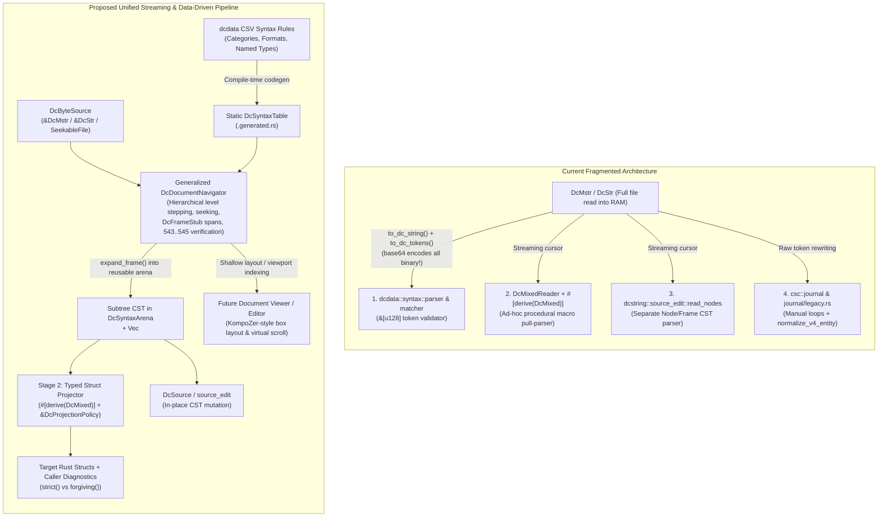

# Data-Driven Dc Syntax Parsing & Projection Plan

## 1. Executive Summary & Architectural Diagnosis

Currently, Document Character (`Dc`) parsing, validation, and serialization/deserialization are split across **four separate parsers** and **multiple hand-coded codec layers**:



---

## 2. Part 1: What Can Be DRYed Out

### A. Four Redundant Document/Frame Parsers
1. **[`dcdata::syntax::parser`](file:///workspaces/ctoolbox/src/formats/dcdata/syntax/parser.rs) & [`matcher.rs`](file:///workspaces/ctoolbox/src/formats/dcdata/syntax/matcher.rs) (`&[u128]` token-slice parser)**:
   - Operates exclusively on `&[u128]`. Validating a binary [`DcMstr`](file:///workspaces/ctoolbox/src/formats/dcstring/dc_mixed.rs#L53-L56) (e.g., in [`assert_dc_document_roundtrip`](file:///workspaces/ctoolbox/src/formats/dcstring/dc_mixed_serde.rs#L211-L246) or [`csc::journal`](file:///workspaces/ctoolbox/src/io/csc/journal.rs#L1182-L1200)) requires calling [`DcMstr::to_dc_tokens()`](file:///workspaces/ctoolbox/src/formats/dcstring/dc_mixed.rs#L521-L526), which base64-encodes every raw binary payload into a `DcString` and allocates a `Vec<u128>` for the entire document.
   - [`parser.rs`](file:///workspaces/ctoolbox/src/formats/dcdata/syntax/parser.rs#L803-L1083) hardcodes structural branches for `255` (escape), `260..261` (literal), `270..271` (identifier), `258..259` (parameter), `269` (assignment), `276` (reference), `279`/`256..257` (invocation), `203..204` (binary encapsulation), `511..512` (format representation), and `310`/`313`/`559` (list/map headers) alongside the general rule engine in [`matcher.rs`](file:///workspaces/ctoolbox/src/formats/dcdata/syntax/matcher.rs).
2. **[`DcMixedReader`](file:///workspaces/ctoolbox/src/formats/dcstring/dc_mixed_serde.rs#L298-L320) + [`#[derive(DcMixed)]`](file:///workspaces/ctoolbox/src/formats/dcstring/ctb_dc_macro/src/lib.rs) (`dc_mixed_serde.rs`)**:
   - Pull-parses directly from `DcMstr`/`DcStr`, but bakes structural assumptions directly into macro-generated tag-matching loops and hand-written `DcMixedDecode` implementations.
   - Diverges from the canonical syntax rules in several places:
     - [`DcMixedReader::read_string`](file:///workspaces/ctoolbox/src/formats/dcstring/dc_mixed_serde.rs#L397-L426) does not unescape `Dc 255` inside `260..261` literals (even though `<str as DcMixedEncode>` escapes `255` and `261`, and [`scan_literal_frame`](file:///workspaces/ctoolbox/src/formats/dcdata/syntax/framing.rs#L61-L177) / [`source_edit.rs`](file:///workspaces/ctoolbox/src/formats/dcstring/source_edit.rs#L121-L154) do unescape `255`).
     - [`Vec<T>::decode_dc_mixed`](file:///workspaces/ctoolbox/src/formats/dcstring/dc_mixed_serde.rs#L964-L1002) expects `[type]` immediately after `Dc 310` and fails if the optional `[number $length]?` header permitted by `Dc 310`'s syntax (`:~ [number $length]? [type] ... 311`) is present.
     - Fails immediately on any unknown field tag or unexpected wrapper because it has no general frame-skipping or error-recovery mechanism.
3. **[`source_edit::read_nodes`](file:///workspaces/ctoolbox/src/formats/dcstring/source_edit.rs#L84-L280)**:
   - A third recursive-descent parser over `DcMixedReader` that builds a lossless `Node` / `Frame` tree (`Node::Atom`, `Node::Literal`, `Node::Binary`, `Node::Frame`) using `default_syntax_resolver().closer_for_opener()` for [`DcSource`](file:///workspaces/ctoolbox/src/formats/dcstring/dc_source.rs#L86-L92) inspection and in-place field edits.
4. **Manual Journal & Legacy Scanners in [`csc::journal`](file:///workspaces/ctoolbox/src/io/csc/journal.rs) and [`csc::journal::legacy`](file:///workspaces/ctoolbox/src/io/csc/journal/legacy.rs)**:
   - [`journal.rs`](file:///workspaces/ctoolbox/src/io/csc/journal.rs#L533-L793) hand-codes `peek_char`/`next_char` loops for `DC_BEGIN_OPERATION_SESSION` (`547..548`), `DC_BEGIN_CHECKSUMMED_SECTION` (`543..544` + `545`), `DC_BEGIN_ERROR_RECORD` (`552..553`), and `DC_BEGIN_WARNING_RECORD` (`554..555`).
   - [`journal/legacy.rs`](file:///workspaces/ctoolbox/src/io/csc/journal/legacy.rs#L92-L386) (`normalize_v4_entity`, `read_v4_raw_flags`, `adapt_v4_stream_names`) implements a fourth state machine tracking `depth`, `in_literal`, `255`, `203`, `317..318`, `539`, and `338` solely to work around buggy development-era v4 test fixtures. Under the new architecture, those special-case token rewriters are removed; broken syntax either errors in `strict` mode or goes through the standard `forgiving` recovery path.

### B. Duplicated Primitive & Structural Codecs
| Construct | Currently Duplicated Across | Unified Target |
| :--- | :--- | :--- |
| **Binary encapsulation** (`203 [type]? [number]? [checksum]? ... 204`) | 1. [`encapsulation.rs`](file:///workspaces/ctoolbox/src/formats/dcstring/encapsulation.rs#L112-L455)<br/>2. [`DcMixedReader::read_binary_payload`](file:///workspaces/ctoolbox/src/formats/dcstring/dc_mixed_serde.rs#L533-L608) & [`read_checksum_payload`](file:///workspaces/ctoolbox/src/formats/dcstring/dc_mixed_serde.rs#L611-L677)<br/>3. [`source_edit::read_binary_node`](file:///workspaces/ctoolbox/src/formats/dcstring/source_edit.rs#L156-L246)<br/>4. [`matcher.rs`](file:///workspaces/ctoolbox/src/formats/dcdata/syntax/matcher.rs#L473-L528) & [`parser.rs`](file:///workspaces/ctoolbox/src/formats/dcdata/syntax/parser.rs#L1007-L1083) | Single mixed-mode `203..204` rule parser producing `DcSyntaxNode::Binary` with `BinaryPayloadRef` (zero-copy byte slice in memory, lazy `FileSpan { file_offset, len }` on seekable `.dcmm` files, or decoded bytes for base64-encapsulated `DcStr`). |
| **Numbers** (`6 [format:number] [^7]+ 7`) | 1. [`DcMixedReader::read_natural` / `read_integer`](file:///workspaces/ctoolbox/src/formats/dcstring/dc_mixed_serde.rs#L428-L517)<br/>2. [`encapsulation::Cursor::read_number`](file:///workspaces/ctoolbox/src/formats/dcstring/encapsulation.rs#L279-L315)<br/>3. [`matcher::decode_natural_number_tokens`](file:///workspaces/ctoolbox/src/formats/dcdata/syntax/matcher.rs#L155-L199) | Single `number` syntax codec supporting `f369` (Natural64), `f370` (Int64), `f374` (Decimal), etc., plus range constraints (`Natural0`, `<8`). |
| **Literals & Identifiers** (`260..261`, `270..271` with `255` escape) | 1. [`framing.rs`](file:///workspaces/ctoolbox/src/formats/dcdata/syntax/framing.rs)<br/>2. [`DcMixedReader::read_string`](file:///workspaces/ctoolbox/src/formats/dcstring/dc_mixed_serde.rs#L397-L426)<br/>3. [`shared::decode_identifier`](file:///workspaces/ctoolbox/src/formats/dcstring/shared.rs#L181-L196)<br/>4. [`source_edit::read_delimited_text`](file:///workspaces/ctoolbox/src/formats/dcstring/source_edit.rs#L121-L154) | Single framing scanner over `DcByteSource` preserving both raw span and unescaped payload. |
| **Key-Value Maps** (`559..560` + `514..515` vs legacy `313..314`) | 1. [`kv_map.rs`](file:///workspaces/ctoolbox/src/formats/dcstring/kv_map.rs)<br/>2. [`source_edit::map_entries`](file:///workspaces/ctoolbox/src/formats/dcstring/source_edit.rs#L365-L444)<br/>3. [`parser.rs`](file:///workspaces/ctoolbox/src/formats/dcdata/syntax/parser.rs#L1133-L1281) | Single `DcSyntaxNode::KvMap` preserving `DcKvMapEncoding` (`Pairs` vs `Legacy`, deprecating `313` via `<prefer>559`). |
| **Equivalents & Optionals** (`397`/`561`, `315`/`316`) | 1. [`ctb_dc_macro`](file:///workspaces/ctoolbox/src/formats/dcstring/ctb_dc_macro/src/lib.rs#L1575-L1618) (`equivalents` and `raw` codegen)<br/>2. [`dc_mixed_serde.rs`](file:///workspaces/ctoolbox/src/formats/dcstring/dc_mixed_serde.rs#L1361-L1418) (`PathBuf`, `Option<T>`)<br/>3. [`matcher.rs`](file:///workspaces/ctoolbox/src/formats/dcdata/syntax/matcher.rs#L290-L413) | First-class `DcSyntaxNode::Equivalents` & `DcSyntaxNode::Optional` unwrapped generically by the Stage 2 projector. |
| **Format & Time Wrappers** (`511 [fN:] 512`, `390..391`, `393..394`, `395..396`) | Hand-coded in [`dc_mixed_serde.rs`](file:///workspaces/ctoolbox/src/formats/dcstring/dc_mixed_serde.rs#L1308-L1443) (`Ipv4Addr`, `Ipv6Addr`, `PathBuf`, `SystemTime`) and [`io/file/metadata.rs`](file:///workspaces/ctoolbox/src/io/file/metadata.rs#L758-L850) (`FileTimestamps`, Finder structs) | Driven by the database syntax rules for `511`, `390`, `393`, `395` and the `fN` format syntax rules (`f226`, `f228`, `f229`, `f490`, `f491`, `f523`, `f524`). |
| **Macro Codegen** ([`ctb_dc_macro/src/lib.rs`](file:///workspaces/ctoolbox/src/formats/dcstring/ctb_dc_macro/src/lib.rs)) | Duplicated `decode_arms` vs `decode_field_arms`, and duplicated struct field vs enum named-variant field decoding (lines 2531–2711) | Unified `FieldProjectionSpec` generator shared across structs, `decode_field`, and enum variants. |

---

## 3. Part 2: Database-Driven Syntax Generation, Hierarchical Document Navigator, & Projection

### A. Open Container Grammars & Sacred Opener/Closer Framing (Preventing Scope Bleed)

To prevent an unrecognized inner field or future statement (such as a new `FileWidget` attribute or an RDF-style graph statement inside `317..318`) from invalidating its enclosing opener and leaking child attributes into the parent scope:
1. **Sacred Opener/Closer Invariant**:
   - Any Dc character whose database `Syntax` rule is a paired delimiter (`:~ ... <closer>`, such as `317..318`, `319..320`, `321..322`, `323..324`, `325..326`, `340..341`, `349..350`, `372..373`, `401..402`, `541..542`, `543..544`, `547..548`, `552..553`, `554..555`) **unconditionally opens a `Container` frame** on the parser's active delimiter stack.
   - An opener is **never** discarded as a stray token if its interior fails validation. Errors inside `317..318` are strictly isolated as child nodes *within* that `317..318` container until the matching `318` closer (or an enclosing ancestor closer if `318` itself is missing) is reached.
2. **Open Container Bodies in Stage 1 (`:~ [^318]+ 318`)**:
   - Container rules remain open in [`semantic.csv`](file:///workspaces/ctoolbox/src/formats/dcdata/data/categories/semantic.csv) (`:~ [^318]+ 318`).
   - Inside any open container, Stage 1 parses child statements/fields using each child tag's own database `Syntax` rule (e.g., `333 -> :~ [number]`, `337 -> :~ [filepath]`, `269 -> :[identifier] ~ [value]`).
   - Because all Dc primitive values and composite structures (`[number]`, `[string]`, `[data]`, `[list]`, `[key_value]`, `511..512`, `390..391`, sub-containers) are **self-framing**, even a completely unknown future tag `Dc 999` followed by a `[value]` or container is cleanly grouped into a self-contained child node inside `317..318`.

---

### B. Generalized Hierarchical Document Navigator (`DcDocumentNavigator`) & Bounded Memory

Both a **KompoZer-style graphical Dc document editor/viewer** (which lays out enclosing structures as labeled boxes, steps into levels on demand, estimates layout lengths across huge containers, and seeks back and forth as the user scrolls) and **`csc::journal`** (which streams across 100 GiB journals with 10M+ records) need the **exact same primitive**: a general, level-aware, random-access document navigator over `DcByteSource`.

#### 1. `DcByteSource` & `BinaryPayloadRef` (Zero-Copy / File-Offset Spans)
Stage 1 operates over `DcByteSource`:
- **`DcByteSource::Memory(&'a [u8])` / `DcByteSource::Text(&'a DcStr)`**: Zero-copy slices for in-memory buffers.
- **`DcByteSource::SeekableFile(BufReader<File>)`**: Buffered streaming and seeking directly over disk files (such as `.dcmm` files and `.cscjournal` files).
- **On-disk binary regions (`203..204`)**:
  - In `.dcmm`, raw binary blocks have the layout `203 [type]? [number $length]? [checksum]? 0xFF <N raw bytes> 0xFF 204`.
  - When navigating or parsing over `SeekableFile`, payloads larger than a small inline threshold ($\le 4\text{ KiB}$) are **not** loaded into memory: the navigator verifies the opening `0xFF`, records **`BinaryPayloadRef::FileSpan { file_offset: u64, len: u64 }`**, seeks `len` bytes forward (`SeekFrom::Current`), verifies the closing `0xFF` and `Dc 204`, and continues.

#### 2. `DcDocumentNavigator`: Level-by-Level Stepping, Shallow Scanning, & Seeking
Instead of a journal-specific iterator, `ctb_formats_dcstring` provides a general **`DcDocumentNavigator<S: DcByteSource>`**:

```rust
/// Lightweight descriptor for a single statement or container frame at a given tree level,
/// produced without materializing its inner subtree in memory.
#[derive(Debug, Clone, PartialEq, Eq)]
pub struct DcFrameStub {
    /// Leading Dc token (e.g. 317 BeginFile, 543 BeginChecksummedSection, 310 BeginList, or field tag).
    pub head_dc: DcChar,
    /// Closing Dc token if this stub is a delimited container/frame.
    pub closer_dc: Option<DcChar>,
    /// Byte span of the entire frame (including opener, closer, and any trailing suffix like 545).
    pub outer_span: DcByteSpan,
    /// Byte span of the interior body (between header/opener and closer), used by `enter_frame()`.
    pub inner_span: Option<DcByteSpan>,
    /// Lightweight parsed header metadata if applicable (e.g. declared list/map length,
    /// binary byte length & media type, or checksummed section sequence ID & verification status).
    pub header_info: DcFrameHeaderInfo,
}
```

**Core operations on `DcDocumentNavigator`**:
1. **Shallow sibling iteration at the current depth (`next_sibling_stub() -> Result<Option<DcFrameStub>>`)**:
   - Reads the next statement or container at the current level.
   - If it is a container (e.g. `317..318`, `310..311`, `543..544`), it scans/seeks to the matching closer (jumping over any `203..204` binary spans in $O(1)$ via `SeekFrom::Current(len)` and tracking nested opener/closer depth without allocating child AST nodes), returning a `DcFrameStub` with exact `outer_span` and `inner_span`.
   - **Built-in `543..544` + `[545:]` Checksummed Section support**: Because `Dc 543` is a standard database-defined construct (`:~ [^544]+ 544 [545:]`), `DcDocumentNavigator` natively supports verifying `inner_span` bytes against the trailing `545` `[checksum]` while scanning or entering a `543` frame!
2. **Hierarchical drill-down (`enter_frame(&stub)` / `exit_frame()`)**:
   - Seeks to `stub.inner_span.start` and restricts the navigator's active bounds to `stub.inner_span`.
   - Allows an editor or caller to inspect the top level, step into a container, stream through `next_sibling_stub()` to count children or build a sparse viewport offset table, and `exit_frame()` back to the parent level.
3. **Random-access seeking (`seek_to_stub(&stub)` / `seek_to_offset(offset)`)**:
   - Jumps directly to any previously observed `DcFrameStub` (e.g., when a user scrolls 2/3 through a huge document in the GUI editor, or when resuming a journal at the last valid batch).
4. **On-demand subtree expansion (`expand_frame(&stub, &mut arena) -> Result<NodeId>`)**:
   - Parses the full CST of a single `DcFrameStub` (or a viewport slice of stubs) into a flat, reusable **`DcSyntaxArena`** (`Vec<DcSyntaxNode>` indexed by `NodeId(u32)`).
   - For a single `FileEntity` (~30 nodes $\approx 2\text{ KiB}$), `expand_frame` populates the arena, Stage 2 projects it onto `FileEntity`, and `arena.clear()` reuses the exact same 2 KiB buffer for the next frame—keeping memory usage $O(1)$ regardless of whether the file is 10 KiB or 100 GiB.

---

### C. Mandatory Explicit `DcProjectionPolicy` (`strict` vs `forgiving`)

All deserialization/projection entry points require an explicit `&DcProjectionPolicy`—removing the old no-argument `decode_dc_mixed(&mut reader)`:

```rust
#[derive(Debug, Clone, Copy, PartialEq, Eq)]
pub enum DiagnosticAction {
    /// Immediately abort projection and return `Err(...)`.
    Error,
    /// Emit a `warn!` log and record in the diagnostic sink, then skip/fallback.
    Warn,
    /// Emit a `log!` and record in the diagnostic sink, then skip/fallback.
    Log,
    /// Record in the diagnostic sink without logging, then skip/fallback.
    Ignore,
}

#[derive(Debug, Clone, PartialEq, Eq)]
pub struct DcProjectionPolicy {
    /// Framing or syntax rule violation in Stage 1 (e.g. unclosed frame, bad literal header).
    pub syntax_error: DiagnosticAction,
    /// Unknown Dc tag encountered inside a container (e.g. forward-compatible field or statement).
    pub unknown_field: DiagnosticAction,
    /// Deprecated syntax or legacy representation (e.g. Dc 313 map, <prefer> replacement).
    pub deprecated_syntax: DiagnosticAction,
    /// Type mismatch or domain error when projecting a known field onto its Rust type.
    pub malformed_field: DiagnosticAction,
    /// Missing required field when projecting a struct (uses fallback/placeholder if non-Error).
    pub missing_required_field: DiagnosticAction,
}
```

#### Two Canonical Policies (No Special-Casing of Dev-Era v4 Bugs):
1. **`DcProjectionPolicy::strict()`**:
   - `Error` on `syntax_error`, `unknown_field`, `malformed_field`, `missing_required_field`, and `deprecated_syntax`.
   - Used by default in `csc` journal reading (unless `--allow-journal-errors` is passed), IPC/storage serialization, and roundtrip tests.
2. **`DcProjectionPolicy::forgiving()`**:
   - `Warn` (or `Ignore` when inspecting in the UI) on `syntax_error`, `unknown_field`, `deprecated_syntax`, `malformed_field`, and `missing_required_field`.
   - Used when `--allow-journal-errors` is passed to `csc`, by [`DcSource::inspect`](file:///workspaces/ctoolbox/src/formats/dcstring/dc_source.rs#L114-L120), and by the future document viewer/editor runtime.
   - Broken development-era v4 test fixtures are not specially immortalized with custom token rewriters; they error under `strict()` and salvage whatever valid fields can be projected under `forgiving()`.

---

## 4. Phased Implementation Plan

### Phase 1: Compile-Time Syntax Table, `DcByteSource`, `DcSyntaxArena`, & `DcDocumentNavigator` (`dcdata` + `dcstring`)
- **Files**:
  - [`src/formats/dcdata/syntax/ast.rs`](file:///workspaces/ctoolbox/src/formats/dcdata/syntax/ast.rs)
  - [`src/formats/dcdata/syntax/resolver.rs`](file:///workspaces/ctoolbox/src/formats/dcdata/syntax/resolver.rs)
  - [`src/formats/dcdata/syntax/parser.rs`](file:///workspaces/ctoolbox/src/formats/dcdata/syntax/parser.rs)
  - [`src/formats/dcdata/syntax/matcher.rs`](file:///workspaces/ctoolbox/src/formats/dcdata/syntax/matcher.rs)
  - [`src/formats/dcstring/dc_mixed.rs`](file:///workspaces/ctoolbox/src/formats/dcstring/dc_mixed.rs)
- **Actions**:
  1. Pre-compile/generate the `DcSyntaxTable` from the CSV `Syntax` rules with opener/closer pairs, prefix tag arities, named type rules, format rules, and `<prefer>` deprecations.
  2. Implement `DcByteSource` (`Memory(&[u8])`, `Text(&DcStr)`, `SeekableFile(BufReader<File>)`) and `BinaryPayloadRef` (`Borrowed`, `Inline`, `FileSpan { file_offset, len }`).
  3. Implement `DcDocumentNavigator` (shallow `next_sibling_stub()`, `enter_frame()`, `exit_frame()`, `seek_to_stub()`, `expand_frame()` into `DcSyntaxArena`, and native `543..545` checksummed section verification) with sacred opener/closer containment and fixes for `Dc 255` literal unescaping and optional `[number $length]?` list headers.

### Phase 2: Stage 2 Projection Engine & Mandatory `DcProjectionPolicy` (`dcstring`)
- **Files**:
  - [`src/formats/dcstring/dc_mixed_serde.rs`](file:///workspaces/ctoolbox/src/formats/dcstring/dc_mixed_serde.rs)
  - [`src/formats/dcstring/encapsulation.rs`](file:///workspaces/ctoolbox/src/formats/dcstring/encapsulation.rs)
  - [`src/formats/dcstring/kv_map.rs`](file:///workspaces/ctoolbox/src/formats/dcstring/kv_map.rs)
  - [`src/formats/dcstring/shared.rs`](file:///workspaces/ctoolbox/src/formats/dcstring/shared.rs)
  - [`src/formats/dcstring/dc_source.rs`](file:///workspaces/ctoolbox/src/formats/dcstring/dc_source.rs)
  - [`src/formats/dcstring/source_edit.rs`](file:///workspaces/ctoolbox/src/formats/dcstring/source_edit.rs)
- **Actions**:
  1. Replace policy-less `DcMixedDecode::decode_dc_mixed` with policy-explicit projection (`decode_dc_mixed(reader, policy)` / `project_dc_node(arena, node_id, ctx)`), requiring all callers to pass `&DcProjectionPolicy` (`strict()` or `forgiving()`).
  2. Implement generic projection for all database-defined named types (`number`, `string`, `boolean`, `data`, `checksum`, `date`, `datemagnitude`, `duration`, `filepath`, `filename`, `ipaddr`, `list`, `key_value`) and transparent wrappers (`315`/`316`, `397`/`561`, `511..512`, `541..542`, `269`/`540`).
  3. Rebase [`DcSource`](file:///workspaces/ctoolbox/src/formats/dcstring/dc_source.rs) and [`source_edit.rs`](file:///workspaces/ctoolbox/src/formats/dcstring/source_edit.rs) onto `DcSyntaxArena`, deleting `source_edit::read_nodes` and the duplicated binary/number/map/literal decoders across `encapsulation.rs` and `dc_mixed_serde.rs`.

### Phase 3: Refactor `#[derive(DcMixed)]` Procedural Macro (`ctb_dc_macro`)
- **Files**:
  - [`src/formats/dcstring/ctb_dc_macro/src/lib.rs`](file:///workspaces/ctoolbox/src/formats/dcstring/ctb_dc_macro/src/lib.rs)
- **Actions**:
  1. Update `#[derive(DcMixed)]` to project structs and enums from `DcSyntaxArena` nodes using `&DcProjectionPolicy` and `DcDecodeContext`.
  2. Deduplicate `decode_arms`, `decode_field_arms`, and enum named-variant field decoding into a single codegen helper.
  3. Support `strict()` vs `forgiving()` handling of unknown tags, deprecated encodings, and malformed/missing fields in generated projectors.

### Phase 4: Migrate `csc::journal` to `DcDocumentNavigator` & `--allow-journal-errors`
- **Files**:
  - [`src/io/csc/args.rs`](file:///workspaces/ctoolbox/src/io/csc/args.rs)
  - [`src/io/csc/journal.rs`](file:///workspaces/ctoolbox/src/io/csc/journal.rs)
  - [`src/io/csc/journal/legacy.rs`](file:///workspaces/ctoolbox/src/io/csc/journal/legacy.rs)
  - [`src/io/file/metadata.rs`](file:///workspaces/ctoolbox/src/io/file/metadata.rs)
- **Actions**:
  1. Add `--allow-journal-errors` to `csc` CLI args to select `DcProjectionPolicy::forgiving()` vs `DcProjectionPolicy::strict()`.
  2. Refactor `read_v4_journal_snapshot` in [`journal.rs`](file:///workspaces/ctoolbox/src/io/csc/journal.rs) to use `DcDocumentNavigator` over `SeekableFile` with a reusable per-record `DcSyntaxArena` (eliminating `file.read_to_end`, the $O(N^2)$ `validate_dcmst` loop, and `to_dc_tokens()`).
  3. Replace manual session/section/error/warning loops in [`journal.rs`](file:///workspaces/ctoolbox/src/io/csc/journal.rs) with `#[derive(DcMixed)]` structs, and remove `normalize_v4_entity` / `read_v4_raw_flags` / `adapt_v4_stream_names` from [`journal/legacy.rs`](file:///workspaces/ctoolbox/src/io/csc/journal/legacy.rs).
