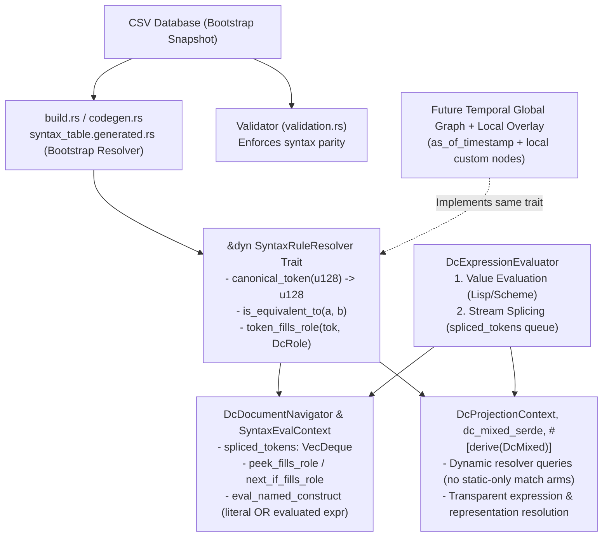

# Dynamic Role-Based Dc Readers, `<equiv>` Validation, and Expression Evaluation Architecture

## Goal

1. **Enforce `<equiv>` syntax parity in data table validation**: Any Document Character (Dc) with a single-token `<equiv>` relationship in the CSV database must have the exact same syntax rule (`:=` pattern/action and `@closes`) as its target; otherwise `./scripts/validate-data-tables` (and `validate_all_data_tables`) reports a validation error.
2. **Replace all fixed-Dc reader/deserializer checks with dynamic `SyntaxRuleResolver` role and equivalence queries**: While writers/serializers continue emitting canonical Dc constants, readers/deserializers across `ctb-formats-dcdata`, `ctb-formats-dcstring`, and `ctb_dc_macro` must never hardcode Dc constants, numeric allowlists, or static-only `match` arms. Instead, all readers query `&dyn SyntaxRuleResolver` ("does the next Dc or Dcs in this document fill role X?" / "is token A equivalent to token B?"), backed by build-time codegen from the CSV database as the default bootstrap snapshot and extensible at runtime for the temporal global + local overlay graph model.
3. **Architect for Lisp/Scheme-like expression evaluation & TeX-like stream splicing**:
   - **Typed value satisfaction**: Any syntax requirement like `[string]` or `[number:Natural0]` can be satisfied either by a direct literal/structural construct or by any Dc expression (bound value reference, named object reference, routine invocation, or equivalent representation) that *evaluates* to a value satisfying that requirement.
   - **Stream splicing (`lang.say` / output-emitting calls)**: In non-quoted streams, stream-emitting calls (such as `256` `void lang.say(String)`) splice their emitted `DcChar` sequence directly into the navigator's lookahead token queue (`spliced_tokens: VecDeque<DcChar>`), naturally supporting constructs like `286 256 258 260 262 264 263 57 86 93 93 96 30 18 72 96 99 93 85 19 287 261 259` (`<i><script>document.write("Hello, World!</i>")</script>`).

---

## Architecture Overview



### 1. Separating Quoted Lexical Atoms, Stream-Spliced Spans, and Evaluable Value Positions

To support both Lisp/Scheme-style value evaluation and TeX/`document.write`-style stream splicing cleanly:

1. **Quoted Lexical Atoms (Non-Evaluated Quotations)**:
   - `260..261` (`BeginLiteral..EndLiteral`), `270..271` (`BeginIdentifier..EndIdentifier`), `6..7` (`BeginNumber..EndNumber`), and `203..204` (`BinaryEncapsulation`) are quoted lexical payloads whose body is terminated only by their own unescaped closing delimiter (`261`, `271`, `7`, `204`, with `255` escape).
   - Because tokens inside `260..261` are quoted data, a token like `287` (`End italicized text`) inside `260 262 264 263 ... 287 261` is simply part of the string literal payload and does not interfere with parsing the `260..261` literal or its enclosing `258..259` parameter list.
2. **Stream-Splicing Expressions in Document / Container Streams (`spliced_tokens: VecDeque<DcChar>`)**:
   - Outside quoted atoms, [`DcDocumentNavigator`](file:///workspaces/ctoolbox/src/formats/dcstring/navigator.rs#L662-L674) maintains a `spliced_tokens: VecDeque<DcChar>` lookahead queue in front of the raw source slice.
   - When the navigator encounters a stream-emitting invocation such as `256` (`void lang.say(String)`) in an active stream (e.g., after `286` `Begin italicized text`), it parses the call's self-contained arguments (`258 260 ... 261 259`), invokes the evaluator (`lang.say`), and pushes the emitted `DcChar`s (`Hello, World! 287`) onto the front of `spliced_tokens`.
   - Subsequent `peek_token()` / `next_token()` calls read from `spliced_tokens` before advancing the source index, so the enclosing `286` span immediately sees `"Hello, World!"` followed by `287` (`End italicized text`) and closes cleanly.
3. **Evaluable Value Requirements (`ValueRequirement`)**:
   - Any position expecting a typed value—such as `[string]`, `[number]`, `[number:Natural0]`, `[boolean]`, `[list:...]`, `[data:...]`, `[filename]`, `[filepath]`, `[value]` in `DcSyntaxRule` evaluation, or a typed field in `DcMixedDecode`—can be satisfied either by a **Direct Construct Match** (using `<equiv>`-aware `DcRole` queries) or by an **Expression Evaluation Match** whose evaluated result satisfies the requirement (including subtype constraints like `Natural0`).

### 2. Readiness for the Append-Only Temporal Global Graph + Local Graph Overlay

- **No static-only `match` assumptions in readers**:
  - In a graph-defined language where users can overlay custom local definitions (`@L...@` or overridden Dcs) or query historical snapshots (`as_of_timestamp`), compile-time `match` arms on hardcoded `const` IDs would miss runtime graph overlays.
  - Therefore, **all** role and equivalence checks in `navigator.rs`, `dc_mixed_serde.rs`, and `#[derive(DcMixed)]` go through `&dyn SyntaxRuleResolver` held on `SyntaxEvalContext` and `DcProjectionContext` (`ctx.tokens_equivalent(actual, target)`, `ctx.canonical_token(tok)`, `ctx.token_fills_role(tok, role)`).
  - [`SyntaxRuntimeRegistry`](file:///workspaces/ctoolbox/src/formats/dcstring/navigator.rs#L473-L527) and [`SyntaxRuntimeResolver`](file:///workspaces/ctoolbox/src/formats/dcstring/navigator.rs#L569-L616) will be extended to support overlaying dynamic `<equiv>` relationships and `DcRole` memberships at runtime on top of any base `SyntaxRuleResolver`.
  - When the append-only global graph + local overlay is ready, it only needs to implement `SyntaxRuleResolver`; zero changes will be required in `navigator.rs`, `dc_mixed_serde.rs`, or `ctb_dc_macro`.

---

## Detailed Design

### Phase 1: `<equiv>` Syntax Parity Validation (`ctb-formats-dcdata`)

#### 1.1 Validation Rule in [validation.rs](file:///workspaces/ctoolbox/src/formats/dcdata/validation.rs)
In [`validate_dc_files_data`](file:///workspaces/ctoolbox/src/formats/dcdata/validation.rs#L1552-L1659):
- Build a lookup map of all parsed `DcDefn` rows by `dc_id` (and `short_id`), storing `(row.syntax, row.closes, &row.source_file, row.line_number)`.
- When validating `<equiv>` decompositions on `row`:
  - If `<equiv>` has a single target token `target`:
    - Resolve `target`'s `DcSyntaxRule` (`target_syntax`) and `@closes` (`target_closes`).
    - Compare `row.syntax` with `target_syntax` (normalizing self-references `SyntaxTerm::SelfChar` vs explicit `CharRef` to the respective Dc, and paired `@closes` targets under `<equiv>`) and `row.closes` with `target_closes`.
    - If one defines a syntax rule (or `@closes`) and the other does not, or if their normalized syntax rules (`pattern` and `action`) differ, emit a validation error via `report.add_error(...)`.
  - If `<equiv>` is a multi-token decomposition (e.g., `237` CRLF `<equiv>240 239`), verify that `row.syntax` and `row.closes` are `None` (or report an error if a multi-token sequence decomposition defines conflicting single-token syntax).
- Update [`DatasetRuleResolver::load_from_dataset`](file:///workspaces/ctoolbox/src/formats/dcdata/syntax/resolver.rs#L819-L846) to use the same normalized comparison and `bail!` on mismatch so build-time codegen and `validate-data-tables` enforce the exact same invariant.

---

### Phase 2: Resolver Equivalence Closure, `DcRole` API & Runtime Overlay Support (`ctb-formats-dcdata`)

#### 2.1 Complete `<equiv>` Closure Across All Resolver Tables
In [`src/formats/dcdata/syntax/resolver.rs`](file:///workspaces/ctoolbox/src/formats/dcdata/syntax/resolver.rs) and [`src/formats/dcdata/syntax/resolver/codegen.rs`](file:///workspaces/ctoolbox/src/formats/dcdata/syntax/resolver/codegen.rs):
- Compute the transitive, symmetric equivalence classes for all single-token `<equiv>` relationships, selecting the active (non-deprecated) target Dc as the **canonical token** (`canonical_token(u128) -> u128`).
- Expand `<equiv>` across **all** resolver tables in `DatasetRuleResolver::load_from_dataset`:
  - `rules` (cloning the syntax rule for equivalent Dcs)
  - `closing_delimiters`
  - `opener_to_closer` (mapping both canonical and equivalent openers to canonical and equivalent closers)
  - `container_headers`
  - `trailing_after_closer`
  - `infix_rules`
  - `opaque_containers`
  - `script_members`
  - `named_type_starters` (`exact_tokens` and `rules`)
- Generate static sorted bootstrap lookup tables in `syntax_table.generated.rs`:
  - `EQUIV_CANONICAL_MAP: &[(u128, u128)]`: maps every Dc with an `<equiv>` target to its canonical `u128` ID.
  - `EQUIV_CLASSES: &[(u128, &[u128])]`: maps each canonical `u128` ID to all members of its equivalence class.

#### 2.2 `DcRole` Classification & Dynamic `SyntaxRuleResolver` Trait Methods
Define `DcRole` in [`src/formats/dcdata/syntax.rs`](file:///workspaces/ctoolbox/src/formats/dcdata/syntax.rs) and populate its default membership tables in `syntax_table.generated.rs` from the CSV database (`@ident` annotations, syntax rules, `@closes`, script classifications, and `README-named-types.csv`):

| Category | `DcRole` Variants | Source in Database |
| :--- | :--- | :--- |
| **Escaping & Embedding** | `Escape`, `LongDcEmbedPrefix`, `BinaryEncapsulationOpener`, `BinaryEncapsulationCloser`, `Utf8EncapsulationOpener`, `Utf8EncapsulationCloser` | `@ident` / syntax rules (`255`, `308`, `203`..`204`, `191`..`192`) + `<equiv>` |
| **Literals, Idents, Numbers** | `LiteralOpener`, `LiteralCloser`, `IdentifierOpener`, `IdentifierCloser`, `NumberOpener`, `NumberCloser`, `IntegerFormatIndicator`, `PositiveSign`, `NegativeSign`, `Base64Digit`, `Base64Padding` | `@ident` / syntax rules (`260`..`261`, `270`..`271`, `6`..`7`, `f199`, `10`, `11`, `127`..`190`, `195`) + `<equiv>` |
| **Collections & Maps** | `ListOpener`, `ListCloser`, `ListElementSeparator`, `KvMapPairsOpener`, `KvMapPairsCloser`, `KvMapLegacyOpener`, `KvMapLegacyCloser`, `KvPairOpener`, `KvPairCloser` | `@ident` / `@closes` (`310`..`312`, `559`..`560`, `313`..`314`, `514`..`515`) + `<equiv>` |
| **Types & Format Specs** | `TypeDefOpener`, `TypeDefCloser`, `TypeAny`, `TypeString`, `TypeNumber`, `TypeRoutine`, `TypeRoutineName`, `TypeUnion`, `TypeIntersection`, `TypeConvert`, `TypeTransmute`, `TypeTransform`, `TypeParamApplication`, `GroupOpen`, `GroupClose`, `TypeToken` | `.EL Types`, `.Formats`, `262`..`263`, `298`..`303`, `516`, `535`, `513` + `<equiv>` |
| **Values & Optionals** | `OptionalPresent`, `OptionalAbsent`, `BooleanTrue`, `BooleanFalse`, `PrimitiveValueAtom`, `DomainValueAtom`, `FilePathDelimiter` | `315`, `316`, `517`, `518`, `README-named-types.csv` (`[value]`, `[boolean]`), `513` + `<equiv>` |
| **Representations & Checksums** | `EquivalentRepresentations`, `PartiallyEquivalentRepresentations`, `FormatRepresentationOpener`, `FormatRepresentationCloser`, `ChecksummedSectionOpener`, `ChecksummedSectionCloser`, `SectionDigestTag`, `SequenceIdentifierTag` | `397`, `561`, `511`..`512`, `543`..`546` + `<equiv>` |
| **Temporal** | `TimeMomentOpener`, `TimeMomentCloser`, `DateMagnitudeOpener`, `DateMagnitudeCloser`, `DateDurationOpener`, `DateDurationCloser` | `401`..`402`, `490`..`493` + `<equiv>` |
| **Scopes, Bindings & Calls** | `IdentifierScopeOpener`, `IdentifierScopeCloser`, `AssignOperator`, `ReferenceBoundValue`, `ReferenceNamedObject`, `RoutineInvocation`, `StreamSayInvocation`, `ParameterOpener`, `ParameterCloser`, `EvaluableExpressionStarter` | `541`..`542`, `269`, `540`, `276`, `279`, `256`, `258`..`259`, `.EL Routines` + `<equiv>` |
| **Comments & Separators** | `SingleLineCommentOpener`, `SingleLineCommentCloser`, `BlockCommentOpener`, `BlockCommentCloser`, `StructuralSeparator` | `246`..`251`, structural delimiter roles + `<equiv>` |

Extend `SyntaxRuleResolver` (implemented by `DatasetRuleResolver`, `SyntaxRuntimeResolver`, and any future `GraphSyntaxResolver`):
- `fn canonical_token(&self, token: u128) -> u128`
- `fn is_equivalent_to(&self, token: u128, target: u128) -> bool`
- `fn token_fills_role(&self, token: u128, role: DcRole) -> bool`
- `fn base64_digit_value(&self, token: u128) -> Option<u8>`
- Extend `SyntaxRuntimeRegistry` so callers (and tests / graph overlays) can register runtime `<equiv>` pairs (`register_equivalence(token, canonical_target)`) and automatically inherit the target's syntax rule, `@closes` pairing, and `DcRole` memberships at runtime!

---

### Phase 3: Lisp/Scheme-Like Expression Evaluation & Stream Splicing (`ctb-formats-dcstring`)

#### 3.1 Value Requirements, Evaluated Values & Stream Splicing
In [`src/formats/dcstring/navigator.rs`](file:///workspaces/ctoolbox/src/formats/dcstring/navigator.rs):
- Define `ValueRequirement`:
  ```rust
  #[derive(Debug, Clone, PartialEq, Eq)]
  pub enum ValueRequirement<'a> {
      /// A named construct from README-named-types.csv, e.g. `("string", None)` or `("number", Some("Natural0"))`.
      NamedConstruct {
          name: &'a str,
          subtype: Option<&'a str>,
      },
      /// A specific format or type token.
      TypeToken(DcChar),
      /// A specific container or tagged construct opener (up to `<equiv>`).
      ConstructOpener(DcChar),
  }
  ```
- Define `DcEvaluatedValue`:
  ```rust
  pub enum DcEvaluatedValue {
      /// Evaluated DcMstring / token sequence that can be spliced or validated against any syntax rule.
      Document(DcMstring),
      /// Direct typed shared value from SharedValueContext (`Arc<dyn Any + Send + Sync>`).
      SharedBinding { name: String },
  }
  ```
- Define the `DcExpressionEvaluator` trait (with a default built-in evaluator that handles `256` `void lang.say(String)` stream splicing and `397`/`561` equivalent representations out of the box, plus hooks for custom/bound evaluators):
  ```rust
  pub trait DcExpressionEvaluator {
      /// Evaluates an expression node when encountered in a value position.
      fn eval_expression_for_requirement(
          &mut self,
          expr_tokens: &[DcChar],
          requirement: &ValueRequirement<'_>,
          resolver: &dyn SyntaxRuleResolver,
      ) -> Result<Option<DcEvaluatedValue>>;

      /// Evaluates a stream-splicing invocation (such as `256 lang.say(String)`) and returns
      /// the DcChar tokens to splice into the navigator's active stream.
      fn eval_stream_splice(
          &mut self,
          call_tokens: &[DcChar],
          resolver: &dyn SyntaxRuleResolver,
      ) -> Result<Option<Vec<DcChar>>>;
  }
  ```

#### 3.2 `spliced_tokens: VecDeque<DcChar>` on `DcDocumentNavigator`
- Add `spliced_tokens: VecDeque<DcChar>` to `DcDocumentNavigator` (included in `NavigatorCheckpoint` so backtracking works seamlessly across spliced tokens!).
- All cursor primitives (`peek`, `next`, `is_at_end`, `save_checkpoint`, `restore_checkpoint`) consult `spliced_tokens` before `self.slice[self.idx..]`:
  - `peek()` returns `self.spliced_tokens.front().copied().or_else(|| self.slice.get(self.idx).copied())`.
  - `next()` pops from `self.spliced_tokens.pop_front()` first, advancing `self.idx` only when `spliced_tokens` is empty.
- **How `286 256 258 260 262 264 263 57 86 93 93 96 30 18 72 96 99 93 85 19 287 261 259` executes**:
  1. When scanning a document/container stream (outside quoted atoms `260..261`, `270..271`, `6..7`, `203..204`), `286` (`Begin italicized text`) is consumed or opened.
  2. Next, the navigator sees `256` (`DcRole::StreamSayInvocation`, `void lang.say(String)`).
  3. It parses `256`'s argument `258 260 262 264 263 57 86 93 93 96 30 18 72 96 99 93 85 19 287 261 259` using `256`'s syntax rule `256 258 [string] 259`. Because `260..261` only stops at `261`, `287` inside the string literal is decoded as part of the string `"Hello, World!\u{E011F}"`.
  4. The evaluator splices the unescaped string contents (`57 86 93 93 96 30 18 72 96 99 93 85 19 287`) onto the front of `self.spliced_tokens`.
  5. The navigator continues reading from `spliced_tokens`, encountering `"Hello, World!"` and then `287` (`End italicized text`), which pairs with the opening `286`!

#### 3.3 How `DcDocumentNavigator` Evaluates Value Requirements
1. **Token-level equivalence in `eval_term_single`**:
   - `SyntaxTerm::CharRef(target)` checks `ctx.resolver.is_equivalent_to(first, target.to_u128())`.
   - `SyntaxTerm::CharSet { negated, members }` checks `members.iter().any(|m| ctx.resolver.is_equivalent_to(first, m.to_u128()))`.
   - `SyntaxTerm::RuleRef { target }` checks `ctx.resolver.is_equivalent_to(first, target.to_u128())`.
2. **Expression-aware construct matching in `eval_named_construct`**:
   - When matching `SyntaxTerm::NamedConstruct { name, subtype, .. }` (such as `[string]`, `[number:Natural0]`, `[boolean]`, `[list:...]`, `[data:...]`):
     - **Step 1 (Direct Match)**: Attempt the direct structural/literal rule for `(name, subtype)` using `DcRole` predicates.
     - **Step 2 (Expression Fallback — Lisp/Scheme semantics)**: If Step 1 does not match at the current cursor and `name != "value"`, check if the next token fills `DcRole::EvaluableExpressionStarter` (`ReferenceBoundValue`, `ReferenceNamedObject`, `RoutineInvocation`, `EquivalentRepresentations`, `PartiallyEquivalentRepresentations`, `FormatRepresentationOpener`, or `.EL Routines`):
       - Parse the expression construct using its own syntax rule from the resolver.
       - Check if the expression satisfies `ValueRequirement::NamedConstruct { name, subtype }`:
         - For `ReferenceNamedObject` (`276 [type] [identifier]`), if an explicit `[type]` is present, check type compatibility with `(name, subtype)`.
         - For `EquivalentRepresentations` (`397` / `561`), check if any candidate representation in its list satisfies `(name, subtype)`.
         - If `ctx.evaluator` evaluates the expression to `DcEvaluatedValue::Document(doc)`, run `DcDocumentNavigator::from_mstr(&doc)` against `SyntaxTerm::NamedConstruct { name, subtype }`, validating subtype constraints like `Natural0` on the evaluated result.

#### 3.4 How `DcProjectionContext` & `DcMixedDecode` Resolve Expressions & Resolver Overlays
- Thread `resolver: &'a dyn SyntaxRuleResolver` (and optional `evaluator`) into [`DcProjectionContext`](file:///workspaces/ctoolbox/src/formats/dcstring/dc_mixed.rs#L53-L94) (defaulting to `default_syntax_resolver()`, and taking `SyntaxEvalContext`'s resolver when projecting from an arena built with a custom/overlay resolver).
- Upgrade `DcProjectionContext::unwrap_transparent(node_id)`:
  - Unwraps `DcRole::OptionalPresent`.
  - Resolves `DcRole::EquivalentRepresentations` and `DcRole::PartiallyEquivalentRepresentations` by selecting a representation child that decodes cleanly.
  - Resolves expression nodes (`DcRole::ReferenceBoundValue`, `DcRole::ReferenceNamedObject`, `DcRole::RoutineInvocation`) via `SharedValueContext` or the expression evaluator so that any `T::decode_dc_node(ctx, node_id)` transparently decodes the evaluated value.

---

## Phase 4: Replacing All Fixed-Dc Reader Implementations

### 4.1 `ctb-formats-dcdata` Readers
- **[`src/formats/dcdata/dc_char.rs`](file:///workspaces/ctoolbox/src/formats/dcdata/dc_char.rs)**:
  - Replace hardcoded `==` chain in `is_type_token` with `default_syntax_resolver().token_fills_role(token, DcRole::TypeToken)` (and expose `fills_role_with(role, resolver)`).
- **[`src/formats/dcdata/dc_number_minimal.rs`](file:///workspaces/ctoolbox/src/formats/dcdata/dc_number_minimal.rs)**:
  - Update `dc_base64_char_to_digit`, `is_dc_base64_encapsulation_char`, and `read_dc_number_u128` to use `DcRole::NumberOpener`, `DcRole::IntegerFormatIndicator`, `DcRole::NumberCloser`, `DcRole::Base64Padding`, and `resolver.base64_digit_value(...)`.
- **[`src/formats/dcdata/format_spec/dc_stream.rs`](file:///workspaces/ctoolbox/src/formats/dcdata/format_spec/dc_stream.rs)**:
  - Update `is_closing_token`, `decode_recursive`, and `decode_apply_params` to match group/parameter/operator tokens via `DcRole` (`GroupOpen`, `GroupClose`, `ParameterOpener`, `ParameterCloser`, `TypeParamApplication`, `TypeUnion`, `TypeIntersection`, `TypeConvert`, `TypeTransmute`, `TypeTransform`) and resolver equivalence instead of raw `298`, `299`, `258`, `259`, `535`.

### 4.2 [`src/formats/dcstring/navigator.rs`](file:///workspaces/ctoolbox/src/formats/dcstring/navigator.rs)
- Add helper methods on `DcDocumentNavigator`:
  - `peek_fills_role(&mut self, role: DcRole, resolver: &dyn SyntaxRuleResolver) -> Result<bool>`
  - `next_if_fills_role(&mut self, role: DcRole, resolver: &dyn SyntaxRuleResolver) -> Result<Option<DcChar>>`
- Replace all hardcoded Dc constants and `to_short_dc()` allowlists with `resolver.token_fills_role(...)` and `resolver.is_equivalent_to(...)`:
  - `is_separator`, `is_primitive_value_atom`, `is_value_atom`, `is_format_or_temporal` (`Some(511)`)
  - `DC_ESCAPE`, `DC_START_ENCAPSULATION_BINARY`, `DC_END_ENCAPSULATION_BINARY`, `DC_BEGIN_LITERAL`, `DC_END_LITERAL`, `DC_BEGIN_IDENTIFIER`, `DC_END_IDENTIFIER`, `DC_BEGIN_NUMBER`, `DC_END_NUMBER`, `DC_BEGIN_TYPE_DEF`, `DC_END_TYPE_DEF`, `DC_TYPE_INTERSECTION`, `DC_TYPE_UNION`, `DC_BEGIN_LIST`, `DC_END_LIST`, `DC_LIST_ELEMENT_SEPARATOR`, `DC_BEGIN_CHECKSUMMED_SECTION`, `DC_SECTION_DIGEST`, `DC_SEQUENCE_IDENTIFIER`, `DC_BEGIN_FORMAT_REPRESENTATION`, `DC_ROUTINE_INVOCATION`, `DC_BEGIN_PARAMETER`, `DC_END_PARAMETER`, `DC_OPTIONAL_PRESENT`, `DC_OPTIONAL_ABSENT`, `DC_ASSIGN`, `DC_BEGIN_LEGACY_KV_MAP`, `DC_BEGIN_KV_MAP`, `DC_BEGIN_KV_PAIR`, `DC_END_KV_PAIR`.
- Update `DcSyntaxArena::extract_kv_map_operand_entries` to classify map openers (`KvMapPairsOpener` vs `KvMapLegacyOpener`), pair containers (`KvPairOpener`), and separators (`ListElementSeparator`) via `DcRole`.

### 4.3 [`src/formats/dcstring/dc_mixed_serde.rs`](file:///workspaces/ctoolbox/src/formats/dcstring/dc_mixed_serde.rs)
- Add dynamic resolver helpers on `DcProjectionContext`:
  - `pub fn resolver(&self) -> &dyn SyntaxRuleResolver`
  - `pub fn canonical_token(&self, token: u128) -> u128`
  - `pub fn tokens_equivalent(&self, a: u128, b: u128) -> bool`
  - `pub fn token_fills_role(&self, token: u128, role: DcRole) -> bool`
  - `pub fn node_fills_role(&self, node_id: NodeId, role: DcRole) -> Result<bool>`
- Replace all fixed-Dc comparisons and `to_short_dc()` checks in `dc_mixed_serde.rs`:
  - `DcRawValue::decode_dc_node` (lines 558–559: `Some(275)`, `Some(312)`, `Some(310)`)
  - `extract_flag_nodes` (lines 1995–2038: `Some(310)`, `Some(275)`, `Some(312)`)
  - `Option<T>`, `bool`, `DcMixedNumber`, `String`, `Vec<T>`, `[T; N]`, `BTreeMap`, `BTreeSet`, `HashMap`, `HashSet`, filepath/filename decoders, temporal decoders (`401`, `490`, `492`), format representation decoders (`511`), and bound/named object reference decoders (`540`, `276`).

### 4.4 [`src/formats/dcstring/ctb_dc_macro/src/lib.rs`](file:///workspaces/ctoolbox/src/formats/dcstring/ctb_dc_macro/src/lib.rs)
- **Dynamic Resolver Equivalence Matching (Graph-Overlay Ready)**:
  - Instead of static-only `match tag { #(#all_match_tags)|* => ... }` that would miss runtime/graph overlays, generated `decode_dc_node`, `decode_dc_projected_fields`, `decode_field`, and `accepts_dc_tag` will check equivalence through `ctx.tokens_equivalent(tag, expected)` (or `ctx.any_token_equivalent(tag, &[#(#all_match_tags),*])`), which resolves through `ctx.resolver()` dynamically!
  - Container openers similarly check `ctx.tokens_equivalent(opener.to_u128(), #begin_dc)`.
- **Role Queries Instead of Inline Numbers**:
  - Replace all `opener.to_short_dc() == Some(310)` with `ctx.token_fills_role(opener.to_u128(), DcRole::ListOpener)`.
  - Replace all `ch.to_short_dc() == Some(316)` with `ctx.token_fills_role(ch.to_u128(), DcRole::OptionalAbsent)`.
  - Replace all `tag.to_short_dc() == Some(315)` with `ctx.token_fills_role(tag.to_u128(), DcRole::OptionalPresent)`.
  - Replace all `ch.to_short_dc() == Some(275)` and `Some(312)` with `DcRole::TypeAny` and `DcRole::ListElementSeparator`.
  - Replace raw `1114315` (Dc 203), `1114381` (Dc 269), and `1114382` (Dc 270) with `DcRole::BinaryEncapsulationOpener`, `DcRole::AssignOperator`, and `DcRole::IdentifierOpener`.

### 4.5 Supporting Modules in `ctb-formats-dcstring`
- **[`src/formats/dcstring/encapsulation.rs`](file:///workspaces/ctoolbox/src/formats/dcstring/encapsulation.rs)**:
  - Replace `self.peek() != Some(DC_BEGIN_NUMBER)`, `self.peek() != Some(DC_START_ENCAPSULATION_BINARY)`, `self.next()? == DC_START_ENCAPSULATION_BINARY`, `ch == DC_END_ENCAPSULATION_BINARY`, and `is_dc_base64_encapsulation_character` in `Cursor` reader methods with `DcRole` queries (`NumberOpener`, `BinaryEncapsulationOpener`, `BinaryEncapsulationCloser`, `Base64Digit`/`Base64Padding`).
- **[`src/formats/dcstring/dc_number.rs`](file:///workspaces/ctoolbox/src/formats/dcstring/dc_number.rs)**:
  - Replace direct `== DC_BEGIN_NUMBER`, `== DC_INTEGER`, `== DC_NEGATIVE`, `== DC_POSITIVE`, `== DC_END_NUMBER`, and hardcoded `s == 6`, `s == 10 || s == 11`, `s == 7`, `127..=190`, `195` in `read_dc_number_from_reader`, `parse_dc_number_digits`, `read_dc_number_short`, `read_dc_number_global`, and `global_dc_to_base64_char` with `DcRole` and `base64_digit_value` lookups.
- **[`src/formats/dcstring/source_edit.rs`](file:///workspaces/ctoolbox/src/formats/dcstring/source_edit.rs)**:
  - Replace `matches!(*opener, DC_BEGIN_LEGACY_KV_MAP | DC_BEGIN_KV_MAP)` and `opener == DC_BEGIN_LEGACY_KV_MAP` with `DcRole::KvMapLegacyOpener` / `DcRole::KvMapPairsOpener`, and canonicalize `SourceView::identity` via the resolver.
- **[`src/formats/dcstring/shared.rs`](file:///workspaces/ctoolbox/src/formats/dcstring/shared.rs)**:
  - Replace `*tag == DC_REFERENCE_BOUND_VALUE` in `decode_shared_reference` with `ctx.token_fills_role(tag.to_u128(), DcRole::ReferenceBoundValue)`.
- **[`src/formats/dcstring/dc_mixed.rs`](file:///workspaces/ctoolbox/src/formats/dcstring/dc_mixed.rs)** & **converters (`dctext.rs`, `dcts.rs`, `utf8.rs`)**:
  - In `DcMstring::from_dc_str`, check `ch.fills_role(DcRole::BinaryEncapsulationOpener)` instead of `ch == DC_START_ENCAPSULATION_BINARY`.
  - In `dctext.rs` and `utf8.rs` readers (`dcarray_to_dclist`, `dclist_to_utf8`), use `DcRole::Escape`, `DcRole::LongDcEmbedPrefix`, `DcRole::Utf8EncapsulationOpener`, `DcRole::Utf8EncapsulationCloser`.

---

## Verification & Testing Plan

1. **Data Table Validation Tests (`cargo test -p ctb-formats-dcdata`)**:
   - Add unit tests in `src/formats/dcdata/validation.rs` verifying that:
     - An `<equiv>` Dc whose syntax rule matches its target passes validation.
     - An `<equiv>` Dc missing a syntax rule when its target has one (or having a different syntax rule / `@closes` target) fails validation with a clear error message.
   - Run `./scripts/validate-data-tables` to verify all repository CSVs pass and regenerate `.generated` files cleanly.
2. **Dynamic Runtime Overlay & Equivalence Reader Tests (`cargo test -p ctb-formats-dcstring`)**:
   - Add tests constructing `SyntaxRuntimeRegistry` overlays with synthetic `<equiv>` Dcs (simulating both build-time `<equiv>` Dcs and future local graph overlay nodes) for:
     - List openers/closers/separators (`310`..`312`)
     - Map openers/closers and pairs (`559`..`560`, `514`..`515`)
     - Literals, identifiers, numbers, and booleans (`260`..`261`, `270`..`271`, `6`..`7`, `517`..`518`)
     - Derived `#[derive(DcMixed)]` structs and enums (verifying that runtime-registered `<equiv>` container openers, field tags, and enum variant tags deserialize identically to their canonical targets without recompiling).
3. **Lisp/Scheme Value Evaluation & Stream-Splicing Tests (`cargo test -p ctb-formats-dcstring`)**:
   - **Stream-Splicing Test**: Verify that `286 256 258 260 262 264 263 57 86 93 93 96 30 18 72 96 99 93 85 19 287 261 259` parses and evaluates `256` (`lang.say`), splices `"Hello, World!"` + `287` into `spliced_tokens`, and cleanly closes the outer `286..287` italicized span.
   - **Typed Value Expression Test**: Verify that syntax requirements like `[string]` and `[number:Natural0]` (and `#[derive(DcMixed)]` struct fields) are satisfied by evaluable Dc expressions (bound value reference `540`, alternative representation `397`, or custom `DcExpressionEvaluator` call) when they evaluate to a valid `string` or `Natural0`, and rejected when the evaluated value violates the subtype requirement (e.g., a negative number for `Natural0`).

### Verification Status & Implemented Coverage
- **`<equiv>` resolver propagation test**:
  - `test_static_syntax_table_matches_csv_dataset` updated to assert `static_table.canonical_map == from_dataset.canonical_map`.
  - Added `test_load_from_dataset_multi_character_equivalence_expansion` in `src/formats/dcdata/syntax/resolver.rs` asserting canonical token mapping, transitive equivalence, opener-to-closer propagation, closing delimiter propagation, container headers, and syntax rules propagation across 3-character chains.
- **Typed value expression evaluation test**:
  - Implemented in `tier4_expression_evaluation_and_stream_splicing::test_typed_expression_evaluation_and_subtype_constraints` in `src/formats/dcstring/tests/e2e_dc_syntax.rs`.
  - Verifies `[string]` and `[number:Natural0]` satisfied by evaluable expressions, and rejects expressions returning negative numbers violating `Natural0`.
- **`lang.say` stream-splicing end-to-end test**:
  - Implemented in `tier4_expression_evaluation_and_stream_splicing::test_lang_say_stream_splicing_end_to_end` in `src/formats/dcstring/tests/e2e_dc_syntax.rs`.
  - Verifies both token stream splicing (`lang.say` emitting `"Hello, World!"` and `287` into `spliced_tokens`) and CST arena parsing without dropping the inner invocation.
- **Literal character decoding & Plane 14 mapping**:
  - `decode_literal_span` and `decode_identifier_span` in `src/formats/dcstring/navigator.rs` updated to resolve canonical equivalents via `resolver.canonical_token` and project short Dcs without direct Unicode equivalents to Plane 14 tag characters (`0xE0000 + short_id`).

